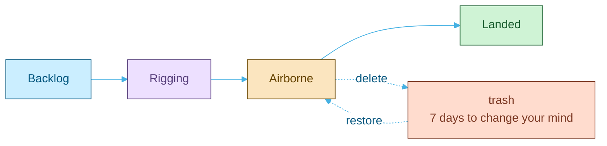

<p align="center">
  <picture>
    <source media="(prefers-color-scheme: dark)" srcset="docs/assets/brand/banner-dark.svg">
    
  </picture>
</p>

<p align="center">
  <a href="https://github.com/kfeuerschvenger/BreezyBoard/actions/workflows/ci.yml"></a>
  <a href="LICENSE"></a>
  
  
  
  
  
</p>

<p align="center"><strong>English</strong> · <a href="README_es.md">Español</a></p>

<p align="center">
  
</p>

**BreezyBoard is a Kanban board for teams who like their work to flow.**

Workspaces hold boards, boards hold columns, and columns hold cards you fling around by mouse or by keyboard.

Built where the wind never takes a day off, so nothing gets blown away: drafts survive a reload, deletes can be undone, and sessions end politely.

## Take the tour

<table>
  <tr>
    <td width="50%" valign="top">
      
      <p><strong>Everything at a glance.</strong> A greeting, your totals and every board you can open, each painted in its own hue.</p>
    </td>
    <td width="50%" valign="top">
      
      <p><strong>Drag it, drop it, done.</strong> Cards glide between columns with a mouse or with the keyboard alone, and land exactly where you let go.</p>
    </td>
  </tr>
  <tr>
    <td width="50%" valign="top">
      
      <p><strong>Cards with pockets.</strong> Priority, owner, colour, a description and a checklist. Half-typed thoughts are kept as drafts, even through a reload.</p>
    </td>
    <td width="50%" valign="top">
      
      <p><strong>Your columns, your weather.</strong> Rename, reorder and recolour in one go. Two tabs editing at once? A stale save is refused rather than quietly dropping a column.</p>
    </td>
  </tr>
</table>

### Why it feels light

- **Two-level access.** Workspace admins run every board in their workspace; members see the boards they created or were added to. Nobody else sees a thing.
- **Undo for the big stuff.** A deleted board or card waits seven days in the trash before the wind takes it.
- **Sessions that slide.** Stay active and you stay signed in; walk away and the session ends after 15 minutes, with a warning first.
- **Accessible by default.** Every surface is scanned with axe and a contrast sweep on a real browser, and the budget only goes down.

Every card follows the same flight path, with a safety net underneath:



## Under the hood

<picture>
  <source media="(prefers-color-scheme: dark)" srcset="docs/assets/diagrams/architecture-dark.svg">
  
</picture>

A React single page app talks to a layered Express API over a versioned `/api/v1`, and MongoDB runs as a replica set so a board and its cards can be deleted in one transaction. The OpenAPI contract is generated from the same Zod schemas that validate every request, so the docs cannot drift from the code.

<p align="center">
  &nbsp;
  &nbsp;
  &nbsp;
  &nbsp;
  &nbsp;
  &nbsp;
  &nbsp;
  &nbsp;
  &nbsp;
  &nbsp;
  &nbsp;
  
</p>

## Quick start

All you need is Docker Desktop, running.

```bash
docker compose up -d --build
docker compose exec back npm run seed:templates
docker compose exec -e DEMO_PASSWORD=<8 characters or more> back npm run seed:demo
```

Then open http://localhost:5173 and sign in as `demo@breezyboard.local` with the password you picked. Four boards, two teammates and a kite festival are waiting.

> [!TIP]
> Reset mail lands in Mailpit at http://localhost:8025, and Swagger UI lives at http://localhost:5000/api/docs/. Everything else, from example accounts to running without Docker, is in [ENVIRONMENT.md](docs/ENVIRONMENT.md).

## Dive deeper

The README is the postcard. The deep docs are the map.

| Document | The hook |
|---|---|
| [Architecture](docs/ARCHITECTURE.md) | Backend layers, access control, the sliding session, the data model and the frontend structure |
| [Environment](docs/ENVIRONMENT.md) | Setup, every variable, the seeds and the demo, and what to check when something stalls |
| [Testing](docs/TESTING.md) | Unit tests, Playwright, the standing verify scripts and the pipeline that takes these screenshots |
| [CI](docs/CI.md) | The five jobs, the branch flow, the audit gate and the install script policy |
| [API](docs/API.md) | Authentication, conventions, error codes and rate limits |
| [Roadmap](docs/ROADMAP.md) | Ideas on the horizon, and what each one needs before it takes off |
| [openapi.yaml](docs/openapi.yaml) | The full HTTP contract, generated from the route schemas |

---

<p align="center">
  <strong>Made in Patagonia · 50°20′S</strong><br>
  Built with care (and a lot of wind) by <strong>Kevin Feuerschvenger</strong> · Software Engineer
</p>

<p align="center">
  <a href="https://github.com/kfeuerschvenger"></a>
  <a href="https://www.linkedin.com/in/kevin-feuerschvenger/"></a>
  <a href="https://feuerschvenger.com/"></a>
</p>

<p align="center"><sub>Released under the <a href="LICENSE">MIT licence</a>.</sub></p>
