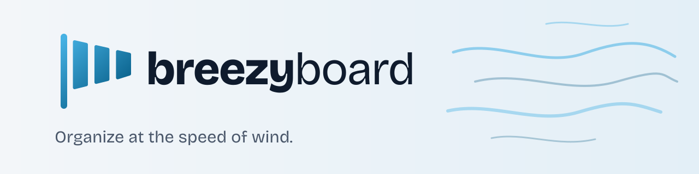
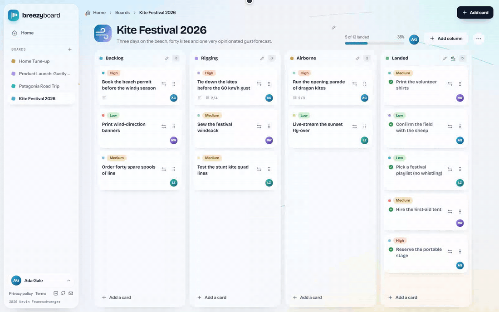
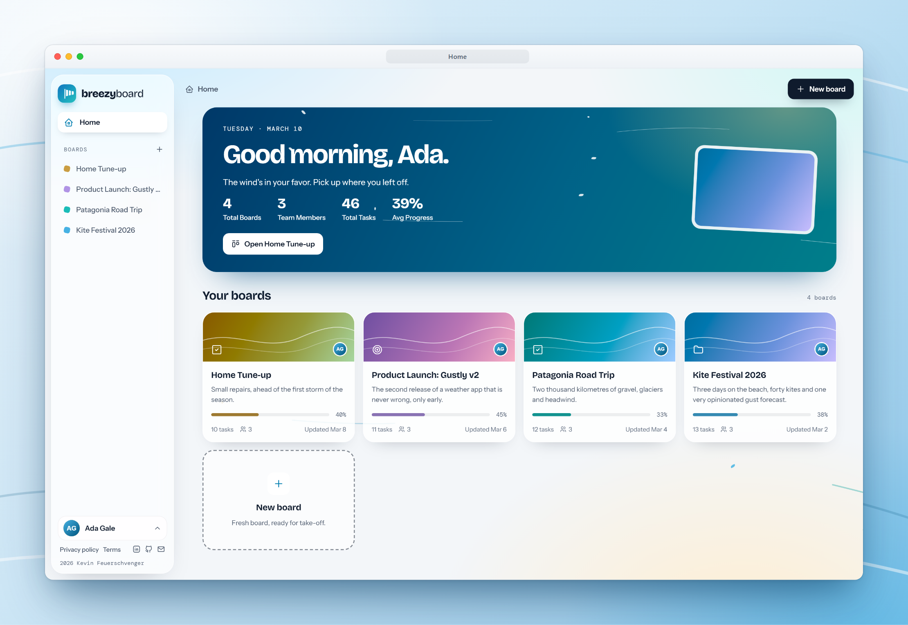
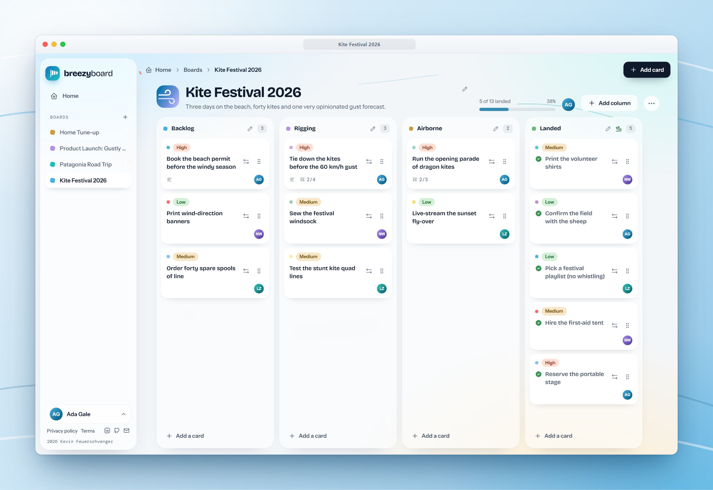
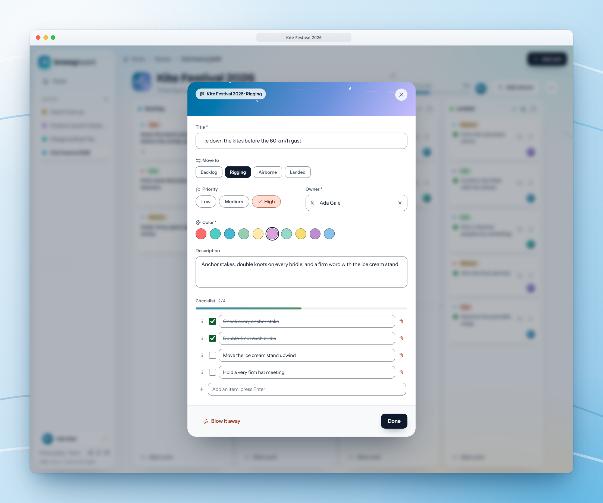
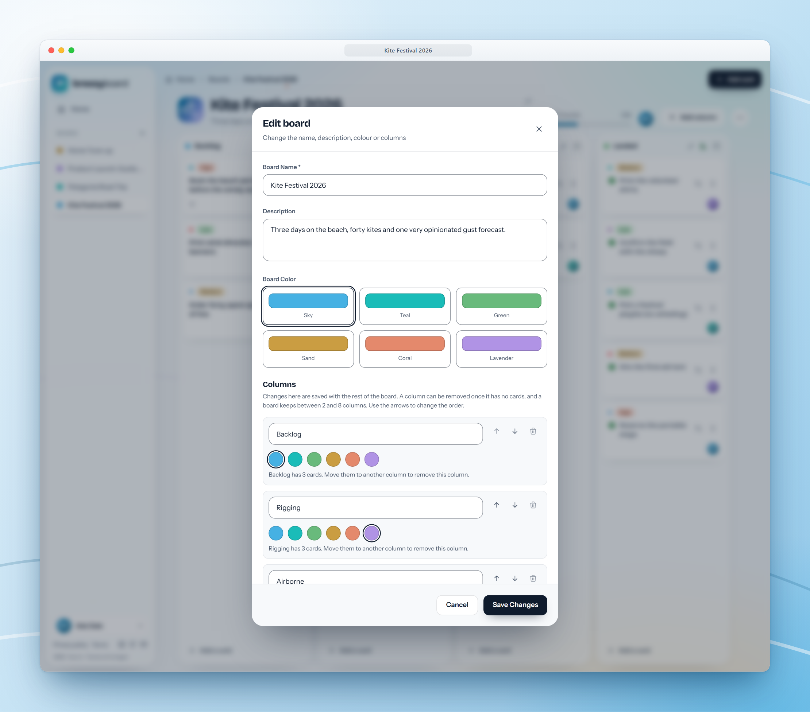
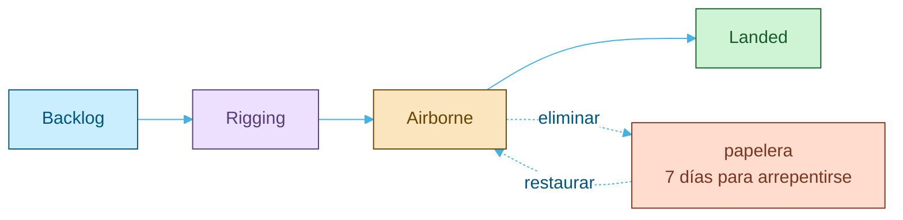

<p align="center">
  <picture>
    <source media="(prefers-color-scheme: dark)" srcset="docs/assets/brand/banner-dark.svg">
    
  </picture>
</p>

<p align="center">
  <a href="https://github.com/kfeuerschvenger/BreezyBoard/actions/workflows/ci.yml"></a>
  <a href="LICENSE"></a>
  
  
  
  
  
</p>

<p align="center"><a href="README.md">English</a> · <strong>Español</strong></p>

<p align="center">
  
</p>

**BreezyBoard es un tablero Kanban para equipos a los que les gusta que el trabajo fluya.**

Los espacios de trabajo contienen tableros, los tableros contienen columnas y las columnas contienen tarjetas que se lanzan de un lado a otro con el mouse o con el teclado.

Hecho donde el viento nunca se toma un día libre, así que nada sale volando: los borradores sobreviven a una recarga, lo eliminado se puede recuperar y las sesiones terminan con buenos modales.

## El recorrido

<table>
  <tr>
    <td width="50%" valign="top">
      
      <p><strong>Todo de un vistazo.</strong> Un saludo, tus totales y cada tablero que puedes abrir, cada uno pintado con su propio tono.</p>
    </td>
    <td width="50%" valign="top">
      
      <p><strong>Arrastrar, soltar, listo.</strong> Las tarjetas se deslizan entre columnas con el mouse o solo con el teclado, y aterrizan justo donde las sueltas.</p>
    </td>
  </tr>
  <tr>
    <td width="50%" valign="top">
      
      <p><strong>Tarjetas con bolsillos.</strong> Prioridad, responsable, color, descripción y checklist. Lo que quedó a medio escribir se guarda como borrador, incluso tras una recarga.</p>
    </td>
    <td width="50%" valign="top">
      
      <p><strong>Tus columnas, tu clima.</strong> Renombra, reordena y cambia colores de una sola vez. ¿Dos pestañas editando a la vez? Un guardado desactualizado se rechaza en lugar de borrar una columna en silencio.</p>
    </td>
  </tr>
</table>

### Por qué se siente liviano

- **Acceso en dos niveles.** Quien administra un espacio de trabajo gestiona todos sus tableros; los miembros ven los tableros que crearon o a los que fueron agregados. Nadie más ve nada.
- **Deshacer lo importante.** Un tablero o una tarjeta eliminados esperan siete días en la papelera antes de que se los lleve el viento.
- **Sesiones que se deslizan.** Mientras haya actividad, la sesión sigue abierta; sin actividad, termina a los 15 minutos, con un aviso previo.
- **Accesible por defecto.** Cada pantalla se analiza con axe y un barrido de contraste en un navegador real, y el margen de errores solo puede bajar.

Cada tarjeta sigue la misma ruta de vuelo, con una red de seguridad debajo:



## Bajo el capó

<picture>
  <source media="(prefers-color-scheme: dark)" srcset="docs/assets/diagrams/architecture-dark.svg">
  
</picture>

Una aplicación de una sola página en React habla con una API de Express por capas a través de `/api/v1`, y MongoDB corre como replica set para que un tablero y sus tarjetas se eliminen en una sola transacción. El contrato OpenAPI se genera a partir de los mismos esquemas de Zod que validan cada petición, así que la documentación no puede desviarse del código.

<p align="center">
  
</p>

## Inicio rápido

Solo hace falta Docker Desktop en ejecución.

```bash
docker compose up -d --build
docker compose exec back npm run seed:templates
docker compose exec -e DEMO_PASSWORD=<8 caracteres o más> back npm run seed:demo
```

Después abre http://localhost:5173 e inicia sesión como `demo@breezyboard.local` con la contraseña que elegiste. Te esperan cuatro tableros, dos compañeros de equipo y un festival de cometas.

> [!TIP]
> El correo de restablecimiento llega a Mailpit en http://localhost:8025, y Swagger UI está en http://localhost:5000/api/docs/. Todo lo demás, desde las cuentas de ejemplo hasta cómo correrlo sin Docker, está en [ENVIRONMENT.md](docs/ENVIRONMENT.md).

## Para profundizar

El README es la postal. La documentación técnica es el mapa, en inglés.

| Documento | De qué trata |
|---|---|
| [Architecture](docs/ARCHITECTURE.md) | Capas del backend, control de acceso, la sesión deslizante, el modelo de datos y la estructura del frontend |
| [Environment](docs/ENVIRONMENT.md) | Puesta en marcha, cada variable, los seeds y la demo, y qué revisar cuando algo se frena |
| [Testing](docs/TESTING.md) | Tests unitarios, Playwright, los scripts de verificación y el proceso que toma estas capturas |
| [CI](docs/CI.md) | Los cinco jobs, el flujo de ramas, el control de auditoría y la política de scripts de instalación |
| [API](docs/API.md) | Autenticación, convenciones, códigos de error y límites de peticiones |
| [Roadmap](docs/ROADMAP.md) | Ideas en el horizonte, y lo que cada una necesita antes de despegar |
| [openapi.yaml](docs/openapi.yaml) | El contrato HTTP completo, generado a partir de los esquemas de las rutas |

---

<p align="center">
  <strong>Made in Patagonia · 50°20′S</strong><br>
  Hecho con cuidado (y mucho viento) por <strong>Kevin Feuerschvenger</strong> · Software Engineer
</p>

<p align="center">
  <a href="https://github.com/kfeuerschvenger"></a>
  <a href="https://www.linkedin.com/in/kevin-feuerschvenger/"></a>
  <a href="https://feuerschvenger.com/"></a>
</p>

<p align="center"><sub>Publicado bajo la <a href="LICENSE">licencia MIT</a>.</sub></p>
