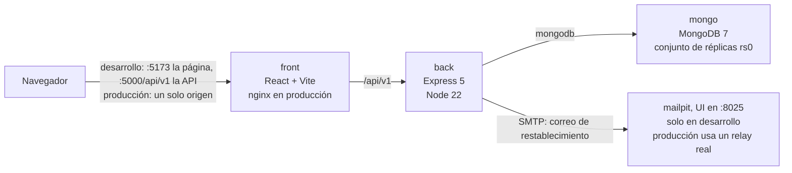
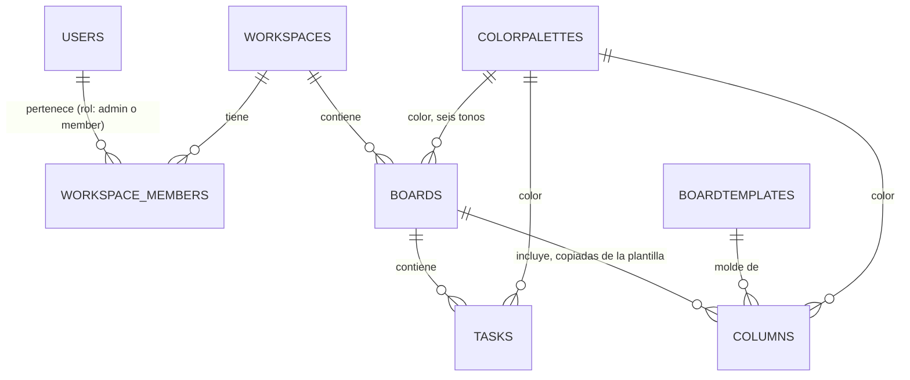
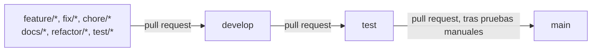

# BreezyBoard

Una aplicación Kanban: los espacios de trabajo contienen tableros, los tableros contienen columnas y las columnas contienen tarjetas de tareas que se arrastran.

## Descripción general

BreezyBoard es una aplicación web para planificar el trabajo en tableros. Las personas inician sesión, pertenecen a espacios de trabajo, crean tableros a partir de plantillas, invitan a otros miembros y mueven las tarjetas entre columnas con el mouse o con el teclado. Eliminar un tablero o una tarea es una eliminación lógica, con un plazo para restaurarlos.

El acceso tiene dos niveles. A un miembro de un espacio de trabajo se lo puede agregar a tableros individuales, y un administrador del espacio administra todos los tableros del espacio. Cada solicitud autenticada desplaza la sesión hacia adelante, y una sesión inactiva termina a los 15 minutos por defecto.

## Stack tecnológico

| Capa | Tecnología |
|---|---|
| Frontend | React 19, TypeScript 5.8, Vite 7, Tailwind CSS 4, TanStack Query 5, React Router 7, dnd-kit, Motion |
| Backend | Node 22, Express 5, Mongoose 8, Zod 4 para validar las solicitudes, pino para el registro |
| Base de datos | MongoDB 7 como conjunto de réplicas de un solo nodo (`rs0`), porque el registro y la purga de un tablero eliminado junto con sus tareas se ejecutan en transacciones |
| Contrato de la API | OpenAPI 3.1 generado a partir de los esquemas de Zod, versionado en `docs/openapi.yaml` |
| Pruebas | Vitest y Supertest (backend), Vitest y Testing Library (frontend), Playwright y los scripts de `e2e/verify` (extremo a extremo) |
| Contenedores | Docker Compose para desarrollo y para producción, nginx delante de la API de producción |

## Arquitectura



El backend está organizado en capas: rutas, middleware, validación, controladores, servicios, modelos y un trabajo en segundo plano que purga los tableros eliminados. Ver [docs/ARCHITECTURE.md](docs/ARCHITECTURE.md).

## Primeros pasos

Requisito previo: Docker Desktop. Node 22 y npm 11.17.0 hacen falta solo para ejecutar las verificaciones fuera de los contenedores.

1. Iniciar Docker Desktop y esperar a que `docker info` responda.
2. Desde la raíz del repositorio, levantar el stack: `docker compose up -d --build`
3. Cargar los datos de referencia y las cuentas de ejemplo, eligiendo la contraseña que comparten: `docker compose exec -e SEED_USER_PASSWORD=<una contraseña de 8 caracteres o más> back npm run seed:all`
4. Abrir http://localhost:5173 e iniciar sesión como `admin@breezyboard.local` con esa contraseña.

Sin `SEED_USER_PASSWORD` las cuentas de ejemplo se omiten, con un mensaje, y los datos de referencia se cargan igual. También se puede registrar una cuenta propia desde la pantalla de inicio de sesión.

Para explorar un espacio de trabajo con datos, cargar la demostración: `docker compose exec -e DEMO_PASSWORD=<una contraseña de 8 caracteres o más> back npm run seed:demo`, e iniciar sesión como `demo@breezyboard.local`. Crea cuatro tableros con tarjetas en todas las columnas, y volver a ejecutarla reemplaza exactamente los mismos datos y nada más. Es independiente de `seed:all`, y `seed:users` elimina todas las cuentas, la de la demostración incluida, por lo que la demostración se carga al final.

Los scripts de carga eliminan datos, por lo que se niegan a ejecutarse salvo que `NODE_ENV` sea `development` o `test` y que el host de la base de datos en `MONGODB_URI` sea `localhost`, `127.0.0.1`, `::1` o `mongo`, el servicio de compose. Una cadena `mongodb+srv` siempre se considera remota. Para cargar una base de datos remota a propósito, ejecutar un script directamente con la opción, por ejemplo `node seeds/users.seed.js --allow-remote`. Las cuentas de demostración existen solo en desarrollo.

| Qué | Dónde |
|---|---|
| Aplicación web | http://localhost:5173 |
| API | http://localhost:5000/api/v1 |
| Swagger UI, solo en desarrollo | http://localhost:5000/api/docs/ |
| Mailpit, el receptor del correo de restablecimiento de contraseña | http://localhost:8025 |
| MongoDB, publicado en el host solo en desarrollo | `mongodb://localhost:27017/boards-db?directConnection=true` |

Se detiene con `docker compose down`. Con `-v` se eliminan también la base de datos y los archivos subidos.

## Configuración

Todas las variables de entorno del backend, del frontend, de los archivos de compose y de la suite de extremo a extremo están listadas en [docs/ENVIRONMENT.md](docs/ENVIRONMENT.md), con el lugar donde se leen, su valor por defecto y si son secretas. El compose de desarrollo define todo lo que el stack necesita, por lo que no hay que configurar nada para ejecutarlo en local.

## Referencia de la API

La API está versionada bajo `/api/v1`. La ruta sin versión `/api` es un alias obsoleto que responde igual.

El contrato es [docs/openapi.yaml](docs/openapi.yaml), generado a partir de los mismos esquemas de Zod con los que las rutas validan. En desarrollo, Swagger UI lo muestra en http://localhost:5000/api/docs/. La ruta no se monta en test ni en producción, donde responde 404.

Después de cambiar el esquema de una ruta, hay que regenerar el documento y versionarlo:

```bash
cd back
npm run openapi
```

`npm run openapi:check` falla cuando el documento versionado está desactualizado, y el CI lo ejecuta. El documento incluye la `version` de `back/package.json` como `info.version`, por lo que subir la versión hace fallar la verificación hasta que se ejecute `npm run openapi` y se confirme el resultado.

## Modelo de datos



El `status` de una tarea es el id de una de las columnas de su tablero, y su `order` es una clave de índice fraccionario: mover una tarjeta escribe ese único documento. Los tableros y las tareas llevan `deletedAt` para la eliminación lógica. Los detalles están en [docs/ARCHITECTURE.md](docs/ARCHITECTURE.md).

## Pruebas y verificaciones

| Paquete | Comando, ejecutado desde su carpeta | Qué comprueba |
|---|---|---|
| `back` | `npm run lint` | ESLint |
| `back` | `npm test` | Vitest con un conjunto de réplicas de MongoDB en memoria, sin base de datos que iniciar |
| `back` | `npm run openapi:check` | `docs/openapi.yaml` coincide con los esquemas de las rutas |
| `front` | `npx eslint src/` | ESLint |
| `front` | `npm run build` | La verificación de tipos (`tsc -b`) y el bundle de producción |
| `front` | `npx vitest run --no-file-parallelism` | Pruebas unitarias y de componentes |
| `e2e` | `npm run typecheck` | El código de Playwright y de verify compila |
| `e2e` | `npx playwright test` | La suite de navegador, contra el stack de desarrollo en ejecución |
| `e2e` | `npm run verify` | Los scripts permanentes de `e2e/verify`, contra el stack de desarrollo en ejecución |
| raíz del repositorio | `node scripts/audit-gate.mjs` | Ninguna dependencia vulnerable en ningún paquete |

`npm run build` es la verificación de tipos del frontend. `npx tsc --noEmit` no comprueba nada allí, porque el `tsconfig.json` de la raíz solo contiene referencias a proyectos, y termina con código 0 diga lo que diga el código.

Playwright y los scripts de verify necesitan el stack de desarrollo levantado, la carga de datos hecha y Mailpit accesible. `csp.mjs` es la excepción: se ejecuta contra el stack de producción. Lo que afirma cada script está en [e2e/verify/README.md](e2e/verify/README.md).

## CI y ramas

El trabajo se hace en ramas tipificadas (`feature/`, `fix/`, `chore/`, `docs/`, `refactor/`, `test/`). Nada se sube directamente a `develop`, `test` ni `main`: las tres están protegidas y reciben cambios solo mediante pull requests.



Cada pull request hacia `develop`, `test` o `main` debe pasar cinco jobs de CI, definidos en `.github/workflows/ci.yml`:

| Job | Ejecuta |
|---|---|
| `back` | lint, la verificación de desfase de OpenAPI, las pruebas |
| `front` | lint, la verificación de tipos y el build, las pruebas unitarias |
| `e2e` | la verificación de tipos del código de extremo a extremo |
| `docker` | las imágenes de producción y las dos imágenes de desarrollo |
| `audit` | el control de auditoría y sus propias pruebas |

Playwright y `e2e/verify` necesitan todo el stack y siguen siendo controles locales. Los workflows de despliegue de `test` y `main` son marcadores de posición.

## Dependencias y scripts de instalación

`node scripts/audit-gate.mjs` ejecuta `npm audit` en cada directorio un nivel por debajo de la raíz que tenga un `package-lock.json` (`back`, `front` y `e2e`), incluyendo las dependencias de desarrollo. Falla ante cualquier aviso moderado, alto o crítico, y ante cinco o más avisos bajos, e imprime los paquetes vulnerables con su severidad. Una auditoría que no se puede leer es un fallo, nunca un éxito: un error del registro, un `npm audit` que no termina en dos minutos, una salida que no es un informe y un repositorio sin ningún paquete terminan con código 2.

npm 11.17.0 bloquea el script de instalación de una dependencia salvo que `allowScripts` en el `package.json` de ese paquete lo liste, y `strict-allow-scripts=true` en cada `.npmrc` convierte un script no listado en un error de instalación. Los scripts aprobados son `mongodb-memory-server` en `back`, y `esbuild` y `@tailwindcss/oxide` en `front`. `fsevents` y `@scarf/scarf` están denegados. Los Dockerfiles y el CI instalan primero npm 11.17.0, porque el npm incluido en Node 22 ignora la política. Una dependencia nueva con un script de instalación hace fallar la instalación hasta que alguien decida.

## Despliegue

`docker-compose.prod.yml` construye las imágenes de producción: el frontend se compila dentro de nginx, que lo sirve y hace de proxy de `/api` y `/uploads` hacia el backend, en un solo origen. El stack sirve HTTP plano en `HTTP_PORT` (8080 por defecto), por lo que TLS debe terminarse delante de él.

El archivo de compose se niega a iniciar sin `MONGO_USER`, `MONGO_PASSWORD`, `JWT_SECRET`, `CORS_ORIGINS`, `FRONTEND_URL`, `SMTP_HOST` y `MAIL_FROM`, y el backend se niega a iniciar en producción sin una cadena de conexión a la base de datos, un secreto de al menos 32 caracteres, una lista de orígenes permitidos y un relay de correo, y ante cualquier variable con un valor mal formado. El primer inicio genera el keyfile de MongoDB en su propio volumen.

```bash
MONGO_USER=bb MONGO_PASSWORD=devpassword JWT_SECRET=local-trial-secret-not-for-real-use-0123456789 \
  CORS_ORIGINS=http://localhost:8080 FRONTEND_URL=http://localhost:8080 \
  SMTP_HOST=localhost MAIL_FROM='BreezyBoard <no-reply@example.test>' HTTP_PORT=8080 \
  docker compose -f docker-compose.prod.yml up -d --build
```

Esos valores sirven para probar el stack de producción en local, nunca para un despliegue real. Swagger UI no se sirve allí.

## Solución de problemas

| Síntoma | Qué revisar primero |
|---|---|
| `docker compose` no alcanza el motor | Docker Desktop no está en ejecución. Iniciarlo y esperar a que `docker info` responda |
| La API responde 429 al registrarse o al recuperar la contraseña | Se agotó un limitador. `docker compose restart back` borra los contadores en memoria |
| Un cambio de dependencias no tiene efecto en el contenedor | `package.json` no está montado como bind mount. Ejecutar `docker compose build back` y luego `docker compose up -d` |
| `npm run seed:all` se niega a ejecutarse | `NODE_ENV` no es `development` ni `test` en ese contenedor, o `MONGODB_URI` nombra un host que no es local. Los scripts de carga eliminan datos a propósito solo allí |
| El registro falla con un error de transacción, o los tableros eliminados nunca se purgan | MongoDB no es un conjunto de réplicas. Usar el archivo de compose, o iniciar `mongod` con `--replSet rs0` y ejecutar `rs.initiate()` una vez |
| El MongoDB de producción no puede autenticarse después de un reinicio de volúmenes | Se eliminó `mongo-keyfile` sin eliminar `mongo-data`. Eliminar ambos volúmenes, o ninguno |
| `npm install` falla con `ESTRICTALLOWSCRIPTS` | Una dependencia tiene un script de instalación que `allowScripts` no cubre. Leerlo y luego aprobarlo o denegarlo |

## Documentación

| Documento | Qué contiene |
|---|---|
| [docs/ARCHITECTURE.md](docs/ARCHITECTURE.md) | Las capas del backend, el modelo de sesión, el modelo de datos, la estructura del frontend y los scripts de verify |
| [docs/ENVIRONMENT.md](docs/ENVIRONMENT.md) | Todas las variables de entorno |
| [docs/openapi.yaml](docs/openapi.yaml) | El contrato de la API |
| [e2e/verify/README.md](e2e/verify/README.md) | Los scripts permanentes de verificación |
