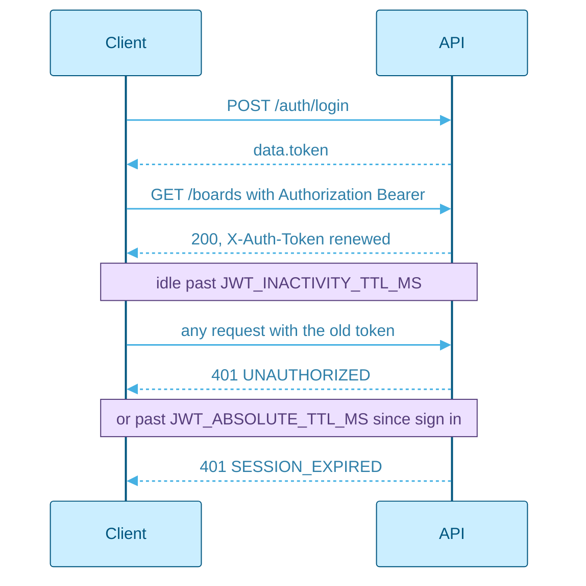

<picture>
  <source media="(prefers-color-scheme: dark)" srcset="assets/brand/header-strip-dark.svg">
  
</picture>

# API

One versioned JSON API, one envelope, one error shape: the whole contract fits in [openapi.yaml](openapi.yaml), and this page is the tour.

## Quick path

1. Start the development stack and open Swagger UI at http://localhost:5000/api/docs/, which renders [openapi.yaml](openapi.yaml).
2. Sign in with `POST /api/v1/auth/login` and keep the `token` from the response.
3. Send it as `Authorization: Bearer <token>`, and replace it with the `X-Auth-Token` header of every response.

Swagger UI is mounted only when `NODE_ENV` is `development`. In test and production the route answers 404.

## Overview

Every path is relative to `/api/v1`. The same routers are also mounted at `/api`, a deprecated alias that answers identically and logs a warning the first time it is used.

| Tag | Paths | Covers |
|---|---|---|
| Auth | `/auth/register`, `/auth/login`, `/auth/logout`, `/auth/ping`, `/auth/me`, `/auth/validate-token`, `/auth/change-password`, `/auth/forgot-password`, `/auth/reset-password` | Accounts, the session and password recovery |
| Boards | `/boards`, `/boards/{id}`, `/boards/{id}/columns/{columnId}`, `/boards/{id}/members`, `/boards/{id}/restore` | Boards, their columns and members, soft delete and restore |
| Tasks | `/tasks/board/{boardId}`, `/tasks/{id}`, `/tasks/{id}/move`, `/tasks/{id}/restore`, `/tasks/{taskId}/checklist/{itemId}` | Cards, their checklists, ordering, soft delete and restore |
| Reference data | `/colors`, `/colors/{id}`, `/templates` | The colour palette and the board templates |
| Dashboard | `/dashboard/stats` | Totals for the home page |
| Users | `/users/search`, `/users/board-members`, `/users/{id}`, `/users/{id}/avatar` | People, profiles and pictures |
| Workspaces | `/workspaces`, `/workspaces/{id}`, `/workspaces/{id}/members` | Workspaces and their members |
| Operations | `/health` | Liveness for the container healthcheck and for monitors |

## Authentication

Authentication is a bearer JWT. There is no cookie. Register, login, forgot password, reset password and health are public; every other route needs a token.



| Rule | Detail |
|---|---|
| Renewal | Every authenticated response carries a fresh token in `X-Auth-Token`. Send that one next |
| Inactivity | A token dies after `JWT_INACTIVITY_TTL_MS` without a request, 15 minutes by default |
| Absolute cap | A session ends `JWT_ABSOLUTE_TTL_MS` after sign in whatever happens, 4 hours by default |
| Revocation | Logout, a password change and a password reset revoke every earlier token at once |
| Keep alive | `GET /auth/ping` renews the session with no other effect and answers 204 |

How the session is built, and why the client never polls, is in [ARCHITECTURE.md](ARCHITECTURE.md#authentication-and-sessions).

## Conventions

| Convention | Detail |
|---|---|
| Success | `{ "success": true, "data": ... }`, with a `pagination` object beside `data` on paginated lists |
| Pagination | Opt in on `GET /boards` and `GET /tasks/board/{boardId}`: `limit` and `offset` in the query. Without `limit` a list returns everything, and `pagination.total` is always present |
| Ids | 24 character hexadecimal strings. A malformed id in a path answers 400 before the route reaches the database |
| Validation | Params, query and body are checked by Zod, and a route only ever sees the parsed values, so a field outside the schema never reaches it |
| Request ids | Every response carries `X-Request-Id`. Send your own to have it echoed back, which ties a client log line to a server one |
| Ordering | A card is moved by naming the two neighbours it was dropped between, never by sending a position. A neighbour that has moved answers 409 |
| Column edits | A save of a board's column list carries the `columnsVersion` it was built on. A stale version answers 409 `COLUMNS_STALE` |
| Avatars | A multipart field named `avatar`: PNG, JPEG, WebP or GIF, up to 6 MB. The bytes are checked against the declared type |

## Errors

Every failure has one shape:

```json
{ "success": false, "message": "Board not found", "code": "NOT_FOUND", "errors": [] }
```

`errors` lists each failing field as `{ field, message }` on a validation failure. `message` is for people and may change; `code` is for programs and does not.

| Code | Status | Meaning |
|---|---|---|
| `VALIDATION_ERROR` | 400 | A param, query or body field failed its schema |
| `UNAUTHORIZED` | 401 | No token, or a malformed, expired or unknown one |
| `TOKEN_REVOKED` | 401 | The token was valid but a logout or a password change has revoked it |
| `SESSION_EXPIRED` | 401 | The absolute cap of the session has passed |
| `WRONG_CURRENT_PASSWORD` | 400 | A password change named the wrong current password |
| `INVALID_RESET_TOKEN` | 400 | A reset link that is unknown, used or expired |
| `INVALID_FILE_TYPE` | 400 | An avatar that is not one of the accepted image types |
| `FILE_TOO_LARGE` | 400 | An avatar above the size limit |
| `FORBIDDEN` | 403 | The caller has a role here, but not the one the action needs |
| `NOT_FOUND` | 404 | Unknown, deleted, or not visible to the caller |
| `CONFLICT` | 409 | The request raced another change, such as a moved neighbour |
| `COLUMNS_STALE` | 409 | The column list changed since it was read. Reload the columns, then save again |
| `RATE_LIMITED` | 429 | A limiter is spent |
| `INTERNAL` | 500 | Anything else. The body names nothing about the cause |

A client signs the person out on any 401. That is why a wrong current password is a 400 and never a 401. Each route declares its own responses in [openapi.yaml](openapi.yaml).

## Rate limits

| Route | Budget | Counted |
|---|---|---|
| `POST /auth/login` | 10 per 15 minutes per client address | Failures only |
| `POST /auth/change-password` | 10 per 15 minutes per account | Failures only |
| `POST /auth/register` | `REGISTRATION_LIMIT_PER_HOUR` per client address, 20 by default | Every request |
| `POST /auth/forgot-password`, `POST /auth/reset-password` | `PASSWORD_RECOVERY_LIMIT_PER_15_MIN` per client address, 10 by default | Every request |
| `GET /health` | 120 per minute | Every request |

## Keeping the contract in sync

[openapi.yaml](openapi.yaml) is generated from the same Zod schemas the routes validate with, and committed. After changing a route schema, regenerate it from `back/`:

```bash
npm run openapi
```

> [!IMPORTANT]
> `npm run openapi:check` fails when the committed document is out of date, and CI runs it. The document embeds the `version` of `back/package.json`, so bumping the version also needs `npm run openapi` and a commit.

---

[Back to the README](../README.md) · Previous: [CI](CI.md) · Next: [Roadmap](ROADMAP.md)
