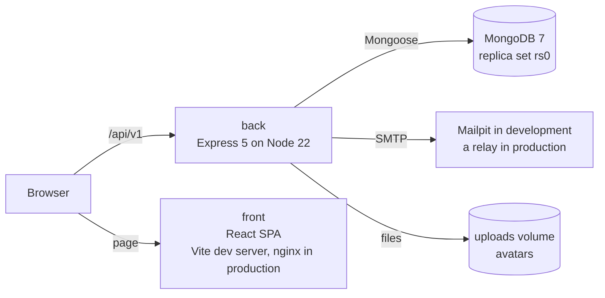
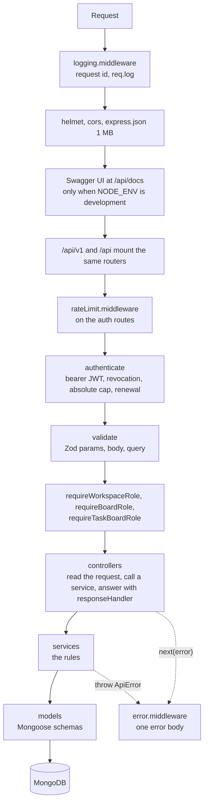
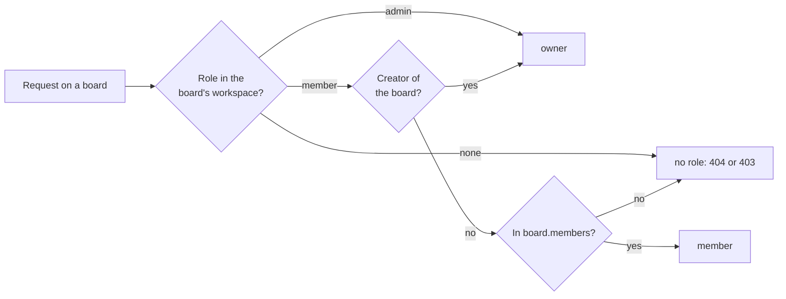
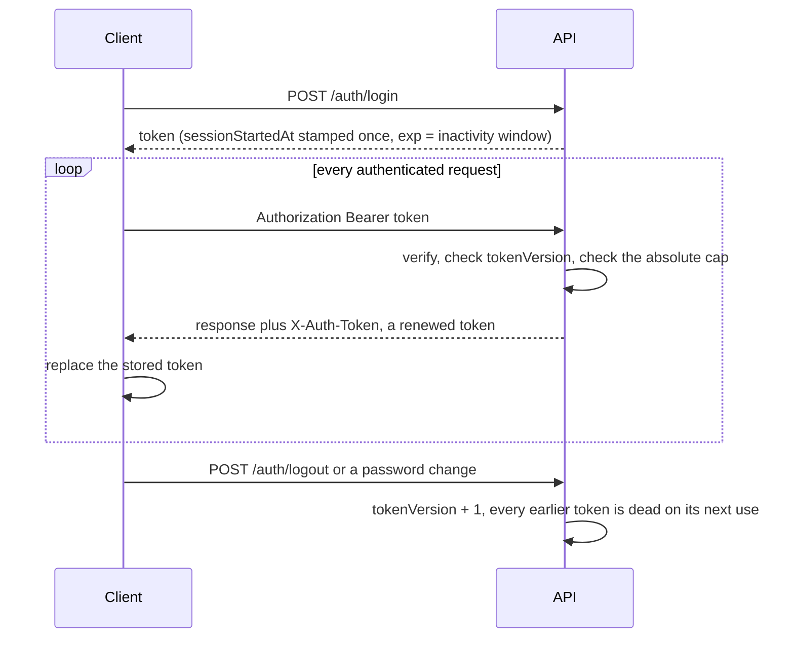
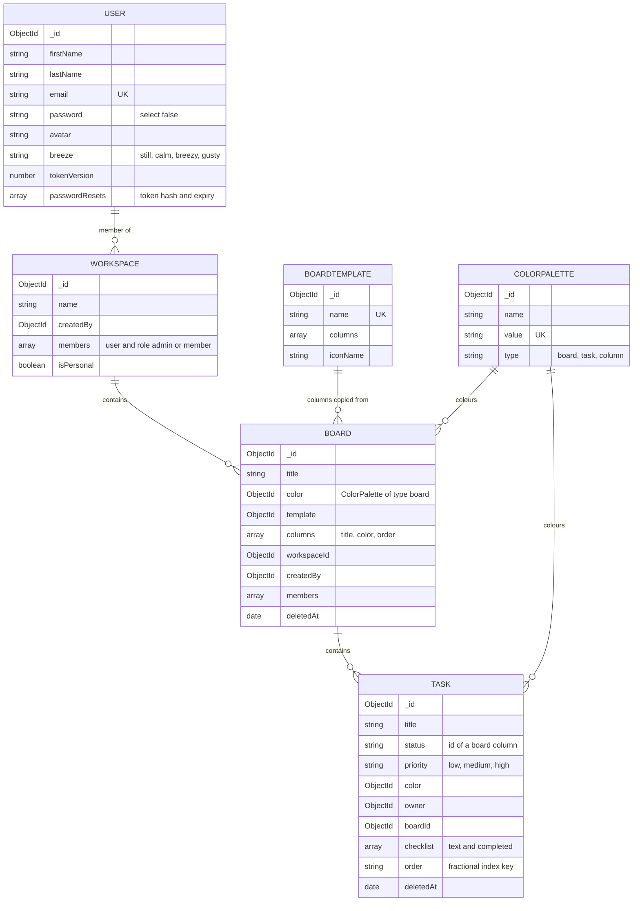
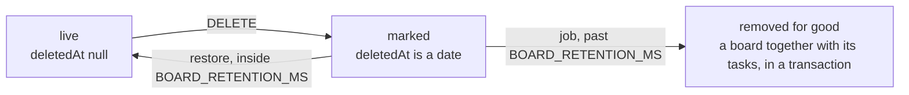
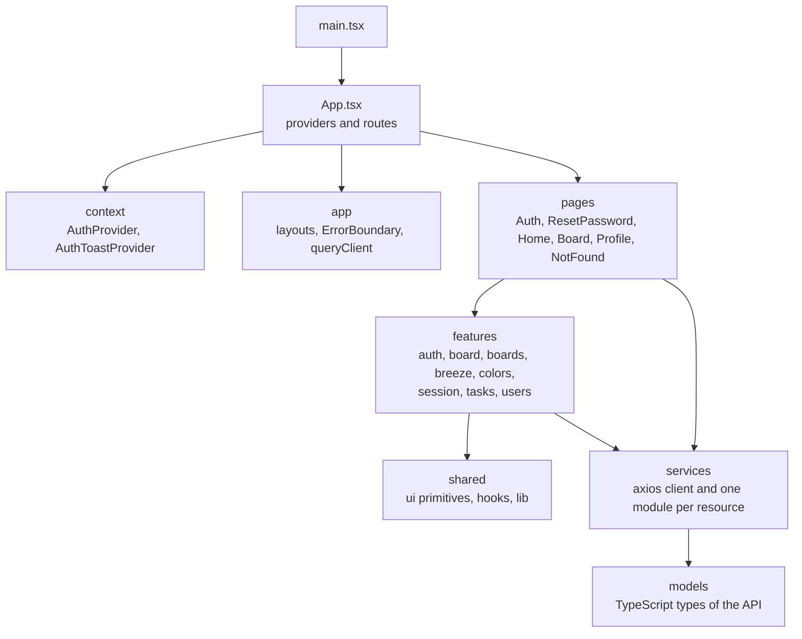
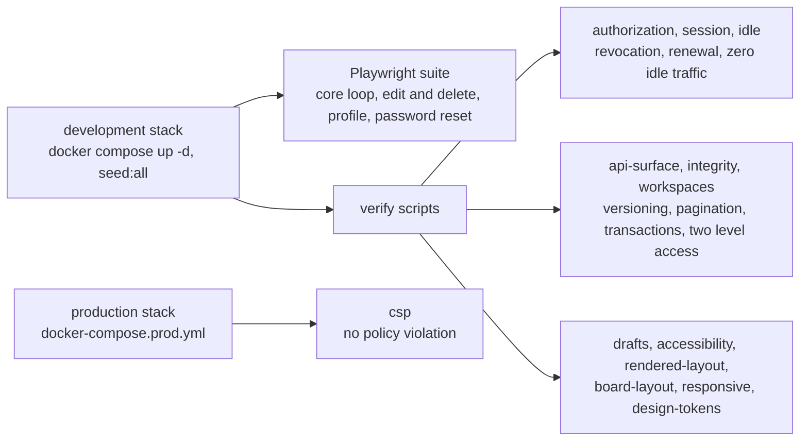

# Architecture

How BreezyBoard is put together: the backend layers, the session model, the data model, the frontend structure and the standing verification scripts. Setup and commands are in the [README](../README.md), the variables in [ENVIRONMENT.md](ENVIRONMENT.md) and the HTTP contract in [openapi.yaml](openapi.yaml).

## System

In production nginx serves the built page and proxies `/api` and `/uploads` to the backend, so the browser sees one origin and the backend trusts exactly one proxy hop for the address its rate limiters key on.

## Backend

All of it lives in `back/src`. A request passes through the same stack of layers, and each layer has one job.

| Folder | Holds |
|---|---|
| `config` | `env.js` reads the environment once and everything else imports it, with three exceptions that read `NODE_ENV` themselves (`utils/logger.js`, `openapi/docs.js` and the seed guard), and `db.js` connects Mongoose |
| `routes` | One router per resource, wired in `routes/index.js`, the table `app.js` mounts and the OpenAPI coverage test walks |
| `middleware` | `auth` (authentication and the three role gates), `validate`, `rateLimit`, `upload` and `verifyImage` for avatars, `logging`, `error` |
| `validation` | The Zod schemas for params, query and body. A passing request has its values replaced by the parsed output, so a route only ever sees whitelisted fields |
| `controllers` | Thin: take the validated request, call a service, answer with `{ success, data }` |
| `services` | The business rules: ordering keys, soft delete and restore, sessions, password reset, mail |
| `models` | The Mongoose schemas: `User`, `Workspace`, `Board`, `Task`, `ColorPalette`, `BoardTemplate` and the shared column schema |
| `jobs` | `boardPurge.job.js`, the timer that removes deleted boards and tasks past retention |
| `constants`, `utils`, `migrations` | Error codes and board hues, the logger, `ApiError` and `responseHandler`, and `migrations/boardHues.js`, the board hue migration. The migration is run by `npm run migrate:board-hues`, which executes the script `seeds/migrate_board_hues.js`: the script connects to the database and calls `migrateBoardHues` from `src/migrations`, and the migration itself holds all of the logic |
| `openapi` | The OpenAPI document built from the Zod schemas, and the development only Swagger UI mount |

Every failure leaves through `error.middleware.js` as `{ success: false, message, code, errors? }`. An `ApiError` carries its status and a machine readable `code` (`VALIDATION_ERROR`, `UNAUTHORIZED`, `FORBIDDEN`, `NOT_FOUND`, `TOKEN_REVOKED`, `SESSION_EXPIRED`, `RATE_LIMITED`, `INVALID_RESET_TOKEN`, `WRONG_CURRENT_PASSWORD`, `CONFLICT`, `INTERNAL`). A Mongoose `CastError` or `ValidationError` becomes a 400, and anything else a 500 that names nothing.

`startServer.js` connects the database, listens, starts the purge job and, on `SIGINT` or `SIGTERM`, stops the job, lets the server drain and closes the connection.

### Access control

Access has two levels, resolved in `auth.middleware.js` and never in a route.

A route asks for a minimum role: `member` or `owner` on a board, `member` or `admin` on a workspace. A soft deleted board or task is a missing one for every route except its own restore, which resolves the role first so that a caller with no role cannot tell a deleted board from an unknown id.

## Authentication and sessions

The session contract, in one diagram and one table.

| Property | Behaviour |
|---|---|
| Transport | `Authorization: Bearer` in, `X-Auth-Token` out. The header is in the CORS `exposedHeaders`, or a browser would hide it. There is no cookie |
| Two clocks | `exp` is the inactivity window, rewritten on every renewal (`JWT_INACTIVITY_TTL_MS`, 15 minutes by default). `sessionStartedAt` is the absolute cap, never rewritten (`JWT_ABSOLUTE_TTL_MS`, 4 hours by default) |
| Revocation | `tokenVersion` on the user is part of every token. Logout and a password change bump it |
| Renewal | A side effect of `authenticate`, before the handler runs, so a 403 or a 500 still renews: a human made the request |
| Client | The token is in `localStorage`. `useKeepAlive` pings from a keydown, a pointer down, a scroll or a tab becoming visible, never from a timer, and `useSessionExpiry` warns 60 seconds before the deadline. Open tabs share renewals over a `BroadcastChannel` |
| Why no polling | The server cannot enforce inactivity on its own, because it renews on every request it sees. A stray interval in the client would turn the window into a session that never ends, which `e2e/verify/idle.mjs` is there to catch |
| Password reset | A mailed link with a token whose SHA-256 is stored, bounded in number and lifetime, and a successful reset revokes every session |

## Data model

| Decision | Why |
|---|---|
| Every account gets a personal workspace at registration, in the same transaction as the account | A board always has a workspace, so no query handles a board that belongs to nothing |
| A board's columns are copied from its template and embedded | Renaming or removing a column on one board touches no other board. A task's `status` is the id of one of those embedded columns |
| A board's colour is one of six hues: `sky`, `teal`, `green`, `sand`, `coral`, `lavender` | The `value` of a board colour is the hue key, and the interface derives its tints from it. Task and column colours keep hex values |
| A task's `order` is a fractional index key | Keys sort lexicographically, so moving a card writes one document. The client sends the two neighbours it dropped between, never a key, and a neighbour that has moved answers 409 |
| `deletedAt` on boards and tasks | A soft delete: every read treats the document as missing and a restore brings back exactly what was there. Within the retention window only |
| Names are stored in lowercase and capitalized when presented | `User.toJSON` capitalizes them. Queries read through `lean()` skip that transform and return the stored form |

### Soft delete, restore and purge

The purge job runs once at start and then every `BOARD_PURGE_INTERVAL_MS`. A restore past the retention window answers 404 whether or not the job has reached the document yet, so the window never stretches by an interval.

## Frontend

All of it lives in `front/src`, a React 19 single page application. Server state is TanStack Query with `refetchOnWindowFocus`, a 30 second `staleTime` and no retries, so a window nobody touches never fetches.

| Folder | Holds |
|---|---|
| `app` | `AppShell` and `AuthLayout`, the error boundary and the `QueryClient` |
| `context` | The authentication state, and the toasts tied to it, which are discarded when the person signs out or changes |
| `pages` | One component per route: `/login`, `/register`, `/reset-password`, `/`, `/board/:boardId`, `/profile`, and the not found page |
| `features` | One folder per feature, with its components, hooks and queries. `session` holds the keep-alive and the expiry warning, `breeze` the ambient motion setting, `tasks` the drag and drop geometry |
| `shared/ui` | The primitive components: `Button`, `Modal`, `Menu`, `Field`, `Avatar`, `SwatchPicker`, `ToastProvider`, `WindLayer` and the design token modules |
| `services` | `api.service.ts` is the axios instance that attaches the bearer token and stores each renewed `X-Auth-Token`; the other modules call one resource each |
| `components`, `hooks`, `utils` | What sits outside the feature folders: `Column`, `TaskCard`, the legal document modal and hooks, and the authentication helper |

Any 401 clears the stored session and redirects to the sign in page. The production build is `tsc -b && vite build`, and it is also the type check. `VITE_API_URL` and `VITE_USE_STRICT_MODE` are the only variables the application reads, and Vite inlines them at build time.

## End to end and verification

`e2e/tests` holds the Playwright suite, and `e2e/verify` holds standing scripts for what no unit test can see: a real browser, real time, a real database, the production CSP. Both run against the development stack, except `csp.mjs`, which needs the production one.

What each script asserts, and why it exists, is in [e2e/verify/README.md](../e2e/verify/README.md). The `back` and `front` CI jobs, the audit gate and the branch convention are in the [README](../README.md).
