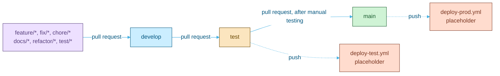

<picture>
  <source media="(prefers-color-scheme: dark)" srcset="assets/brand/header-strip-dark.svg">
  
</picture>

# CI

Five jobs stand between a branch and `main`, and none of them takes a day off: lint, types, tests, images and a dependency audit on every pull request.

## Branch flow

Work happens on typed branches (`feature/`, `fix/`, `chore/`, `docs/`, `refactor/`, `test/`). Nothing is pushed straight to `develop`, `test` or `main`: all three are protected and take changes only through pull requests, with every required check green and the branch up to date.

## Workflows

| File | Trigger | Does |
|---|---|---|
| `.github/workflows/ci.yml` | Pull requests into and pushes to `develop`, `test` and `main` | The five jobs below |
| `.github/workflows/deploy-test.yml` | Push to `test` | A placeholder that deploys nothing |
| `.github/workflows/deploy-prod.yml` | Push to `main` | A placeholder that deploys nothing |
| `.github/actions/setup-node-npm` | Used by the jobs | Node 22 with the npm cache, npm 11.17.0, then `npm ci` in one package |

`ci.yml` runs with read-only contents permission, pins every action by commit SHA and checks out without persisting credentials. A newer push to a pull request cancels the run in progress, while a push to a protected branch always runs to the end, so every commit there keeps a result.

## Jobs

The job names are what branch protection requires, so renaming one detaches it from the rule.

| Job | Timeout | Runs |
|---|---|---|
| `back` | 15 min | `npm run lint`, `npm run openapi:check`, `npm test`. The `mongod` binary of the in-memory database is cached, keyed on `back/package-lock.json` |
| `front` | 20 min | `npx eslint src/`, `npm run build` (the type check and the bundle), `npx vitest run --no-file-parallelism` |
| `e2e` | 10 min | `npm run typecheck`. Playwright and `e2e/verify` need the whole stack and stay local gates, see [TESTING.md](TESTING.md) |
| `docker` | 30 min | `docker compose -f docker-compose.prod.yml build`, then the development stages of `back` and `front`. The images are built and thrown away |
| `audit` | 10 min | `node --test scripts/audit-gate.test.mjs`, then `node scripts/audit-gate.mjs`, straight from the lockfiles with no install |

The `docker` job sets throwaway values for the variables the production compose file requires (`MONGO_USER`, `MONGO_PASSWORD`, `JWT_SECRET`, `CORS_ORIGINS`, `FRONTEND_URL`, `SMTP_HOST`, `MAIL_FROM`) so that it parses. No container ever sees them.

> [!TIP]
> To reproduce CI before pushing, run from each folder: `back` (`npm run lint`, `npm run openapi:check`, `npm test`), `front` (`npx eslint src/`, `npm run build`, `npx vitest run --no-file-parallelism`), `e2e` (`npm run typecheck`), and from the root `node --test scripts/audit-gate.test.mjs` and `node scripts/audit-gate.mjs`.

## The audit gate

`scripts/audit-gate.mjs` runs `npm audit --json` in every directory one level below the root that has a `package-lock.json` (today `back`, `front` and `e2e`), development dependencies included. A new package is picked up without editing the script. The report decides, not npm's exit code.

| Outcome | Rule | Exit |
|---|---|---|
| Pass | No critical, high or moderate advisory, and fewer than 5 low ones | 0 |
| Fail | Any moderate, high or critical advisory, or 5 or more low ones | 1 |
| Unreadable | A registry or network error, an audit that does not finish in two minutes, output that is not an audit report, or no package found | 2 |

An unreadable audit is never a pass. The script prints a table per package and the vulnerable packages, worst first. Because advisories are published independently of the code, a new one can turn CI red with no change in the repository, and the target is zero. `--root <dir>` audits the packages below another directory, and `--input <report.json>` decides on a saved report.

## Install scripts

A dependency's install script runs arbitrary code on every machine that installs it, so each one is approved by name and version.

| Piece | Detail |
|---|---|
| `strict-allow-scripts=true` | In `back/.npmrc`, `front/.npmrc` and `e2e/.npmrc`. An unlisted install script is an install error, `ESTRICTALLOWSCRIPTS` |
| `allowScripts` in `back/package.json` | `mongodb-memory-server` approved, `@scarf/scarf` and `fsevents` denied |
| `allowScripts` in `front/package.json` | `@tailwindcss/oxide` and `esbuild` approved, `fsevents` denied |
| `e2e` | No dependency with an install script |
| Version bumps | Entries are pinned to exact versions, so bumping an approved package updates its entry in the same change, or the install fails |
| New dependencies | One with an install script fails `npm ci` until someone reads the script and approves or denies it |

npm 11.17.0 enforces the policy, and the npm bundled with Node 22 ignores it. That is why npm 11.17.0 is installed explicitly in four places, which move together: `back/Dockerfile`, `front/Dockerfile`, `.github/actions/setup-node-npm/action.yml` and the `audit` job in `ci.yml`. Local npm should match.

## Images

| Dockerfile | Stages |
|---|---|
| `back/Dockerfile` | `base` (Node 22 Alpine with the pinned npm), `deps-dev`, `deps-prod`, `dev` (bind mounted source, `npm run dev`), `prod` (runs as user `node`, healthcheck on `/api/health`) |
| `front/Dockerfile` | `base`, `dev` (the Vite dev server), `build` (build arguments `VITE_API_URL` and `VITE_USE_STRICT_MODE`), `prod` (nginx serving the bundle) |

Swagger UI depends on a development dependency, so the production image never installs it and the route is not mounted there.

## Deployment

The two deploy workflows are placeholders that only print a message: deployment to real test and production environments is a separate piece of work. When it lands, TLS has to be terminated in front of the production compose stack, because nginx there serves plain HTTP. A local trial of that stack is described in [ENVIRONMENT.md](ENVIRONMENT.md#trying-the-production-stack-locally).

---

[Back to the README](../README.md) · Previous: [Testing](TESTING.md) · Next: [API](API.md)
