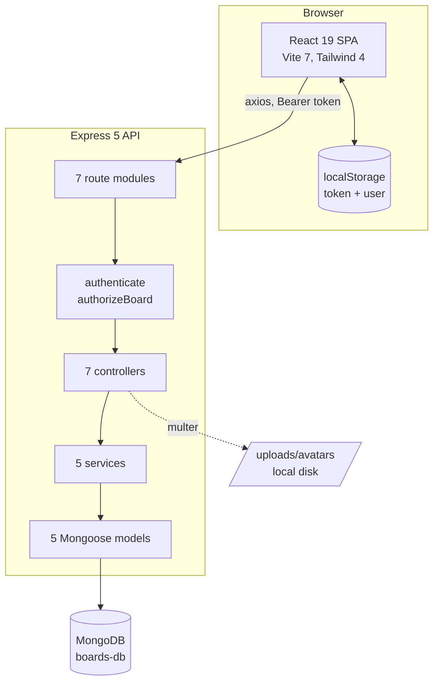
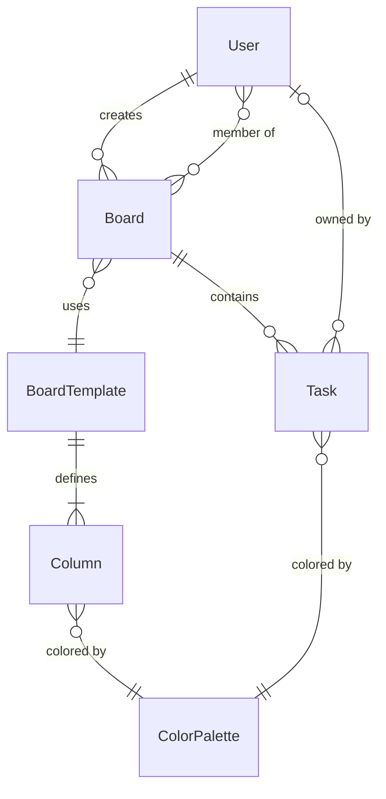
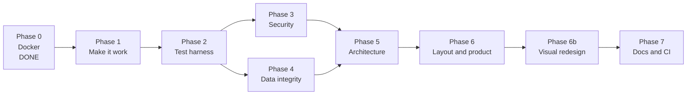
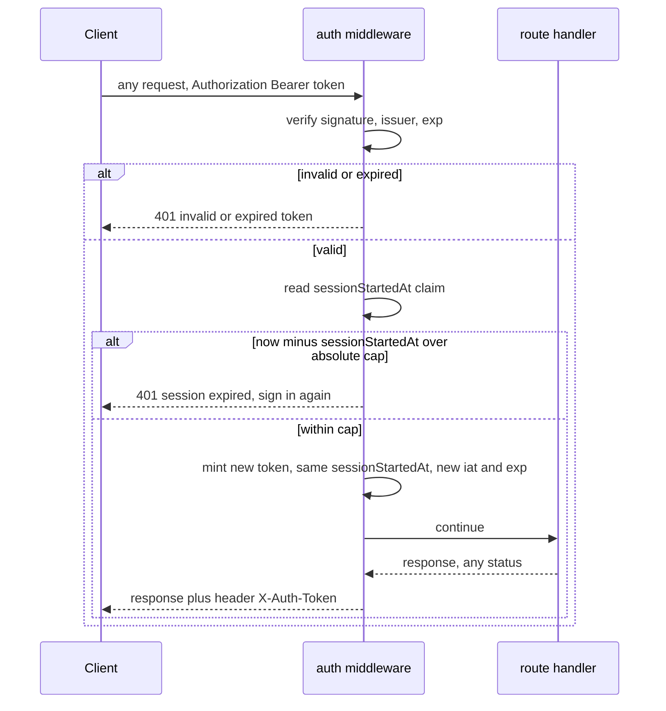
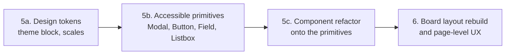
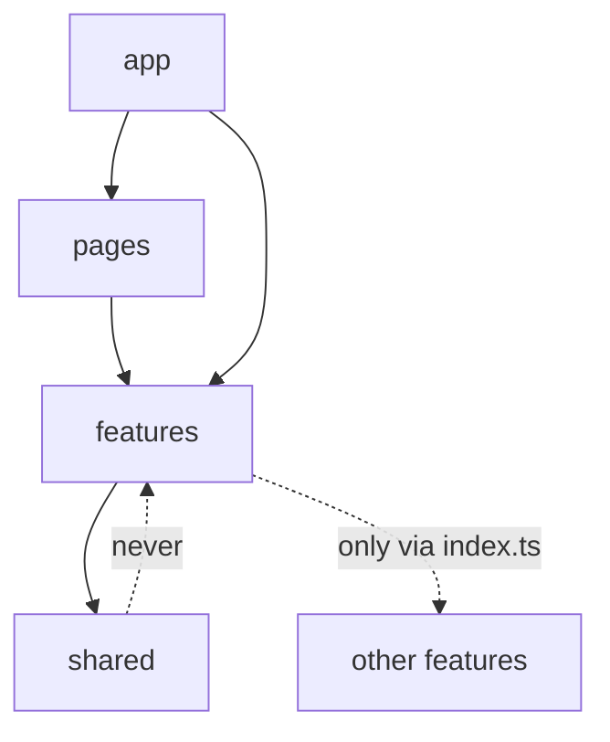

# BreezyBoard revival plan

Status: draft for review. Date: 2026-09-08. Scope: the codebase as it exists at commit `9931e8d`.

## 1. Executive summary

BreezyBoard is a Kanban board application with a Node 22 plus Express 5 plus Mongoose backend and a React 19 plus TypeScript plus Vite 7 plus Tailwind 4 frontend. Roughly 6,900 lines across 103 tracked files. The idea, the data model and the visual shell are all there, and the seed data, the templates and the color palettes are genuinely useful groundwork.

The verdict from running it: the application does not work. A user cannot create a task, and no task can be moved between columns, which between them are the entire product. Separately, any authenticated user can read, modify and delete any task belonging to any other user, which was confirmed with a live exploit against the running stack, not inferred from reading code.

That reframes the work. The first milestone is not refactoring, documentation or design. It is making the product do the one thing it exists to do, then closing the authorization holes, then building the test harness that stops both classes of defect from coming back. Everything else follows.

Two defects were confirmed by driving the real application in a browser, and each of them independently makes the product unusable:

| ID | Defect | Effect |
|---|---|---|
| P0-1 | The Save button in the task drawer can never be enabled | Tasks cannot be created or edited at all |
| P0-3 | The drag handle overrides the drag-and-drop library's own event handlers | Drag and drop is dead for mouse and keyboard |

A third, P0-2, was reported in the first draft of this document and has been **withdrawn on verification**. See section 5.1 for what was wrong with it and what real defect remains underneath.

And one security defect of the same weight:

| ID | Defect | Effect |
|---|---|---|
| P1-1 | Every single-task route is missing its authorization check | Any logged-in user can read, edit and delete any task in the database |

## 2. How this assessment was produced

The findings below are not a code read alone. The sequence was: read every backend and frontend file, containerize the stack, boot it, seed it, then drive the running application with Playwright and probe the live API directly.

That order matters in both directions. Both P0 defects were invisible to static reading: two independent full-file audits of the frontend and backend missed that the task form can never be submitted, and it only surfaced when a browser filled in every field and the button stayed grey. But driving the application also produced one false positive, the withdrawn P0-2, because the reproduction went around the blocked UI path instead of through it and then attributed the result to the code. A runtime finding is only as good as the path used to reach it.

The Docker setup added in this pass is described in section 8 and is already working. The reproduction commands for every P0 and P1 finding are in appendix A.

## 3. Current architecture



The layering is sound in principle: routes, controllers, services, models, with a shared error middleware and a response envelope. Two resources break the pattern by querying models straight from the controller (`color.controller.js`, `template.controller.js`), and one cross-cutting concern is implemented twice, once as middleware for boards and once inline in the service for users.

The data model is five collections: `User`, `Board`, `Task`, `BoardTemplate`, `ColorPalette`. A board references a template, which owns the column definitions. A task references a board and carries a free-text `status` that is meant to name the column it sits in. That last relationship is the seam where P0-2 lives.



## 4. What works today and what does not

Verified by driving the running application.

Working: registration and login, JWT issue and validation, session restore on reload, the 401 interceptor and forced logout, board creation with template and color, the board list dashboard, board statistics counts, the profile page, the legal document modals, the user search endpoint, and the auth page layout.

Broken or missing: the production build (see P5-9), task creation, task editing, drag and drop, cross-column keyboard movement, average progress on the dashboard (always zero by construction), board editing and deletion from the UI, member management from the board view, a 404 page, password recovery (the link points back to `/login`), and any form of persisted task ordering.

## 5. Findings

Severity is by consequence, not by effort. P0 means the product does not function. P1 means data belonging to one user is exposed to another. P2 means data can be silently corrupted or lost. P3 and below are quality, and they are real, but they are not what should be fixed first.

### 5.1 P0, the product does not function

**P0-1. The task drawer can never be submitted.** File `front/src/components/TaskDrawer.tsx:533`.

`handleOwnerChange` clears the owner error by assigning `undefined` to the key rather than removing it:

```ts
setErrors(prev => ({ ...prev, owner: undefined }));
```

`isFormValid()` at line 445 gates the submit button on `Object.keys(errors).length === 0`. `Object.keys({ owner: undefined })` has length 1, so the moment a user picks an owner, which is a required field, the button locks permanently. Confirmed in the browser: title, description, owner and color all populated, submit still disabled. Task creation and task editing are both impossible through the UI.

The fix is one line, but the class of bug is the point: a hand-rolled validation object used as a boolean gate. See P3-1.

**P0-2. Withdrawn. The board renders tasks correctly.**

The first draft of this document claimed that tasks never render, on the basis that `Board.tsx:300` filters by `task.status === column.id` where `column.id` is a Mongo ObjectId. That claim was wrong, and the error was in the reproduction rather than in the code.

Because P0-1 blocks the only UI path to creating a task, the tasks used for that test were created through the API with `status` set to a column title. The application never writes that value. Every writer in the frontend is consistent on storing the column `_id`: `handleAddTask` sets `status: defaultColumn.id` at `Board.tsx:239`, `handleDragEnd` writes the target column id at `Board.tsx:113-127`, and `Board.tsx:300` reads the same thing back. The mismatch was introduced by the test, then attributed to the code.

Verified after fixing P0-1: a task created through the drawer is stored with `status` holding the column `_id` and appears in the correct column immediately, with no page errors. The board is fine.

What remains underneath is real but smaller, and is filed as P2-9.

**P0-3. Drag and drop is dead.** File `front/src/components/TaskCard.tsx:161-172`.

The drag handle spreads dnd-kit's listeners and then declares its own handlers after the spread:

```tsx
<div
  {...listeners}
  {...attributes}
  onKeyDown={handleDragHandleKeyDown}
  onPointerDown={e => e.stopPropagation()}
>
```

In JSX the last duplicate prop wins, so `onPointerDown`, which is exactly how dnd-kit's `PointerSensor` starts a drag, is replaced by a handler that does nothing but stop propagation. The replacement `onKeyDown` then tries to fake a pointer event by calling `listeners.onPointerDown({})` with an empty object.

Confirmed live. Dragging from the handle does nothing. Dragging from the card body does nothing, because the listeners live only on the handle. No API call is issued. The keyboard path throws `TypeError: Cannot read properties of undefined (reading 'dndKit')`, because dnd-kit reads `event.nativeEvent.dndKit` on an object that has no such property.

Note that this error is swallowed. There is no error boundary anywhere in the application, and `onDragEnd` is never awaited, so the exception surfaces only in the browser console.

**P0-4. Cross-column keyboard movement is not implemented.** File `front/src/pages/Board.tsx:43-48, 289-294`.

Independent of P0-3. A `KeyboardSensor` is registered, but `sortableKeyboardCoordinates` only reorders within a single `SortableContext`. Moving a card between columns needs custom coordinate logic that does not exist. Even once P0-3 is fixed, a keyboard-only user will not be able to perform the application's primary action.

### 5.2 P1, security

**P1-1. Every single-task route is missing its authorization check.** File `back/src/routes/task.routes.js:16-23`.

`GET`, `PUT`, `DELETE /api/tasks/:id`, `PATCH /api/tasks/:id/move`, and both checklist item routes apply `authenticate` but never `authorizeBoard`. They cannot apply it as written, because the middleware resolves a board from a `:boardId` param and these routes carry a task id.

Confirmed with a live exploit against the running stack. A second seeded user who is not a member of the board was correctly refused at the board level, and then read and overwrote that board's task anyway:

```
GET  /api/boards/:id   -> 403   (authorization works here)
GET  /api/tasks/:id    -> 200   (full task document returned)
PUT  /api/tasks/:id    -> 200   (title overwritten)
```

Any authenticated account can enumerate and destroy every task in the database. The fix is a task-scoped authorization middleware that resolves the board from the task, applied to all six routes.

**P1-2. Board takeover through mass assignment.** Files `back/src/services/board.service.js:52-73` and `back/src/middleware/auth.middleware.js:44-65`.

`updateBoard` passes `req.body` straight into `findByIdAndUpdate` with no field whitelist, and `authorizeBoard` treats the creator and any ordinary member identically. Any member can therefore `PUT /api/boards/:id` with `{ "members": ["<their own id>"], "createdBy": "<their own id>" }` and remove the real owner and every other member. The same gap lets any member permanently delete the board and cascade-delete its tasks.

Two fixes are needed: a field whitelist on every update path, and an owner-versus-member distinction in the authorization middleware.

**P1-3. `updateTask` allows relocating a task to another board.** File `back/src/services/task.service.js:37-50`.

Same mass assignment shape. `createTask` validates that the supplied owner is a board member, `updateTask` validates nothing and accepts a new `boardId`. Combined with P1-1, an attacker can move any task in the system into a board they control.

**P1-4. `updateOrders` is not scoped per task.** File `back/src/services/task.service.js:72-81`.

The route authorizes the `:boardId` in the URL, then bulk-writes whatever task ids appear in the request body with no filter tying them to that board. A legitimate member of one board can renumber tasks in any other.

**P1-5. The JWT secret has a hardcoded fallback.** File `back/src/config/env.js:9`.

`JWT_SECRET: process.env.JWT_SECRET || 'secret-key'`. If the variable is ever unset in a real deployment, the application silently signs and verifies tokens with a publicly known string. There is no fail-fast startup validation for any required secret.

**P1-6. NoSQL injection surface on login.** File `back/src/services/auth.service.js:11, 38`.

`email` and `password` go from `req.body` into `User.findOne({ email })` with no type check. A body of `{"email": {"$ne": null}, "password": "x"}` turns the lookup into "match any user". The root cause is that no request body anywhere in the application is schema-validated.

**P1-7. `VITE_JWT` in the frontend environment example.** File `front/.env_example:3`.

`VITE_JWT="4vr4k3hd4br4"` is byte for byte the backend's `JWT_SECRET` example value. It has zero consumers in the frontend source today, which is the only reason this is not already critical. Any variable prefixed `VITE_` is inlined into the built bundle and readable by anyone, and the name actively invites a future developer to wire it into a client-side check. Delete it now.

**P1-8. Missing baseline hardening.** File `back/src/app.js`.

No `helmet`, so no security headers of any kind. `cors()` with no options, so every origin is allowed. No rate limiting on `/api/auth/login`, so credential stuffing is unbounded. No Content-Security-Policy on the frontend either, which matters because the JWT lives in `localStorage`.

**P1-9. Lower-severity items.** Account enumeration on registration (`auth.service.js:12`), JWT verification without a pinned algorithm (`auth.middleware.js:18`), member ids added without checking the users exist (`board.service.js:103`), upload type trusted from the client-supplied mime header rather than file magic bytes (`upload.middleware.js:29`), user search passing the raw query into `$regex` (`user.service.js:31`), and any authenticated user being able to read any user profile or any board's member list (`user.service.js:46-63`).

### 5.3 P2, data integrity and correctness

**P2-1. `status` is unconstrained free text.** File `back/src/models/Task.js:21`.

The direct cause of P0-2 is a schema that permits any string in a field that must name one of a fixed set of columns. `priority` right next to it is a proper enum. Fixing P0-2 without constraining this field leaves the door open for the same class of bug.

**P2-2. Board deletion is not transactional.** File `back/src/services/board.service.js:75-86`.

`findByIdAndDelete` then `Task.deleteMany` as two independent operations. If the second fails, tasks are orphaned against a board that no longer exists and nothing ever reclaims them. Note the prerequisite: the default connection string is a standalone MongoDB instance, which does not support multi-document transactions. A replica set is required first, including in the Docker setup.

Fixed in Phase 4. Both writes now run inside one `session.withTransaction`, and the replica set landed in the same change: development, production and the in-memory test harness all run a single node set. The regression test injects a failure into the cascade and asserts the board survives; it was checked against the previous code first, where the board is already gone and the task outlives it. `e2e/verify/integrity.mjs` covers the other half, that a real deployment can run a transaction at all, which no unit test can observe.

**P2-3. Task ordering is stored and then ignored.** File `back/src/services/task.service.js:83-89`.

`getTasksByBoard` sorts by `createdAt` descending. The `order` field that the whole drag-and-drop feature writes is never read back. Reordering has no persistent effect even once P0-3 is fixed.

Superseded by the move to fractional indexing, recorded below. `order` is now a base 62 key rather than a position, the sort reads it, and `PATCH /tasks/:id/move` names the two neighbours a card was dropped between rather than an absolute number. `PATCH /tasks/board/:boardId/orders` was removed rather than adapted: there is nothing left to renumber.

Three consequences worth stating. A move is one write to one document, whatever the length of the column, where the integer version rewrote every card below the insertion point. The cross-column drop defect recorded in section 11.4 is fixed as a side effect, because a client can finally express "between these two" instead of "one past the maximum". And a client naming a neighbour that has moved since it last fetched gets a 409 carrying `CONFLICT` rather than a 400, which is a distinction it can act on: refetch the board, rather than fix a payload that was never malformed.

The P1-4 security tripwire was rewritten rather than deleted. It guarded the bulk renumbering endpoint against a task id belonging to another board, and that endpoint is gone, but the property survives the move: a client still names other tasks when it moves one, and the neighbour lookup is scoped to the authorized board and target column, so a foreign neighbour is refused and nothing moves.

Fixed in Phase 4. The query sorts by `order` ascending with `createdAt` descending kept as the tiebreaker, so tasks that genuinely share an order keep the arrangement they had. The board page had been re-sorting the array itself after fetching, which hid the bug there and left it visible everywhere else, including in any paginated request, where the page boundary was being cut on a different ordering than the one the caller saw.

Worth recording how close one of the regression tests came to being worthless. The first version reordered two tasks and asserted the result, and it passed against the broken sort, because the arrangement it expected happened to be the one creation order already produced. Both tests now expect an arrangement that creation order cannot produce, and both fail against the previous code. The same trap is written into `e2e/verify/integrity.mjs`, where the fixture creates its tasks with deliberately reversed orders for exactly this reason.

**P2-4. Average progress is always zero.** Files `back/src/services/dashboard.service.js:6-8` and `back/src/models/Board.js:57-71`.

Two independent bugs stacked. The dashboard query uses `.lean()`, which strips virtuals, so `board.progress` is `undefined` at the point it is summed. And the virtual itself is declared as an async getter, which Mongoose does not support: it would return a pending Promise rather than a number. The `toJSON` transform never copies it either. This is dead code that should be replaced with an aggregation.

Fixed in Phase 4. The virtual is gone and one aggregation in `board.service.js` produces both the task total and the completion count per board, used by the dashboard totals and by the board list alike.

It turned out to be three numbers rather than one. The dashboard cards render a task count, a member count and a progress bar, and two of the three were always zero for the same class of reason: `taskCount` is a populate virtual that no query ever populated, so `doc.taskCount` was `undefined` and the `toJSON` transform faithfully copied `undefined`. Only `memberCount` worked, because it is a plain getter. The board list now computes all three explicitly and the transform is no longer load-bearing for it.

A task counts as complete when it sits in its board's last column, or when it carries a checklist with every item ticked. The second rule is what the old virtual intended; the first is what it was trying to say by comparing `status` to the literal `'done'`, which is the second of the two impossible comparisons recorded under P2-9 and is now closed with it.

One detail that is easy to get backwards, and has its own test. An empty checklist satisfies "every item is ticked" vacuously, so the rule has to require at least one item. Written the obvious way it would report every board with no checklists anywhere as a hundred percent done.

Matching every board's done column in a single `$in` is correct rather than merely convenient, and only became correct in Phase 4b: column ids belong to one board now, so a task whose status appears in that set is necessarily in its own board's last column.

**P2-5. `TaskService.move` is called with a missing required argument.** Files `front/src/services/task.service.ts:29` and `front/src/pages/Board.tsx:254`.

`move(taskId, newStatus, newOrder)` declares three required parameters and is called with two, so the backend receives `order: undefined` whenever a task auto-moves to done on checklist completion.

**P2-6a. Drag activation is timing-sensitive.** File `front/src/pages/Board.tsx:43-48`.

Observed while building the end-to-end suite rather than by reading the code. The `PointerSensor` is registered with no activation constraint, so it activates on the first pointer move after the press, and the card simultaneously runs a framer-motion tap animation that transforms it under the cursor. Adding video and trace recording to the test run, which slows the renderer by a few milliseconds, was enough to make the drag intermittently fail to start.

A human pressing and moving generates many more intermediate events than an automated pointer, so this is not a defect a user would hit often. It does mean the interaction has very little margin, and a slow device or a heavy board is exactly where that margin disappears. Adding a distance activation constraint was tried and made the automated case worse, so the fix is not obvious and should be done with the drag rewrite in Phase 4 rather than guessed at now.

**Status: known issue, deferred.** It has not been reproduced by hand, and the measurements so far place the failures inside full runs of the end to end spec rather than in isolation, which points at state carried between tests or at contention. It is not scheduled in any phase and does not block one. Whoever picks it up starts from the measurements in section 12.6b, and from the "Move to" menu, which gives every move a path that does not depend on the drag sensor.

Measured during Phase 4b, because it was briefly mistaken for a regression: the core loop spec fails roughly one run in six, and the failure is always the same one, the sensor never announcing the pickup so the `role="status"` live region stays empty. The rate is identical with and without the workspace authorization layer, at 5 passes in 6 either way and with the same durations, so the extra query that layer adds per request is not what causes it.

Two things made it look worse than it is, and both are worth knowing before diagnosing this again. Three consecutive failures is unremarkable at a one-in-six rate, so a handful of runs is not a measurement. And each separate `npx playwright test` invocation reports browser startup inside the test duration, which turns an 8.8 second run into a 16 second one and invites a conclusion about performance that the numbers do not support. Use `--repeat-each` within one invocation to compare.

The `retries: 1` in the Playwright config masks this in ordinary use, which is why it has stayed open.

**Still open after Phase 4, and two hypotheses are now ruled out.** Both were tried, measured and reverted rather than shipped, and both are recorded here so nobody spends the afternoon on them again.

The first was `whileTap={{ scale: 0.98 }}` on the card's outer `motion.div`, which contains the drag handle. It looked compelling: pressing the handle scales the card and moves the handle out from under the cursor at the exact moment the sensor is waiting for a pointer move on it, and it would have explained why a distance constraint made things worse. Removing it measured 5 passes in 8, against a baseline of 5 in 6. No improvement.

The second was `whileHover={{ scale: 1.02 }}`, on the theory that the spec measures the handle's bounding box before moving the pointer there, so it presses at coordinates taken before the card grew. Removing both animations measured 3 passes in 8. No improvement either, and if anything worse.

So it is neither animation. What remains untested is whether this is a product defect at all or a defect in the spec's pointer choreography, and answering that needs a measurement method better than eight runs on a laptop that has been running Docker all afternoon. The honest state is: the mechanism is not understood, the fix is still not obvious, and guessing at it is what this entry has now cost twice.

**P2-6. Drag-and-drop has no concurrency control.** File `front/src/pages/Board.tsx:92-183`.

The optimistic state computation sits outside the try block, no service accepts an `AbortController`, and nothing prevents a second drag starting while the first request is in flight. A late failure from an earlier drag can roll back over a newer already-applied update. This becomes reachable the moment P0-3 is fixed, so it should be fixed in the same pass.

Fixed in Phase 4. A ref holds the move currently in flight and a second drag aborts it rather than racing it, and an aborted move returns without touching state at all, since the newer drag owns the board by then. That is precisely the rollback-over-a-newer-update this finding describes.

Any other failure, including the 409 the server now sends when the neighbours have moved, refetches the board rather than restoring a snapshot. Restoring is wrong for the same reason the original defect is wrong: a snapshot taken before the drag may by now be older than changes that did land.

The arrangement logic came out of the page into `front/src/features/board/arrangeColumn.ts`, which is both the first piece of the feature-sliced structure in section 12 and the only way this was going to be tested. Driving a real dnd-kit drag under jsdom is not practical; a pure function that decides where a card lands and which neighbours that implies is thirteen cheap tests, including the cross-column case that used to always land at the bottom.

One gap stated plainly rather than left implied: the abort guard itself has no automated test. Its correctness rests on a three-line early return and on the end-to-end suite exercising the happy path. Covering it properly needs the drag driven at the component level, which is Phase 5 work.

**P2-7. `SALT` was never coerced to a number.** File `back/src/config/env.js:11`. Fixed during this pass.

`process.env.SALT || 10` yields the string `"10"`, and `bcrypt.genSalt` throws `illegal arguments: string`. Registration and the user seed both crashed the first time the stack ran in Docker with `SALT` set. Fixed with `Number(...)`, but the general problem stands: no environment variable anywhere is validated or typed. See P5-2.

**P2-9. `status` is an unvalidated reference, and two comparisons against it can never match.** Files `back/src/models/Task.js:21-24`, `back/src/models/Board.js:63`, `front/src/pages/Board.tsx:216`.

This is what remains of the withdrawn P0-2, and it is a robustness problem rather than a broken feature.

`status` is declared as a bare required `String` with no enum and no reference. It holds the `_id` of a column subdocument inside the board's `BoardTemplate`. The application always writes a valid one, but nothing enforces it: a task created through the API with any other string is accepted by the server and then renders in no column at all, invisible in the UI while still counting in every total. That is exactly how the false P0-2 was produced, which makes it a demonstrated defect rather than a theoretical one.

Fixed in Phase 4, in two layers, because neither layer can do the whole job. The model now rejects anything that is not ObjectId-shaped, which closes the demonstrated case of a task filed under `todo`. The service then checks that the id names a column of this particular board, which is the half a schema cannot express: the valid set is different for every board and lives in another collection. A well-formed id belonging to a different board is the failure with real consequences, and it is now refused on create, on update and on move.

The type stays `String` rather than becoming `ObjectId` on purpose. It points at a subdocument, not a collection, so `ref` is not available and `ObjectId` would add nothing beyond the shape check, while making every task document already stored unreadable until migrated. A constraint that requires a migration to buy nothing is not worth the migration.

One consequence worth recording, because it changed two existing tests. Request validation runs before the authorization middleware, so an assertion that an outsider gets 403 only means something if the payload is otherwise legitimate. Both the tripwire in `back/test/security.test.js` and the replay in `e2e/verify/authorization.mjs` were sending a status literal that is now malformed, and would have started passing for the wrong reason: 400 instead of 403, with the authorization check never reached. They now send a real column id.

Two comparisons then treat the same field as if it held a title. `back/src/models/Board.js:63` filters `task.status === 'done'`, and `front/src/pages/Board.tsx:216` guards on `result.status !== 'done'`. Neither literal can ever equal an ObjectId. The backend one contributes to the always-zero progress in P2-4, and the frontend one makes the guard always true, so completing a checklist re-moves a task that is already in the last column.

There is also a domain problem worth recording, though not worth fixing in Phase 1: columns belong to `BoardTemplate`, which is shared across boards. Two boards created from the same template share the same column ids, so no board can rename, add or remove a column without affecting every other board using that template. Per-board columns are a schema change, and the right time to decide it is alongside the workspace question in section 11.2.

Decided in section 11.4 and scheduled as Phase 4b: columns are copied onto the board at creation, so the template becomes a mould rather than a live reference.

Done. `Board` now carries its own `columns`, copied out of the template when the board is created, and Mongoose assigns them fresh subdocument ids on the way in, which is the whole mechanism: two boards built from one template no longer share a single column id between them. Validating `status` became a single document read as a result. `template` survives as provenance and as the source of the dashboard icon, and was removed from the update whitelist, because repointing a board at another template would now swap an icon and leave every column and every task exactly where they were.

The standing scripts earned their keep here. `authorization.mjs` crashed on the first run after the change, because it was still building a task status out of the template's column ids. That is precisely the behavior the change introduces, caught by a script rather than by a user.

**P2-10. The task drawer discarded what the user typed when the colors arrived.** File `front/src/components/TaskDrawer.tsx:360-403`. Found while writing the component tests, fixed in the same pass.

The effect that resets the form listed `taskColors` among its dependencies. That array starts empty and is replaced once the colors request resolves, so the effect ran a second time after mount and rebuilt the entire `formData` object from `task`. Anything typed before the request came back was overwritten with the values from the task, which for a new task means empty strings.

On a fast local connection the window is a few dozen milliseconds and nobody notices. On a slow one it is a user losing a sentence they had already written. It also reproduced reliably enough that the first version of the component tests had to work around it with an explicit wait, which is how it surfaced.

The reset now keys on the task alone and reads the colors through a ref, and a second effect patches only the colour field once the colors land, leaving a colour the user picked by hand untouched. The regression test was verified against the old code first: it fails there and passes against the fix.

This is the same class of defect as the withdrawn P0-2 and as P0-1: state derived from an async value, rebuilt wholesale instead of patched. The React Hook Form migration in Phase 5a removes the pattern rather than the instance.

**P2-8. Correctness items in the frontend.** Infinite loading spinner when `boardId` is falsy (`Board.tsx:41, 51`), no error state at all on the board page so a failed fetch is indistinguishable from an empty board (`Board.tsx:77-81`), silent save failures that log to console and change nothing in the UI (`TaskDrawer.tsx:480`, `CreateBoardModal.tsx:61`), a `key` derived from `Date.now()` that changes every render (`BoardDashboard.tsx:331`), and missing unmount guards on the board fetch.

### 5.4 P3, architecture and code quality

**P3-1. Three validation architectures in one application.** React Hook Form with Zod in `Profile.tsx` and `RegisterForm.tsx`, hand-rolled state objects in `Login.tsx` and `TaskDrawer.tsx`, and bare HTML5 `required` in `CreateBoardModal.tsx`. P0-1 is a direct consequence of the hand-rolled one. Zod is already a dependency. Standardize on React Hook Form plus Zod everywhere, and share the schemas with the backend contract.

**P3-2. No request validation layer on the backend at all.** Every controller reads `req.body` and `req.params` raw. This is the shared root cause of P1-2, P1-3, P1-6 and P2-1. A validation middleware backed by Zod, with one schema per route, closes all of them at once and gives the frontend a contract to mirror.

**P3-3. Components carrying far too much.** `TaskDrawer.tsx` at 729 lines holds two fetch effects, a nested autocomplete component with its own debounce and fetching, hand-rolled validation, payload reshaping and a nested `DndContext`. `BoardDashboard.tsx` at 506 lines, `Profile.tsx` at 411 and `Board.tsx` at 327 follow the same pattern. There is no container and presentational separation anywhere, and exactly one custom hook exists in the whole codebase (`useTextFile`).

Closed in Phase 5c. All four now use the shared `Modal`, which is also where escape handling, focus trapping, focus restoration and a labelled close button live, so the gaps the four copies got inconsistently right are right once. `LegalModal` lost about half its lines to it and `SuccessModal` rather more.

Only the shells moved. `AddMemberModal`'s member list is untouched on purpose: P4-3 singles it out as the one autocomplete in this codebase that was already keyboard operable, and there is nothing to gain from rewriting the part that was right.

**P3-4. The modal shell is reimplemented four times.** `AddMemberModal`, `CreateBoardModal`, `LegalModal` and `SuccessModal` each build their own backdrop, panel, animation and escape handler from scratch. The escape listener is duplicated verbatim three times, and `CreateBoardModal` and `TaskDrawer` simply forgot theirs, which is why escape does not close the task drawer. A single shared `Modal` primitive removes the duplication and fixes the accessibility gaps in one place.

**P3-5. No shared data-fetching abstraction.** Every page reimplements loading, error and unmount-guard state by hand, inconsistently, which is why some pages have error states and others do not. Either a small `useAsync` hook or a proper server-state library is the fix.

**P3-6. Duplication in the small.** `response.data.data` unwrapped at roughly eighteen call sites with no helper, the avatar-with-initials fallback written three times when `SimpleUserAvatar` already exists for it, priority color maps duplicated between `TaskCard` and `TaskDrawer`, two different hardcoded default colors, button styles copy-pasted across five files with no `Button` component, and `connectDB` written three times in the backend.

**P3-7. Missing indexes.** No index on `Task.boardId`, `Board.createdBy` or `Board.members`, all of which are the primary filter in every query that touches them. Cheap to add, and the right time is before there is data volume.

**P3-8. TypeScript discipline.** Eleven `any` casts, six of which cast a field whose correct union type is already declared in the models. Four non-null assertions, two of them on a `boardId` that the same file guards properly elsewhere. `noUncheckedIndexedAccess` is absent from the tsconfig. `typescript-eslint` runs on the non-type-checked preset, so `no-floating-promises` and `no-explicit-any` are both inactive.

**P3-9. Backend layering inconsistencies.** `color.controller.js` and `template.controller.js` skip the service layer. `logger.js` exists and is imported by nothing, while every actual log call uses `console` directly. Authorization lives in middleware for boards and inline in the service for users.

### 5.5 P4, interface, experience and accessibility

The interface is competent and completely generic. It reads as default Tailwind: `blue-600` primary, `gray-200` borders, `rounded-lg` everywhere, uniform shadows, no typographic hierarchy beyond weight, and no visual identity that would distinguish it from any other tutorial Kanban board. There is nothing wrong with any individual screen. There is also nothing memorable in any of them.

**P4-1. The typography system does not exist.** `font-heading` and `font-body` are applied across eight files and roughly thirty-five call sites. There is no `@theme` block, no `tailwind.config` file, and `index.css` is two lines. Under Tailwind 4 an undefined utility is a silent no-op, so every one of those classes does nothing and the entire application renders in the default sans stack. Inter is imported and then never actually bound to anything.

Fixed in Phase 5a. `index.css` now carries an `@theme` block binding both role tokens to Inter, plus a `body` rule so that the far larger number of elements carrying neither class also get it; without that, declaring the two tokens alone would have produced an application in two different typefaces.

Both roles resolve to the same family, which is the faithful fix rather than a shortcut. Inter is the only family the application loads, and the two names record a distinction the design already makes in weight. Introducing a separate display face later is one line here instead of forty edits.

Verified the way the finding was found, on a rendered page rather than in the stylesheet: `e2e/verify/design-tokens.mjs` reads the computed font family off the running application. Against the previous stylesheet all three of its assertions fail, and the middle one reports the symptom in as many words, that the `font-heading` utility is silently ignored.

**P4-2. The board is not a board.** Columns are laid out as `grid-cols-1 md:grid-cols-2 lg:grid-cols-4`, so they wrap into rows rather than scrolling horizontally, which stops being a Kanban board at five columns. Each column is pinned to a 600px minimum height with no internal scroll, so on the screenshot from the running application three empty columns occupy the full viewport height while holding nothing, and a busy column will instead grow the page indefinitely.

**P4-3. Accessibility gaps, ranked.** Drag and drop is unusable by keyboard even after P0-3 (see P0-4), and the droppable columns carry no role or label so a screen reader is told nothing. `FormInput.tsx:17` renders a label with no `htmlFor` and threads no `id`, which makes every field in the registration flow an unassociated label and input pair. The owner suggestions in `TaskDrawer` are plain divs with click handlers, unreachable by keyboard, while the near-identical list in `AddMemberModal` does it correctly. The entire priority badge on a task card is `aria-hidden`, hiding real information rather than a decorative icon. No modal traps focus, none restore focus to the trigger on close, `CreateBoardModal` has no dialog role at all, and `SuccessModal` auto-dismisses after two seconds with no way to pause it. `eslint-plugin-jsx-a11y` is not installed, so none of this is caught automatically.

**P4-4. Responsive coverage is thin.** Responsive prefixes appear in four files. There are none in `Column`, `TaskCard`, `TaskDrawer`, `AddMemberModal`, `PageHeader`, `LegalModal`, `SuccessModal`, `RegisterForm` or `FormInput`. The registration name row is a fixed two-column grid with no mobile fallback.

**P4-5. Missing feedback and states.** An empty column renders as blank whitespace with no message. A failed save looks exactly like an idle form. The submit button in the task drawer is disabled with no indication of which field is missing, which is the anti-pattern that made P0-1 invisible for a year. Contrast risk on `text-gray-400` icons and `gray-500` on `gray-200` avatar initials, both below the 4.5 to 1 minimum.

The contrast half is now measured rather than estimated, by `e2e/verify/design-tokens.mjs` against a real element on the running application: `text-gray-400` comes out at **2.6 to 1** against the surface behind it. That fails 1.4.3 for text at 4.5 to 1 and also fails 1.4.11 for the meaningful parts of an icon at 3 to 1, so it is worse than the finding claimed rather than better.

It is reported rather than asserted, deliberately. The colour appears thirty five times across ten files, used for both text and icons, and the right replacement differs per call site: a decorative chevron and a piece of secondary text want different answers. A global swap would be a design change made blind. It belongs with the component migration, and the number is recorded here so that work starts from a measurement.

One trap worth recording, because the first version of that script fell into it and reported 8.31 to 1, which would have closed the finding wrongly. Tailwind 4 states its palette in oklch, so a computed colour reads as `oklch(0.707 0.022 261.325)`. A parser that pulls three numbers out and treats them as channels of 0 to 255, which is what almost every contrast snippet on the internet does, produces a confident and meaningless answer. The script paints the colour onto a one pixel canvas and reads the bytes back instead, which is exact for any colour space the browser accepts.

**P4-6. Product gaps visible from the UI.** No 404 page, unknown routes silently redirect to the dashboard. The forgot-password link points at `/login`. There is no way to edit or delete a board from the board view, and no member management there either. The footer uses emoji as decoration.

### 5.6 P5, infrastructure, testing and documentation

**P5-1. There are no tests.** No test runner, no test script, no test file, in either package. Given that three separate P0 defects survived a year in this codebase, this is the single highest-leverage gap in the list. One integration test that creates a task through the API and asserts it renders would have caught P0-1 and P0-2 together.

**P5-2. No environment validation.** The backend reads five variables with silent fallbacks including the JWT secret. The frontend reads two with a `|| ''` fallback. Zod is a dependency on both sides and is used for neither. P2-7 was caused by exactly this.

**P5-3. No linting on the backend.** No ESLint config and no lint script. Prettier is configured but is not even listed as a dependency in the frontend, so `npm run format` fails unless it happens to be installed globally.

**P5-4. No error boundary in the frontend.** Any uncaught render exception blanks the entire application with no fallback.

**P5-5. No code splitting and a defeated tree shake.** No `lazy` or `Suspense` anywhere, so every page, modal and drawer ships in one eager bundle. `lucide-react` is imported as `import * as Icons` in two files and then indexed dynamically, which makes it impossible for the bundler to drop unused icons.

**P5-6. Operational gaps.** No graceful shutdown handler. A health check that reports healthy with a dead database connection. No request logging, no request ids, no structured logging. No API documentation of any kind. No CI pipeline.

**P5-7. Documentation.** The root `README.MD` contains the words "Work in progress...". The frontend README is the untouched Vite template. Nothing documents the environment variables, the seeds, the routes or how to run any of it.

**P5-9. The frontend production build does not compile.** `npm run build` runs `tsc -b && vite build` and dies at the first step with 12 type errors across `CreateBoardModal.tsx`, `BoardDashboard.tsx`, `Board.tsx`, `TaskDrawer.tsx` and `RegisterForm.tsx`.

The consequence is larger than a failing command. It means no production bundle has ever been produced from this code, and it means the type checker has been reporting real problems that nobody has seen, because the dev server transpiles without checking types. Several of the errors are latent bugs rather than annotation noise: `BoardDashboard.tsx:345` reads `board.lastUpdated`, a field that does not exist on the model or in the API response, and `TaskDrawer.tsx:527` dereferences a possibly-null `over` inside a drag handler.

This also blocks the `prod` target of the frontend Dockerfile added in section 8, which runs the same command.

A trap discovered in Phase 4 while changing the type of `Task.order`, and worth knowing before anyone trusts a type check in this repository. **`npx tsc --noEmit` in `front/` checks nothing and exits 0 unconditionally.** The root `tsconfig.json` is a solution-style config: it declares `"files": []` and delegates everything to project references, so the command compiles an empty file list and reports success. The real check is `tsc -b`, which is what `npm run build` runs.

This was not theoretical. A test fixture was left holding `order: 0` after the field became a string, `tsc --noEmit` reported clean, and the error only surfaced when the test ran and the page threw `a.order.localeCompare is not a function`. `tsc -b` catches it immediately. Use `npm run build`, or `tsc -b`, and never the bare `--noEmit` form in this project.

Related: 10 or more source files import from `framer-motion`, which is not a declared dependency. Only `motion` is in `package.json`, and the import resolves transitively. It works today by accident.

**P5-8. Seeds are destructive with no guard.** Both seed scripts call `deleteMany()` with no filter and then insert. `users.seed.js` hardcodes six accounts with weak passwords committed in source. Nothing prevents them from being pointed at a populated database.

## 6. Remediation roadmap

### Status

Phases 0 through 5 are complete. Phase 6 is in progress and phases 6b and 7 have not started. Everything below this block still describes the plan as designed; this block records what has actually landed on the `fix/phase-1-foundations` branch.

Four things are deliberately left open and are not oversights. Three of the line targets in section 12.6 are missed, and 12.6b records the reason for each rather than the number alone. `P2-6a`, the intermittent drag pickup, is a known issue deferred out of every phase, see section 5.3. The contrast of the colours the new `Avatar` introduced has not been measured. And `FormInput` is gone but the wider half of `P4-3` is not: nothing below a browser catches a label whose content is an expression.

| Phase | State | Evidence |
|---|---|---|
| 0, containers | Done | Dev and prod compose files, multi-stage Dockerfiles, uploads on a named volume |
| 1, make it work | Done | Both P0 defects fixed and verified in a browser. P0-2 was withdrawn on verification, see section 5.1 |
| 1, unplanned | Done | The production build never compiled, see P5-9. Fixed, `npm run build` now exits 0 |
| 2, backend harness | Done | Vitest, Supertest and mongodb-memory-server. 20 behavior tests plus 11 security tripwires, `npm test` exits 0 |
| 2, end to end | Done | Playwright suite covering the core loop and keyboard reachability of the drag handle |
| 2, frontend units | Done | Vitest and Testing Library, 13 tests over the task drawer, the board page and the auth guard |
| 2, overall | Done | Backend, frontend and end to end suites all green. Phase 3 closes when the 11 tripwires are flipped |
| 3, authorization | Done | Task and board routes role-gated, original exploit replayed and fully refused, 9 tripwires flipped |
| 3, validation | Done | Zod layer replacing every request value with the parsed output, all 11 tripwires flipped |
| 3, hardening | Done | Fail-fast secrets, CORS allowlist, helmet, rate limits, pinned JWT algorithm, escaped search, upload magic bytes, CSP |
| 3, sliding session | Done | Two clocks, real revocation via tokenVersion, warning toast, draft persistence, verified live |
| 3, API surface | Done | Dual mount at /api/v1 and /api, opt-in pagination, error code enum, pino with request ids |
| 3, overall | **Done** | Every P1 finding closed, all 11 tripwires flipped, verified live and in production |
| 4, transactional cascade | Done | Single node replica set in development and production, board delete and its task cascade atomic (P2-2) |
| 4, status constraint | Done | status refused unless it is ObjectId-shaped and names a column of that board (P2-9) |
| 4, order is read back | Done | Tasks list in stored order and a reorder survives a reload (P2-3) |
| 4, paused | Paused | Every open decision in section 11.2 is now resolved, see section 11.4. The schema layer goes first |
| 4b, board-owned columns | Done | Columns copied from the template at creation, status validated against the board's own |
| 4b, workspaces | Done | Workspace collection, personal workspace at registration, two-level access with an admin exception |
| 4b, overall | **Done** | Phase 4 resumes against the final schema |
| 4, fractional indexing | Done | order is a server minted key, /move names neighbours, /orders removed (P2-3, P2-5, and the cross-column drop) |
| 4, progress aggregation | Done | Board progress, task counts and the dashboard average all computed (P2-4) |
| 4, drag concurrency | Done | In-flight move aborted by the next drag, failures refetch rather than restore (P2-6) |
| 4, indexes | Done | One compound index on tasks, three on boards, all verified as IXSCAN against the real queries |
| 4, overall | **Done** | P2-6a stays open, with two ruled-out hypotheses recorded |
| 5a, accessibility gate | Done | jsx-a11y plus layer rules, vitest-axe on every primitive, an axe ratchet over six live surfaces |
| 5a, design tokens | Done | Inter actually bound, font-heading and font-body stop being no-ops (P4-1) |
| 5c, create board modal | Done | On Modal, Field and React Hook Form. Labels 10 to 6, button-name cleared, region 10 to 6 |
| 5c, task drawer | Done | On Drawer and Field. Orphan labels 6 to 0 application wide, aria-dialog-name cleared |
| 5c, owner combobox | Done | Keyboard operable suggestion list with the combobox pattern (P4-3) |
| 5c, dashboard cards | Done | Cards are containers with a stretched title link. Gate warnings 4 to 2, all on TaskCard |
| 5c, server state | Started | TanStack Query with refetch on focus, dashboard migrated, idle invariant confirmed intact |
| 5c, board page onto queries | Done | Fetching effect gone, optimistic drag writes through the cache, P2-6 guard intact |
| 5c, remaining modals | Done | All four modals on the shared shell (P3-4), success message no longer auto-dismisses |
| 5c, profile onto queries | Done | Fetch, writes and cancel through the cache; a duplicated field mapping removed |
| 5c, create board flake | Done | The defaults are applied per field, so a name typed as the fetch resolves survives. 18 runs, 0 recurrences |
| 5d, owner picker extracted | Done | `features/users/UserPicker` with the resolution on the feature query. `TaskDrawer` 852 to 588 |
| 5d, checklist extracted | Done | `features/tasks/Checklist` owns its sensors and its four edits, 6 tests of its own. `TaskDrawer` 588 to 442 |
| 5d, priority select extracted | Done | `features/tasks/PrioritySelect`, and its selected state now exists in the stylesheet (P4-7) |
| 5d, task form hook | Done | `useTaskForm` owns the values, the errors, the draft and the submit. 10 tests, 6 mutations caught |
| 5d, swatch picker shared | Done | `shared/ui/SwatchPicker` serves both colour pickers. `TaskDrawer` 196 to 163 |
| 5d, drawer reference data | Done | `useColors` and `useBoardMembers` replace two effects that refetched per task. `TaskDrawer` 163 to 121 |
| 5d, drawer shell and form split | Done | `TaskForm` and `useTaskDrawer` in `features/tasks`. `TaskDrawer` 121 to 32, from 852 where this started |
| 5d, dashboard characterized | Done | 15 tests over a page that had none, 8 mutations caught after one test was strengthened |
| 5d, dashboard colours | Done | One board palette request replaces one per board (zero calls to `/colors/:id` in an end to end run) |
| 5d, dashboard totals | Done | `shared/ui/StatTile` and `features/boards/BoardStats`. `BoardDashboard` 475 to 405 |
| 5d, board delete in-flight | Done | The unreachable "Deleting..." state now reads the mutation (P4-8). `BoardDashboard` 405 to 403 |
| 5d, board card extracted | Done | `BoardCard`, `BoardCardMenu` and `useBoardMenu`. `BoardDashboard` 403 to 217 |
| 5d, dashboard composed | Done | `useBoardDashboard` and `shared/ui/EmptyState`. `BoardDashboard` 217 to 140, section 12.5 row closed |
| 5d, failed task save | Done | The board page stopped swallowing the error, so the drawer can report it and keep the draft (P4-9) |
| 5d, board drag extracted | Done | `useTaskDragAndDrop` with 13 tests and 8 mutations caught, P2-6 covered at last. `Board` 344 to 233 |
| 5d, board page composed | Done | `useBoardData`, `BoardColumns` and `shared/ui/LoadingScreen`. `Board` 233 to 153 |
| 5d, profile characterized | Done | 13 tests on a page that had none, 8 mutations caught after one test was strengthened |
| 5d, profile accessibility | Done | Joined date no longer reads Invalid Date (P4-10), avatar upload reachable by keyboard (P4-11) |
| 5a, gate covers the profile | Done | A seventh surface, measured and budgeted. Its first run found a prohibited aria-label in `PageHeader` |
| 5d, profile composed | Done | `useProfile`, `ProfileSummary`, `ProfileForm`, `ProfileActions`, `AvatarUploader`. `Profile` 380 to 66 |
| 5d, add member modal | Done | `features/users/AddMemberModal` over `useMemberSearch`, `MemberSearchResults`, `SelectedMembers`. 335 to 130 |
| 5d, member search retry | Done | Try again refetches instead of clearing an already empty term (P4-12) |
| 5d, task card colours | Done | Resolved by the board and passed in. `colorUtils` deleted with its uninvalidated cache. Zero `/colors/:id` in a full run |
| 5a, legacy a11y list empty | Done | The drag handle is a real button and the priority badge is announced (P4-3). The warn list is deleted and the three rules are errors everywhere |
| 5d, password toggles | Done | `shared/ui/PasswordInput` replaces three copies. Two were rendered off their fields and stacked (P4-13), one had no name |
| 5d, FormInput retired | Done | `RegisterForm` and `ProfileForm` on `Field` and `Input`. `FormInput` deleted, closing its half of P4-3 |
| 5a, rendered layout gate | Done | A standing script asserting a control sits on the field it belongs to, which no layer below a browser can check |
| 5d, login on a form library | Done | `features/auth/LoginForm` on React Hook Form and Zod. `Login` 231 to 61 |
| 5d, auth layout moved | Done | `app/layouts` with `AuthIllustration` and `FeatureItem`. One heading level closed `heading-order` on three surfaces |
| 5d, priority colours shared | Done | `features/tasks/priority` decides them once, in both spellings P4-7 requires (P3-6) |
| 5d, avatar promoted | Done | `shared/ui/Avatar` replaces five hand-written copies and the one-caller component built for it (P3-6) |
| 5d, user menu extracted | Done | `users/UserMenu`, named independently of a breakpoint (P4-15). `UserAvatar` 232 to 45 |
| 5d, create board composed | Done | `TemplatePicker` out, the dialog in `features/boards`. 306 to 264 |
| 5d, create board on the cache | Done | `useColors` and `useTemplates` replace an effect that refetched a palette the dashboard already held |
| 5d, remember me removed | Done | A checkbox nothing read and nothing sent, so ticking it did nothing (P4-14) |
| 3, fifth modal found | Done | The forgot password dialog was the one P3-4 missed. On the shared shell, and scanned open for the first time |
| 5d, section 12.5 | **Done** | Every row closed. Nine pages and modals decomposed, five files deleted outright, eight findings opened and closed |
| 5c and 5d overall | **Done** | Phase 5 is complete. What is left of it is three line targets in section 12.6, each recorded in 12.6b with the reason |
| 6, board layout | Done | Columns are a fixed width in one row that scrolls sideways, each column scrolls inside itself under a fixed header, empty columns say so, an empty board shows a banner with an Add task button, the board page has no footer, by product decision, and fills the viewport under the header. `e2e/verify/board-layout.mjs` measures it at 390, 1024 and 1440 pixels (55 assertions) including dnd-kit auto-scrolling the row while a card is held at the edge |
| 6, move to menu | Done | Every task card has a "Move to" menu, the single-pointer alternative to dragging that WCAG 2.5.7 requires. It runs through the same move path as a drop, `useTaskMover`, so it shares the optimistic cache write, the `/move` request with neighbour keys and the P2-6 in-flight guard. New `shared/ui/Menu` primitive, and `UserMenu` is on it. Keyboard only end to end test, the axe gate scans the menu open |
| 6, keyboard move | Done | The drag handle works with the keyboard across the whole board: Space or Enter picks up, Up and Down move within a column, Left and Right move to the neighbouring column at the same row, clamped to the end of a shorter one, Space or Enter drops and Escape cancels. The target is chosen by position (`keyboardDrag.ts`), not by screen geometry, and a drop goes through `useTaskMover` with the P2-6 guard. Announcements name the task and the column, focus returns to the handle, and the row scrolls to the target column at 390 pixels. Four Playwright tests |
| 6, bottom sheet drawer | Done | `shared/ui/Drawer` is a bottom sheet below the medium breakpoint and the side panel from it up: full width, anchored to the bottom, capped at 90 dvh so the page header stays in view, with a fixed header and footer and a body that scrolls. The task form's Save and Cancel moved into the footer so a long form never carries them off screen. `useMediaQuery` picks the animation axis, `interactive-widget=resizes-content` asks the browser to shrink the layout for the on-screen keyboard, and no drag to dismiss gesture was added. `e2e/verify/responsive.mjs` measures it at 320, 390, 768, 1024 and 1440 pixels (39 assertions) and the axe gate scans it open at 390 |
| 6, layout and product surface | In progress | Remaining: responsive coverage for the nine components, the 404 page, board editing and deletion, password recovery |
| 6b, visual redesign | Not started | Added to the plan, see Phase 6b |
| 7, documentation and CI | Not started | The contributing guide is out of scope |

Two things were pulled forward into Phase 1 because they blocked it. The `app.js` split into an importable app plus a `server.js` that owns the connection, the listen and the shutdown handlers was a prerequisite for testing anything, and it closes the missing graceful shutdown from P5-6. The first three shared primitives, `Field`, `Modal` and `Button`, were built early because they are additive and because the React Hook Form migration in `TaskDrawer` lands on them.

The security tripwires deserve a note, because they change how Phase 3 will feel. Each one asserts the correct 403 and is wrapped in Vitest's `test.fails`, so the suite is green while the hole exists and turns red the moment it closes. They are not skipped tests waiting to be remembered; they are alarms that go off when the work is done, and Phase 3 is finished when all eleven have been flipped to ordinary tests.

Phases are ordered by dependency, not by preference. Each phase should land as its own reviewable pull request, or as a small chain of them where the diff would run past roughly 400 lines.



Phase 2 sits before the security and integrity work deliberately. Those phases change authorization and data shape, which is exactly the kind of change that needs a safety net underneath it.

### Phase 0. Reproducible environment. Complete.

Delivered in this pass and described in section 8. The one item that was left for Phase 4, converting the MongoDB service to a single node replica set, has since landed alongside the transactional board delete that needed it.

### Phase 1. Make the product work. Size: S.

The whole phase is small in lines and total in impact. Nothing else is worth doing until it lands.

| Task | Files | Acceptance criteria |
|---|---|---|
| Fix the error-clearing bug | `TaskDrawer.tsx:533` | A task can be created and edited through the UI |
| Fix the two dead comparisons against the literal `'done'`, see P2-9 | `Board.tsx:216`, `back/src/models/Board.js:63` | Completing a checklist moves the task once, and only when it is not already in the last column |
| Remove the overriding handlers from the drag handle | `TaskCard.tsx:161-172` | A card can be dragged between columns with the mouse and the move persists across reload |
| Add an error boundary and surface save failures | new component, `TaskDrawer.tsx:480`, `CreateBoardModal.tsx:61` | A failed save shows the user a message |
| Add an error state and fix the infinite spinner on the board page | `Board.tsx:41, 51, 77-81` | A failed board fetch shows an error with a retry, never a permanent spinner |

Recommendation: replace the hand-rolled validation in `TaskDrawer` with React Hook Form and Zod in this phase rather than patching one line. The one-line fix restores the feature; the replacement removes the class of bug and is the first step of P3-1.

### Phase 2. Test harness. Size: M.

The goal is not coverage. It is a regression net under the two things that were broken, before touching authorization or data shape.

Backend: Vitest plus Supertest plus `mongodb-memory-server`. Integration tests over the real route stack for the auth flow, board CRUD, task CRUD, and one test per authorization boundary. Those authorization tests are written in this phase and are expected to fail, which is what Phase 3 fixes.

Frontend: Vitest plus Testing Library. Component tests for the task drawer submit path, the board rendering path, and the auth guard. One Playwright end-to-end test covering login, create board, create task, see it in a column, drag it to another column, reload and confirm it persisted. That single test covers all three P0 defects.

Acceptance: `npm test` runs green in both packages, the Playwright test passes against the Docker stack, and the authorization tests written against the not-yet-fixed backend fail for the documented reason.

### Phase 3. Security. Size: M.

Phase 3 does not fit in one reviewable change. The tasks below together run well past the 400-line budget, and a single diff touching authorization, validation, transport hardening and the session model at once is a diff nobody reviews carefully. It ships as five chained slices, each independently valuable and each verifiable on its own:

| Slice | Covers | State |
|---|---|---|
| 1, authorization | P1-1, P1-2, P1-4, H2, and the role-shaped middleware from section 11.2 | Done |
| 2, request validation | P1-3, P1-6, P3-2, L3 | Done |
| 3, hardening | P1-5, P1-7, P1-8, and the remaining P1-9 items | Done |
| 4, sliding session | All of section 9, backend and frontend | Done |
| 5, API surface | Versioning, pagination, error codes, request ids, structured logging | Done |

Slice 1 is complete. A note on the design choice, because it deviates from what section 11.2 literally asks for. The plan calls for a per-board role model, which read strictly means turning `Board.members` into subdocuments carrying a role. That is a schema migration whose blast radius reaches every board query and several frontend components, and it buys nothing today because there are only two roles in play.

What was built instead is the half that matters: the middleware is written in terms of a role, not a boolean. `requireBoardRole('owner')` and `requireTaskBoardRole('member')` are the route-level API, and `resolveBoardRole(board, userId)` derives owner from `createdBy` and member from the existing array. Adding a viewer or an admin later means one entry in the rank table and one change inside `resolveBoardRole`, with no route touched. The schema change becomes a separate, additive decision rather than a prerequisite.

The remaining slice content is unchanged:

| Task | Addresses |
|---|---|
| Add a task-scoped authorization middleware, apply it to all six single-task routes | P1-1 |
| Distinguish owner from member in `authorizeBoard`, restrict destructive operations to the owner | P1-2 |
| Add a Zod request-validation middleware, one schema per route, whitelist every update payload | P1-2, P1-3, P1-6, P3-2 |
| Scope `updateOrders` to tasks belonging to the authorized board | P1-4 |
| Fail fast at startup on missing secrets, remove the `secret-key` fallback, pin the JWT algorithm | P1-5, P1-9 |
| Delete `VITE_JWT` from the frontend environment example | P1-7 |
| Add `helmet`, an explicit CORS allowlist, rate limiting on the auth routes, and a CSP | P1-8 |
| Validate member ids exist, verify upload magic bytes, escape the user search term | P1-9 |
| Build the sliding session, the inactivity window and the absolute cap, per section 9 | Section 9 |
| Add the per-board role model rather than a boolean membership check, per section 11.2 | Section 11 |
| Add pagination, the `/api/v1` prefix and machine-readable error codes while every route is being touched | Section 11.2 |
| Add request ids and structured logging, pulled forward from Phase 7 | Section 11.3 |

Acceptance: every authorization test written in Phase 2 passes, the exploit in appendix A returns 403 at each step, and the session acceptance criteria in section 9.8 hold.

### Phase 4. Data integrity. Size: M.

Convert the MongoDB service to a single-node replica set, then wrap board deletion and its task cascade in a transaction. Constrain `status` at the schema level once Phase 1 has settled its representation. Read `order` back in `getTasksByBoard`. Replace the broken `progress` virtual with an aggregation and drop `.lean()` from the dashboard query, or compute progress entirely in the aggregation pipeline. Fix the missing `move` argument. Add an `AbortController` to the service layer and a concurrency guard around drag operations. Add the three missing indexes.

Acceptance: deleting a board leaves no orphaned tasks under an injected failure, dashboard progress reflects real completion, and task order survives a reload.

Done, all three, plus the ordering strategy change from section 11.4 and the schema layer that became Phase 4b.

The indexes deserve a note, because declaring one and having a query use it are different claims. There is one compound index on tasks, `{ boardId, status, order }`, which serves the busiest query in the product end to end: the board page's match, its sort and its projection of `order` all come out of it without touching a document, and it also covers the three narrower lookups the ordering work added. Boards get three separate single-field indexes rather than one compound, because `visibleBoardFilter` is an `$or` over `createdBy` and `members` with `workspaceId` `$and`-ed across it, and MongoDB uses one index per `$or` branch, so a compound index would serve one branch and leave the other scanning. All of them were checked with `explain()` against the real query shapes on the running database, and every one reports `IXSCAN` rather than `COLLSCAN`.

### Phase 5. Architecture. Size: L.

Order correction, see sections 10.1 and 12.7: this phase now opens with the design token layer and the accessible primitives, because refactoring components before they exist means refactoring them twice. Section 12 is the full component architecture, including the target structure, the primitive layer justified by duplication counts, and the per-file decomposition map. Phase 5a, the primitives and tokens, is additive and may start immediately in parallel with Phase 1. Phase 5c, the migration, waits for the Phase 2 harness.

Standardize on React Hook Form plus Zod across every form. Extract a shared `Modal` primitive and migrate all four modals plus the drawer onto it. Extract a data-fetching hook, or adopt a server-state library, and migrate every page onto it. Break `TaskDrawer`, `BoardDashboard`, `Profile` and `Board` into container and presentational pairs with the fetching and validation lifted into hooks. Extract `Button`, the response unwrapper, the priority map and the color constants. Consolidate the three `connectDB` copies and route `color` and `template` through the service layer. Wire up `logger` or delete it. Tighten the tsconfig and move `typescript-eslint` to the type-checked preset, then clear the resulting `any` casts.

This is the largest phase and the most divisible. It should be a chain of small pull requests, one concern each.

### Phase 6. Layout and product surface. Size: L.

The design token layer and the accessible primitives moved into Phase 5a and 5b, so what remains here is everything that operates above the component level.

Rebuild the board as a horizontally scrolling column set with a fixed column width, internal vertical scroll per column, and a real empty state, replacing the wrapping grid. Add the single-pointer alternative to dragging required by WCAG 2.5.7, which is the "Move to" menu described in section 10.3, and then the dnd-kit cross-column keyboard coordinates. Make the task drawer a bottom sheet below the medium breakpoint. Add responsive coverage to the nine components that have none, mobile-first. Add the missing 404 page, board editing and deletion from the board view with confirmation and undo, and password recovery.

Password recovery is decided: it is implemented, not removed. That means a reset request that answers the same way whether or not the address exists, a single-use token with a short expiry stored hashed, a reset page that sets the new password, and a bump of `tokenVersion` on success so every existing session is revoked, per section 9. The request route sits behind the same rate limit as the other auth routes. Delivery needs a mail transport, which in development can be a local catcher container rather than a real provider.

The accessibility enforcement gate from section 10.2 should be wired at the start of Phase 5, not here, so that everything built from that point forward is checked as it lands.

### Phase 6b. Visual redesign. Size: L.

The interface works and is accessible, but it reads as generic: it has no visual identity of its own. This phase gives it one. It covers a brand direction, a palette, a type pairing, an icon treatment, motion, and the density and rhythm of the board, the dashboard and the auth screens.

It runs after Phase 6 so it styles the final layout rather than one about to be rebuilt. That costs little because of Phase 5: colour, type and spacing live in the token layer and the `shared/ui` primitives, so most of the redesign lands there instead of in every feature component. Where a screen needs more than a restyle, that is a finding against the primitive layer and is fixed there.

The accessibility gate stays in force throughout. Every new colour pair is measured for contrast before it lands, which also closes the unmeasured `Avatar` colours left open from Phase 5.

Acceptance: the axe gate and the rendered layout gate stay green on every surface, every text and control colour pair meets WCAG 2.2 AA contrast by measurement, and the change is visible in the tokens and primitives rather than as overrides scattered across features.

### Phase 7. Documentation and CI. Size: M.

A real root `README.md` in ASCII per the formatting standard, a `README_es.md` with Mermaid, an architecture document, an environment variable reference, and an OpenAPI specification generated from the Zod schemas written in Phase 3. A contributing guide is out of scope. Guard the seed scripts against running outside development. Add a CI pipeline running lint, type check, tests and a Docker build on every pull request. Add graceful shutdown, a health check that verifies the database connection, request ids and structured request logging.

## 7. Recommended sequence

Phase 1 first, and on its own. It is a few hours of work that turns a broken product into a working one, and it makes every later phase testable by hand.

Then Phase 2, because Phases 3 and 4 rewrite authorization and data shape and should not be attempted without a net.

Phases 3 and 4 can then run in parallel if desired, since they touch mostly different files.

Phase 5 before Phase 6, because redesigning components that are about to be split in half is wasted work. Within Phase 5, tokens and primitives before the component refactor, for the same reason one level down. See section 10.1.

Phase 6b after Phase 6, so the redesign styles the final layout rather than one about to be rebuilt.

Phase 7 last, since documenting the architecture, and taking screenshots of an interface, before it stops changing means writing it twice.

Two decisions block Phase 5 and should be made before it starts rather than during it: the real-time transport and the workspace question, both in section 11.2. They are decisions, not implementations, so they cost a conversation now and a migration later. The real-time one additionally interacts with the session design, as explained in section 9.7.

Both are now resolved, along with task ordering and the column ownership question they were entangled with. Section 11.4 records what was decided and why, and adds Phase 4b, which runs before the rest of Phase 4.

## 8. Docker setup delivered in this pass

Files added: `docker-compose.yml`, `docker-compose.prod.yml`, `back/Dockerfile`, `back/.dockerignore`, `front/Dockerfile`, `front/.dockerignore`, `front/nginx.conf`.

Both Dockerfiles are multi-stage with separate `dev` and `prod` targets. The development compose file runs MongoDB 7 with a health check and a named volume, the backend under nodemon with the source bind-mounted, and the Vite dev server bound to `0.0.0.0`. Uploads go to a named volume rather than the container filesystem. The production compose file builds the frontend into nginx, which serves the static bundle and reverse-proxies `/api` and `/uploads` to the backend so the browser talks to a single origin, and it requires the Mongo credentials and the JWT secret to be set rather than falling back to defaults.

```bash
docker compose up -d --build
docker compose exec back npm run seed:all
```

The application is then at `http://localhost:5173`, the API at `http://localhost:5000/api`, and the seeded login is `admin@example.com` with password `admin123`.

Phase 4 has since changed the MongoDB service in both files. It now runs as a single node replica set called `rs0`, initiated by its own health check on first start, because multi document transactions do not exist on a standalone instance and the board delete cascade needs one. Production additionally generates a keyfile into its own named volume on first start, since enabling authentication on a replica set also requires internal authentication between members, even when there is only one. Deleting `mongo-keyfile` without also deleting `mongo-data` leaves a set that can no longer authenticate to itself.

Known limitations to address later: the development Mongo port is published to the host and should not be in any shared environment, Vite file watching over a bind mount on Windows may need polling enabled if hot reload proves unreliable, and there is no `.env` file committed, so the compose defaults are what run today.

## 9. Session and authentication hardening

Requested: close the session on inactivity, originally specified as five minutes and settled at fifteen in section 9.4, and replicate the token renewal concept from the `awc-management-web` and `awc-management-service` pair.

### 9.1 What the reference actually implements

The reference was read in full before designing this. It is worth stating plainly, because the shape is not what the name suggests: **there is no refresh token in that system.** No second token type, no `/auth/refresh` endpoint, no token table, no rotation of a long-lived credential against a short-lived one. A repository-wide search for a refresh token entity returns nothing.

What it implements instead is a **single sliding JWT**. One token is both the credential and its own renewal mechanism. Every authenticated request verifies the token, mints a brand new one with a fresh expiry, and returns it to the client in an `X-Auth-Token` response header. The client swaps it into storage and carries on. Renewal is a side effect of ordinary traffic rather than a call the client makes on purpose.

This matters for the port, because building an access-plus-refresh pair would be a different and considerably more complex system than the one being copied. The recommendation is to copy what is actually there, which is both simpler and sufficient for the inactivity requirement.

Note also that the reference's inactivity window is already five minutes (`jwt.expiration-ms` defaults to 300000), which is where the originally requested number came from. The requested timeout and the reference default were the same number because they are the same design.

### 9.2 The idea worth copying exactly: two independent clocks

This is the non-obvious part and the reason the design is good.

The token carries two timestamps. The standard `exp` is the inactivity window, and it is rewritten on every single request. A separate custom claim, `sessionStartedAt`, is stamped once at login and copied verbatim into every renewed token, never refreshed. Renewal is refused once `now - sessionStartedAt` exceeds an absolute cap, four hours in the reference, regardless of how active the user has been.

The reason `sessionStartedAt` exists rather than reusing `iat` is precise: `iat` is rewritten on every renewal, so anchoring the cap to it would silently turn a hard four hour ceiling into a second inactivity window. One clock resets on activity, the other never does. Copy both, and copy the reason.



Renewal happens regardless of the handler's final status. A 403 or a 500 still proves a human made the request. It also has to work that way, because middleware cannot know the final status before the chain runs.

### 9.3 Contract for BreezyBoard

| Method and path | Auth | Purpose | Notes |
|---|---|---|---|
| `POST /api/v1/auth/login` | no | Issue the first token | Generic failure message for wrong password, unknown email, disabled and locked accounts alike, to avoid enumeration. Closes finding P1-9 |
| `POST /api/v1/auth/logout` | yes | End the session | See 9.6, this must do more than the reference does |
| `GET /api/v1/auth/ping` | yes | Force a renewal with no other side effect | Returns 204 with `Cache-Control: no-store`. The renewal already happened in the middleware |
| `GET /api/v1/auth/me` | yes | Current user | Replaces the existing `validate-token` endpoint |

Transport matches the reference: `Authorization: Bearer` on the way in, `X-Auth-Token` on the way out. The renewal header must be listed in the CORS `exposedHeaders` or the browser hides it from JavaScript, which is the single most common way this design fails silently. That pairs with replacing the current wildcard CORS from finding P1-8.

Token storage on the client stays in `localStorage`, matching the reference. This is a deliberate tradeoff rather than an oversight: it is readable by any successful cross-site scripting attack, and the compensating controls are the short inactivity window, the absolute cap, the Content Security Policy from P1-8, and the fact that the application has no HTML injection surface today. Revisit only if a rich text editor is ever added to task descriptions.

### 9.4 Inactivity, and the one place to deviate from the reference

Two mechanisms cover activity, and the split is worth keeping.

Ordinary API traffic renews the token implicitly. On top of that, a keep-alive hook listens for a deliberately narrow set of DOM events and calls the ping endpoint. The reference uses `keydown`, `pointerdown`, `scroll` and `visibilitychange`, and explicitly excludes `mousemove`, because incidental cursor movement would keep a session alive with nobody present. The ping is double throttled: it fires at most once a minute, and it is skipped entirely if a real request already renewed the session within that minute. It exists for the case of a user filling in a long form and generating no other traffic.

Where this plan deviates: **the reference has no warning and no countdown.** The session simply stops working and the route guard redirects to login. For BreezyBoard that is both a WCAG failure and a data loss risk.

WCAG 2.2.1 Timing Adjustable, level A, requires that a user be able to turn off, adjust or extend a time limit, unless the limit is essential or is a security exception. A session timeout can qualify for the security exception, but the accessible and the merely decent behavior is the same here: warn before acting, and give the user a way to continue.

**Decided values.** The inactivity window is fifteen minutes and the absolute cap stays at four hours. Five minutes is aggressive for a board where reading a card is a normal, event-free activity, and the cap is what actually bounds a stolen token.

**Decided surface: a toast, not a modal.** The warning appears at fourteen minutes as a persistent toast with a sixty second countdown and a button to stay signed in, which calls the ping endpoint and dismisses it. At fifteen minutes, sign out.

The reasoning is worth recording, because the obvious choice is the modal and it is the wrong one. A modal's only advantage is that it cannot be missed, and that advantage applies to exactly one user: the one who is present but inactive, reading a card. For that user the modal is pure interruption cost. It cannot protect the absent user, who misses both surfaces equally, and it cannot interrupt a typing user, who by construction never sees the warning at all because typing is activity.

That leaves data loss as the only real argument for the heavier surface, and a louder warning is the wrong instrument for it. The correct instrument is not losing the data.

**Draft persistence, added as the actual safeguard.** The task drawer and the board creation form persist their in-progress values to `localStorage` as they are edited, keyed by task or board id, and clear the entry on successful save. Restoring on next open costs a small hook and removes the entire data loss argument. It also covers what no warning surface can: an accidental tab close, a browser crash, and a network failure mid-save. This is worth doing regardless of the session design.

Two constraints on the toast that are not negotiable:

It must not auto-dismiss. An auto-dismissing warning for an event this consequential is worse than no warning, and the existing `SuccessModal` auto-close behavior described in section 5.5 is the pattern to avoid, not to copy. It must also carry an explicit action, because WCAG 2.2.1 requires the user be able to extend the limit, not merely be told it exists.

The countdown must not be announced sixty times. A number ticking inside a live region produces one screen reader announcement per second, which is worse than silence. Announce the full message once with `role="alert"`, render the ticking number in an `aria-hidden` element, and re-announce only at thirty and ten seconds remaining.

### 9.4b What changed during implementation, and what was verified

Two refinements to the design above, both improvements on what section 9.4 originally specified.

The warning is scheduled from the token's own `exp` claim rather than from a hardcoded fourteen minutes. The client already has to decode the token, so deriving the deadline from it costs nothing and keeps the client correct if the server window is ever changed without a matching frontend release. The rule is simply: warn sixty seconds before `exp`, sign out at `exp`.

A `jti` claim was added, which the brief did not call for. It turned out to be necessary rather than decorative: `iat` and `exp` are whole seconds, so two tokens minted within the same second were byte for byte identical, and a renewal that returns the token you already had is indistinguishable from no renewal at all.

The behavior was verified by running it rather than by reading it, with the inactivity window shortened to ninety seconds so the whole lifecycle fits in a test:

| Checked | Result |
|---|---|
| Background traffic while idle | Zero API calls across 85 seconds |
| Warning timing | Appeared at t+30s of a 90s window, which is `exp` minus 60 |
| Warning persistence | Still present at t+85s, never dismissed itself |
| Warning action | Keyboard reachable, calls the ping endpoint, dismisses, and the session outlived its original expiry |
| Countdown announcement | The ticking number sits in an `aria-hidden` element |
| Unattended expiry | Signed out at t+90s and landed on the login page |
| Draft persistence | A half written description survived a full page reload and was cleared after a successful save |

The first row is the one that matters most, because the inactivity window is not enforced by the server. The server renews on every request it sees, so a single stray poll anywhere in the client would turn a fifteen minute window into a session that never ends, and nothing would fail loudly when it did.

One deliberate consequence of deploying this: tokens issued before the change carry no `sessionStartedAt`, which is treated as expired, so every existing session ends once and users sign in again.

### 9.5 Multi-tab behavior

The reference has no `BroadcastChannel`. Cross-tab behavior rides entirely on the browser's native `storage` event, which fires in every other tab whenever `localStorage` changes. That is enough to propagate a logout, since clearing storage in one tab is observed by the rest, and it is enough to propagate renewals incidentally, since each renewal writes the new token.

Copy that, because it is free. What it does not give is a synchronized countdown across tabs, and with a warning toast added that becomes visible: two open tabs would each run their own countdown. A `BroadcastChannel` carrying only the last-activity timestamp resolves it and is roughly twenty lines.

### 9.6 Gaps in the reference, and which ones to close

The reference is stateless by design, and that buys zero infrastructure at the cost of immediate revocation. Three consequences, stated because they are easy to inherit without noticing:

Logout writes an audit row and deletes the client's copy. The token itself stays cryptographically valid until its own expiry, so a stolen token survives a logout for up to the inactivity window. Password changes do not invalidate existing tokens. Deactivating a user blocks their next login, not their current session.

For BreezyBoard, close these with one cheap addition rather than a full token store. Add a `tokenVersion` integer to the `User` document, include it as a claim, and reject any token whose claim does not match the stored value. Increment it on logout, on password change, and on administrative deactivation. That gives immediate, real revocation on all three paths.

The cost is honest and should be stated: it adds one indexed document read per authenticated request, where today there is none. Given that every request already hits the database for its actual work, this is acceptable, and it can be cached later if it ever measures.

Do not attempt to add refresh token reuse detection. There is no refresh token in this design, so there is nothing to detect reuse of, and inventing one would be building a different system than the one being copied.

### 9.7 A collision to resolve before Phase 5

This is the most important paragraph in the section, because it connects this work to section 11.

The sliding token design rests on one invariant that the reference source states explicitly: **no client code may generate background traffic.** Every request is assumed to originate from a human action. The moment anything polls, or holds an open connection that counts as activity, the inactivity window silently becomes a session that never expires. The security property is not enforced by the server, it is an emergent consequence of client behavior.

Section 11 recommends deciding on real-time collaboration before Phase 5, and a Server-Sent Events stream or a WebSocket is precisely the kind of long-lived, non-human traffic that breaks this invariant.

The two features are compatible, but only if the rule is set now: the real-time transport authenticates once at connection time and must never renew the token, and the server must close the stream when the session's inactivity window lapses rather than treating the open connection as evidence of a present user. Deciding this after both are built means discovering that the session timeout has quietly stopped working, which is the kind of defect nobody finds until an audit.

### 9.8 Tasks

This work belongs in Phase 3, alongside the rest of the security work, and it depends on nothing from Phase 1 or 2.

| Task | Where |
|---|---|
| Add `sessionStartedAt` and `tokenVersion` claims, mint on login, copy on renewal | `back/src/services/auth.service.js` |
| Renew and set `X-Auth-Token` in the auth middleware, enforce the absolute cap | `back/src/middleware/auth.middleware.js` |
| Add `tokenVersion` to the `User` schema and increment it on logout and password change | `back/src/models/User.js` |
| Add the logout, ping and me endpoints, remove `validate-token` | `back/src/routes/auth.routes.js` |
| Expose `X-Auth-Token` in the CORS configuration | `back/src/app.js` |
| Read the renewal header in the axios response interceptor and swap the stored token | `front/src/services/api.service.ts` |
| Add the activity module outside React so the interceptor can write to it without rendering | new file |
| Add the keep-alive hook with the event allowlist and the double throttle | new file |
| Add the expiry timer, the warning toast with countdown, and the `BroadcastChannel` sync | new files plus `AuthProvider.tsx` |
| Add draft persistence to the task drawer and the board creation form | `TaskDrawer.tsx`, `CreateBoardModal.tsx`, new hook |
| Configure both windows as validated environment variables, defaulting to fifteen minutes and four hours | `back/src/config/env.js` |

Acceptance: a session with no activity signs out at fifteen minutes after showing a persistent toast at fourteen, activity extends it, the absolute cap ends the session at four hours regardless of activity, logout immediately invalidates the token server side, a second tab follows the first into the login screen, and a draft open in the task drawer survives the sign-out and is restored on the next login.

### Notes from slices 2 and 3

Two things are worth carrying forward from this work.

The validation middleware **replaces** the request value with the parsed output rather than merely checking it. That is the whole fix for mass assignment: a controller that still reads the raw body would happily act on a field no schema declared. There is an Express 5 detail buried in it worth knowing about, because it is not obvious and it fails loudly: `req.query` is a getter with no setter, so the parsed value has to be installed with `defineProperty` instead of assigned.

Two of the hardening changes proved themselves by breaking something during verification, which is the outcome to want from a fail-fast. Requiring `CORS_ORIGINS` in production stopped the production stack from booting, which is how it emerged that the production compose file never passed it. And adding `helmet` produced a container that crashed with a missing module, which exposed a real defect in the development compose file: it mounted a named volume over `node_modules` in both services. That protected nothing, since the bind mounts only cover source directories, and it persisted a stale dependency tree across rebuilds so that every new dependency required deleting a volume by hand. Both are fixed.

Also confirmed in production, incidentally: the computed font on a rendered page is the default Tailwind stack, not Inter. That is finding P4-1 observed rather than deduced. The typography system genuinely does not exist.

### Phase 3 closing note

Every security finding recorded in section 5.2 is closed, and the eleven tripwires the harness planted are all ordinary passing tests. The suite counts at the end of the phase: 63 backend, 41 frontend, 2 end to end, plus three standing scripts that drive the running stack rather than a test double.

Those scripts are the part worth keeping. Each one checks something a unit test structurally cannot:

The exploit replay drives two real accounts against the running API and asserts twelve outcomes, including that a legitimate owner and member can still do their work. A middleware that denied everyone would pass every negative security test ever written, so the positive cases are not padding.

The session check confirms the renewal contract over real HTTP: the header is present, the token differs, `sessionStartedAt` survives verbatim while `exp` advances, a 404 still renews, and a logged-out token is dead on its next use.

The idle check is the one that could not have been written any other way. It shortens the inactivity window to ninety seconds, drives a browser, and counts requests. Zero API calls across eighty-five idle seconds is the assertion, and it is the only way to verify a property that no code enforces: the window works because nothing polls, and nothing would fail loudly the day something did.

Two decisions made during the phase deviate from what this document originally specified, and both are recorded where they belong rather than quietly applied. The role model was built as a role-shaped middleware over the existing schema instead of a members migration, in section 6. The expiry warning is scheduled from the token's own claim rather than a hardcoded offset, in section 9.4b.

One thing this phase deliberately did not do: adopt pagination in the frontend. The contract exists and defaults to returning everything, so nothing truncates today and adopting it later is not a breaking change. That adoption belongs with the data-layer work in Phase 5.

## 10. Accessibility, responsive and UX as a gate

Requested as a standing requirement rather than a phase: accessibility correct on every element, responsive everywhere, and an interface that is intuitive by professional standards.

Treating that as a phase is what produces the outcome we already have, where `AddMemberModal` builds its suggestion list correctly and `TaskDrawer` builds the same list as unreachable divs, in the same codebase, by the same author. The difference is not knowledge, it is that nothing enforced it. So the change is to make it a definition of done backed by tooling, and to fix one ordering mistake in the roadmap.

### 10.1 The ordering correction

The current plan puts the component refactor in Phase 5 and the design and accessibility work in Phase 6. With this requirement added, that order means every component gets rewritten twice: once to split container from presentation, and again to receive tokens, focus management and responsive rules.

The corrected order moves the foundations of Phase 6 to the front of Phase 5. Concretely, Phase 5 now starts with the design token layer and the accessible primitives, and only then refactors components onto them.



The primitives are where accessibility is actually won. One `Modal` with focus trapping, focus restoration, escape handling and a correct dialog role fixes five surfaces at once and makes the sixth impossible to get wrong. The same applies to a `Field` primitive that cannot render a label without an associated control, and a `Listbox` primitive for the two autocomplete lists.

### 10.2 The enforcement gate

Accessibility that is not enforced regresses on the next pull request. Three layers, all blocking in CI:

| Layer | Tool | Catches |
|---|---|---|
| Lint | `eslint-plugin-jsx-a11y` | Missing label association, `aria-hidden` on interactive elements, click handlers without keyboard handlers, invalid ARIA |
| Component test | `jest-axe` or `vitest-axe` on rendered components | Contrast, roles, names, and structure per component |
| End to end | `@axe-core/playwright` on every page and with every modal open | Everything the static layers cannot see, including focus order and live regions |

The end-to-end layer matters most here, because the three defects in section 5.1 were all invisible to static analysis. An axe scan with the task drawer open would have flagged the unlabeled dialog immediately.

Definition of done for any component from here on: zero axe violations, operable by keyboard alone, visible focus ring, correct role and accessible name, and renders correctly at 390px, 768px and 1440px.

**All three layers are in, as of Phase 5a.** The lint layer runs `eslint-plugin-jsx-a11y` plus the dependency-direction rules from section 12.3 written as `no-restricted-imports`. The component layer registers `vitest-axe` globally and covers every primitive. The end to end layer is `e2e/verify/accessibility.mjs`, driving six surfaces including two with a dialog open.

Two of the three are ratchets rather than clean passes, and that is deliberate. The lint layer holds three accessibility rules at warn inside `src/components` and `src/pages`, the directories Phase 5c rewrites anyway, while the same rules are errors in `shared/`, `features/` and `app/`, where all new code lives. The end to end layer records the violation count per surface and fails on anything above it. Neither can get worse, and neither demanded that a linter's installation also rewrite the drag handle. A gate that failed on all the existing debt at once would be switched off within a week.

The gate justified itself three times on the day it went in.

It confirmed the prediction two paragraphs above, word for word: the task drawer reports `aria-dialog-name`, an unlabelled dialog, which nothing else in this repository had ever noticed.

It found a defect no component could have fixed. `index.html` carried `user-scalable=no`, which stops a person pinching to zoom, fails WCAG 1.4.4, and disables the browser's own remedy for every other accessibility problem in the application. One line, and `meta-viewport` cleared from all six surfaces at once.

And it nearly lied. The first measurement reported eleven contrast violations on the login page and four on the dashboard. Every one was an artefact of scanning during the entrance animation: framer-motion animates opacity from zero by writing inline styles, and axe computes contrast against whatever opacity it happens to find, so the count moved between 0, 3 and 11 across consecutive runs of an identical page. The script now waits for animations to settle, after which the count is zero and stays there. A ratchet built on a number that flaps is worse than no ratchet, because the first false red teaches everyone to ignore it. The contrast concern in P4-5 is about icon colours, which is WCAG 1.4.11 and a rule axe does not run by default, so it is neither confirmed nor refuted by any of this.

### 10.3 WCAG 2.2 criteria that specifically apply to this product

These are not generic. Each one maps to something the audit found.

**2.5.7 Dragging Movements, level AA.** Any drag operation the author controls must have a single-pointer alternative. This is the important one, and it is stronger than what the plan currently says. Fixing keyboard drag (P0-3 and P0-4) is necessary but not sufficient: the board also needs a non-drag way to move a card, such as a "Move to" menu on each card or move-up and move-down controls next to the handle. That is also the fastest correct fix for cross-column movement, because a menu works for keyboard, screen reader, touch and mouse users at once, and it can ship before the dnd-kit keyboard coordinate work.

**2.5.8 Target Size Minimum, level AA.** The web threshold is 24 CSS pixels, not the 44 pixels often quoted from native platform guidance. The drag handle currently measures 24.48 pixels, so it passes by a fraction. Any reduction, or any new icon-only control, needs checking.

**2.4.11 Focus Not Obscured Minimum, level AA.** Relevant once the board scrolls horizontally and the header is sticky. Reserve space with `scroll-padding-top` rather than letting the header cover the focused card.

**2.2.1 Timing Adjustable, level A.** This one is triggered by the inactivity timeout and is covered in section 9.4, including why the warning is a persistent toast rather than a modal and why the countdown must not be announced every second.

**1.3.1 Info and Relationships, level A.** The `FormInput` label association bug fails this across the entire registration flow.

**4.1.2 Name, Role, Value, level A.** The owner suggestion list, the unlabeled dialogs and the `aria-hidden` priority badge all fail this.

Note: the session timeout guidance in section 9.4 comes from WCAG 2.2.1 directly. The UX guideline database returned no match for session timeout patterns, so that recommendation is not backed by a database result.

### 10.4 Responsive

Nine components currently contain no responsive rules at all: `Column`, `TaskCard`, `TaskDrawer`, `AddMemberModal`, `PageHeader`, `LegalModal`, `SuccessModal`, `RegisterForm` and `FormInput`. The approach is mobile-first, meaning the base styles target the narrow viewport and breakpoints add capability, which is the opposite of how the existing four responsive components were written.

Three layout decisions carry the most weight:

The board becomes a horizontally scrolling column set with a fixed column width and internal vertical scroll per column, replacing the wrapping four-column grid. This is what makes it a Kanban board rather than a card grid, and it is the only layout that survives a board with eight columns.

The task drawer becomes a bottom sheet below the medium breakpoint and keeps the side panel above it. A full-height side drawer on a 390 pixel viewport leaves no room for the board behind it.

The registration name row drops to a single column below the small breakpoint.

Verification is part of the end-to-end suite rather than a manual pass: the Playwright run exercises 390, 768 and 1440 pixels, and fails on any horizontal overflow of the document body.

### 10.5 Intuitiveness

The product database match for this product type is Productivity Tool, whose recommended direction is Flat Design with micro-interactions, with Minimalism and Swiss style as the secondary, and a color strategy built on clear hierarchy plus functional color. That is close to what exists, which is the actual problem: the current interface is the unconsidered version of the right direction rather than a considered one. Section 5.5 covers the visual side. What follows is the behavioral side.

**Never disable a submit button without saying why.** This is the anti-pattern that hid P0-1 for a year. A user who fills in every field and sees a grey button has no path forward and no information. Either enable the button and validate on submit with errors next to the offending fields, or keep it enabled and show what is missing on click. React Hook Form with Zod, already the direction in Phase 5, does this correctly by default.

**Every asynchronous action needs three states.** Pending, success and failure, each visible. Today a failed task save and an idle drawer are pixel-identical, and a failed board fetch and an empty board are pixel-identical. This is the single largest gap between the current product and one that feels trustworthy.

**Every empty state needs a next action.** An empty column currently renders 500 pixels of nothing. The dashboard empty state is done well and is the model to follow.

**Destructive actions need confirmation and undo.** Board deletion cascades to every task in it and currently happens on one click. Undo is better than a confirmation dialog where it is feasible, and for a soft-deleted board it is feasible, which is one of the reasons soft delete appears in section 11.

**Optimistic updates need visible reconciliation.** Once drag and drop works, a move that fails on the server must visibly return the card and say why, not silently roll back.

## 11. Foundational decisions to make now

Requested explicitly: what is missing that, if decided now, avoids an expensive refactor later.

The filter used below is retrofit cost. Every item is something that is cheap to build into a model, a contract or an abstraction today, and expensive to retrofit once there is data in the database and code depending on the current shape. Items that are merely useful features are not listed. None of these compete with Phase 1, and most of them are decisions rather than implementations, which is the point: deciding now costs a conversation, deciding later costs a migration.

### 11.1 Ranked by retrofit cost

| Decision | Cost if built now | Cost if deferred |
|---|---|---|
| Real-time collaboration transport | A transport choice and a reconciliation rule while the data layer is being written in Phase 5 | Rewriting the entire client data layer, because fetch-once-and-cache and stream-and-merge are different architectures |
| Task ordering strategy | A field type choice in the `Task` schema | Data migration of every task, plus rewriting the reorder endpoint and the drag handlers |
| Workspace or organization layer | One field on `Board` and one collection | Migration across every collection, every query, and every authorization check in the system |
| Per-board role model | A role on the membership record instead of a bare id array | Rewriting the authorization middleware that Phase 3 is about to write, plus a data migration |
| Pagination on list endpoints | A shared query contract | A breaking API change for every consumer, and a UI that has already been built assuming full arrays |
| API versioning and error codes | A path prefix and an error envelope | A breaking change, or permanent support for an unversioned surface |
| Soft delete and audit fields | Three fields on each schema and a query default | Backfill with no source data for the historical values, which means the audit trail simply does not exist for anything before the change |
| Internationalization | A provider and a key convention while components are being rewritten anyway | A mechanical but enormous diff touching every component, done a second time |
| File storage abstraction | An adapter interface with a local implementation | Migrating stored URLs and every reference to them |

### 11.2 The four that matter most

**Real-time collaboration.** The login page says "Team Collaboration, work together seamlessly in real-time". That is currently false: two people with the same board open see nothing of each other until one reloads. This is the decision with the highest retrofit cost in the entire list, because it determines how the client data layer is designed, and Phase 5 is where that layer gets written. Building a fetch-once cache in Phase 5 and adding a socket in Phase 8 means rewriting Phase 5. Recommendation: decide the transport before Phase 5 starts, and design the cache around server-authoritative events from the beginning even if the socket itself ships later. Server-Sent Events over a board-scoped channel is the cheaper option and is sufficient for board updates; WebSocket is warranted only if presence indicators and live cursors are wanted.

**Task ordering.** Integer `order` with bulk renumbering is the shape the schema has today. It costs one write per affected task on every drag, and it is inherently race-prone when two people reorder at once, which is exactly the scenario real-time collaboration introduces. Fractional indexing, meaning a string or decimal key computed between the two neighbors, makes a move a single write to a single document with no coordination. Changing this later is a migration of every task row plus a rewrite of the reorder endpoint and the drag handlers. Recommendation: change it in Phase 4, when the ordering bug P2-3 is being fixed anyway and the cost is close to zero.

**Workspace layer and per-board roles.** Today a board has a `createdBy` and a flat array of member ids, and section 5.2 shows that the flat array is precisely why any member can delete the board. Phase 3 is about to write the authorization middleware. If that middleware is written against a boolean membership check, it gets rewritten the first time a viewer role or a workspace admin is needed. Writing it against a role from the start costs the same. The workspace layer is a separate question and can be deferred, but the decision cannot: adding a `workspaceId` after there are boards means touching every collection, every query and every authorization check. Recommendation: build roles into Phase 3 now, and decide the workspace question before Phase 4 touches the schemas.

**Pagination, versioning and the error contract.** All three are API surface decisions that become breaking changes the moment anything depends on them. `GET /api/boards` and `GET /api/tasks/board/:id` return unbounded arrays today. The error envelope carries a human-readable message with no machine-readable code, so the frontend can only match on English strings, which breaks the moment internationalization lands. All three are cheap in Phase 3, when the Zod validation layer is being added and every route is being touched anyway.

### 11.3 Also worth deciding, lower cost

**Optimistic concurrency.** A `version` field on `Task` and `Board`, checked on update. Without it, two users editing the same task means last write wins silently. Cheap now, and it becomes necessary the moment real-time collaboration exists.

**Email capability.** Three separate items are blocked on it: the dead password-recovery link, board invitations by email rather than by user id, and any notification. It is one provider decision.

**Domain model gaps that will be asked for.** `Task` has no due date, no labels, no comments and no attachments, and supports exactly one owner rather than multiple assignees. `Board` has no archived state and no settings. `User` has no email verification, no last-login timestamp and no disabled state. None of these need to be built now. The one worth deciding now is comments, because a comment collection with an author and a timestamp is the natural place the audit trail from soft delete and audit fields also lives, and building both against one activity model is cheaper than building two.

**Observability.** Request ids, structured logging and error tracking are already in Phase 7. The reason to pull them earlier is that Phases 3 and 4 change authorization and data shape, which is exactly when production-shaped diagnostics are worth having. Recommendation: move request ids and structured logging into Phase 3.

**Rate limiting granularity.** Phase 3 adds rate limiting on the auth routes. Decide at the same time whether limits are per IP, per account, or both, because per-account limiting requires a store and adding it later means adding infrastructure.

### 11.4 The resolutions

Everything 11.2 left open was settled with Kevin on 2026-09-14. This subsection is the authoritative record; where it contradicts the recommendation written above it, this subsection wins, and the reasoning for the change is given.

The question that collapsed three of the four: two people will have the same board open at the same time only occasionally, editing in bursts, with rare collisions.

**Real-time transport: none is built.** Occasional concurrency rules out WebSocket outright, since presence indicators and live cursors are the only things that would justify it. It also undercuts Server-Sent Events, because the plan's own diagnosis locates the retrofit cost in the cache rather than in the transport: fetch-once-and-cache and stream-and-merge differ in whether the cache can be written from something that is not a fetch. A server-state library provides that write path as a matter of course, so Phase 5 adopts one and revalidates on window focus. Adding a stream later becomes writing the producer rather than redesigning the consumer.

This also disposes of the collision in section 9.7 rather than managing it. There is no long-lived connection, so there is nothing that must authenticate once and never renew, and nothing the server must close when the inactivity window lapses. The invariant that no client code generates background traffic continues to hold by construction, and `idle.mjs` continues to be the thing that would notice if it stopped.

**Task ordering: fractional indexing.** `order` becomes a string key computed between its two neighbours. `PATCH /tasks/:id/move` takes a relative position rather than an absolute number, the server computes the key, and `updateOrders` is removed rather than kept as a renumbering endpoint. The recommendation on the table had been to stay with integers, on the grounds that fractional indexing mainly buys uncoordinated concurrent reordering, which occasional concurrency does not need, and that the migration was not worth it. Kevin overrode it on a fact that removes the objection entirely: the application has never run anywhere but development, so there is no data to migrate and the change is close to free.

A defect surfaced while examining this and is worth recording, because it is not in section 5. A cross-column drag always lands at the bottom of the destination column regardless of where it was dropped, because `Board.tsx` computes `newOrder` as one past the maximum of the target column. Reordering within a column respects the drop position; moving between columns does not. It is a consequence of `/move` taking an absolute number, and the neighbour-based contract fixes it as a side effect.

**Workspaces: built now.** The recommendation was to defer, on evidence that the cost of deferring is far lower than 11.2 claimed. That claim, a migration across every collection, every query and every authorization check, was written before Phase 3 existed. Authorization is now resolved in a single function, `resolveBoardRole(board, userId)`, which both middlewares call and no route bypasses, so adding a workspace level means changing one function and no routes. Combined with there being no data to backfill, deferring would have cost a field, a collection and two queries. Kevin chose to build it anyway, which the cost argument no longer opposes.

The shape: every board belongs to exactly one workspace, with no exceptions, and a personal workspace is created automatically at registration so that no query carries a null branch and no user meets an onboarding wall. Membership is two levels. Belonging to the workspace is a prerequisite, and explicit board membership is still required on top of it, so `Board.members` and `AddMemberModal` survive unchanged. A workspace admin holds owner rights over every board in the workspace. A viewer role is deliberately not decided here, because 11.2 already established that adding one later changes `resolveBoardRole` and no routes.

**Columns belong to the board.** They are copied out of the `BoardTemplate` when the board is created, which turns the template into a mould rather than a live reference. This closes the domain problem recorded at the end of P2-9, where two boards created from one template shared column ids and neither could rename a column without renaming it on the other. It also simplifies work already committed: validating `status` becomes a single document read instead of a populate into another collection.

**Sequencing.** The schema layer goes first, as Phase 4b, and the rest of Phase 4 follows against the final shape. Both alternatives cost rework: the `status` validation committed in `3a20f1a` is rewritten against board-owned columns, the indexes depend on `workspaceId`, and the progress aggregation needs to know which column means done on that particular board. Only fractional indexing and the drag concurrency work are genuinely independent of the schema.

### Phase 4b. Workspaces and board-owned columns. Size: M.

Add a `Workspace` collection with a membership list carrying roles, create a personal workspace on registration, and give `Board` a required `workspaceId`. Extend `resolveBoardRole` to require workspace membership and to grant owner rights to a workspace admin, leaving every route untouched. Copy the template's columns onto the board at creation and move `status` validation onto the board's own columns. Update the board and dashboard queries to scope by workspace.

Acceptance: a new account can create a board without choosing a workspace first, a workspace admin can administer a board they were never added to, a member of the workspace who is not a member of a board still cannot read it, and renaming a column on one board leaves every other board created from the same template untouched.

Done, all four, covered by `back/test/workspaces.test.js` and by `e2e/verify/workspaces.mjs` against a running stack.

Two things came out of building it that were not in the design.

The board listing had to be rewritten to mirror `resolveBoardRole` clause for clause, including the admin exception. A listing that is merely close to the per-board check is worse than one that is obviously wrong: boards appear and then answer 403 when opened, or exist and never appear at all, and neither reads as a rule anyone could state. The dashboard totals use the same filter for the same reason.

Adding somebody to a board now also admits them to its workspace. Without it the invitation is inert: `resolveBoardRole` gives no role to somebody outside the workspace, so they would sit in `Board.members` and be refused on every request, which reads as a bug rather than a policy. The consequence is deliberate and should be revisited when workspace management gets a real interface: a board owner who is only a plain member of the workspace can pull somebody into that workspace by adding them to a board.

## 12. Component architecture

Requested: review whether the current components are correctly separated, whether they should be broken into reusable pieces, and whether the pages are carrying code that belongs in components.

### 12.1 The diagnosis, in one number

There are 14 components and 5 real pages. Of those 14 components, **9 have exactly one importer, and not a single one has four or more.** The highest reuse count in the entire codebase is `PageHeader`, at three.

That is the whole finding. `components/` is not a component library, it is a folder of page fragments that were moved out of pages for length rather than for reuse. A component library has a reuse curve: a few primitives imported everywhere, then progressively more specific pieces. This has a flat curve at one.

The consequence is visible everywhere in the inventory, and it always takes the same shape: the same visual unit exists three, four or five times, and the copies have drifted apart, with the accessible version and the broken version living side by side.

| Visual unit | Copies | The drift |
|---|---|---|
| Modal shell | 6 | Four near-identical centered modals, one drawer variant, and an inline one in `Login.tsx:194-233` with no `role="dialog"` and no `aria-modal` |
| Avatar with initials fallback | 6 | `SimpleUserAvatar` exists and is imported by exactly one file. The other five are hand-rolled with different sizing and different null handling |
| Form field | 11 | `FormInput` is used correctly in two files, and the same label-plus-input-plus-error shape is rebuilt by hand in three others |
| Close button | 6 | Same classes, icon size varies between 14, 18, 20 and 24 |
| Escape to close | 5 | Five separate `keydown` listeners in five files |
| Empty state | 4 | One with icon, heading, body and call to action; one with icon and body; one text only |
| Error state | 7 | Four structurally different shapes plus three inline red banners |
| Dropdown menu | 2 | `UserAvatar` has `role="menu"` and animation, the board options menu in `BoardDashboard` has neither |
| Progress bar | 2 | `BoardDashboard` has `role="progressbar"` and `aria-valuenow`, `TaskCard` has neither |
| Priority colors | 2 | `TaskCard` and `TaskDrawer` each define their own independent color map |
| Stat tile | 4 | The identical block repeated four times inside one file, never extracted |

This is the mechanical explanation for finding P4-3. Accessibility is not inconsistent because of uneven knowledge, it is inconsistent because there are six chances to get a modal right and each one was taken separately.

### 12.2 The design tokens already exist, uncredited

The class-string analysis is the most useful part of the inventory, because it shows a token system that was designed and then never named:

| Repeated verbatim | Times | What it actually is |
|---|---|---|
| `block text-sm font-medium text-gray-700 mb-2` | 10 | The label token |
| `focus:ring-2 focus:ring-blue-500 focus:border-transparent` | 9 | The focus ring token |
| `mt-1 text-sm text-red-600` | 8 | The error text token |
| `text-gray-400 hover:text-gray-600` | 13 | The muted icon token |
| `bg-white rounded-xl shadow-sm border border-gray-100` | 3 | The card surface token |
| `p-2 hover:bg-gray-100 rounded-lg transition-colors cursor-pointer` | 4 | The icon button token |

Two things follow. First, the `@theme` block from finding P4-1 is not a design exercise, it is a transcription of decisions that were already made consistently. Second, `text-gray-400` appearing thirteen times is the same string flagged for contrast failure in section 5.5. Naming the token and fixing the contrast are one edit in one place instead of thirteen.

### 12.3 Target structure

Feature-sliced in three layers, with the domain visible at the top level.

```
src/
  app/            router, providers, error boundary, layouts
  shared/
    ui/           primitives, no domain knowledge
    hooks/        useAsync, useEscapeKey, useClickOutside, useDebouncedValue, useDraft
    lib/          normalizeRef, formatDate, initials, unwrap
  features/
    auth/         components, hooks, services, model, index.ts
    boards/
    tasks/
    users/
  pages/          composition only
```

The reason for this over atomic design is enforceability. Atomic design classifies by visual complexity, which no lint rule can check, so the boundary erodes. This classifies by dependency direction, which is three rules in `eslint-plugin-import` or `dependency-cruiser`, failing the build:



`shared` must not import from `features` or `pages`. `features` must not import from `pages`. One feature reaches another only through its public `index.ts`. A structure that cannot be verified automatically is a convention, and this codebase is the evidence of what happens to conventions.

On container and presentational: the pattern's original job, separating data access from rendering, is done by hooks now. What survives is the rule, not the file pair. A component under `shared/ui` or a feature's `components/` may not import from `services/`. Data access lives in the feature's `hooks/`. Pages compose. That gives the separation without `TaskDrawerContainer` plus `TaskDrawerView` boilerplate at every level.

### 12.4 The primitive layer

Every entry below is justified by a count from the inventory, not by anticipation. Nothing is built because it might be needed.

| Primitive | Replaces | Evidence |
|---|---|---|
| `Overlay`, `Modal`, `Drawer` | 6 modal shells | Focus trap, focus restoration, escape and dialog role solved once. Closes most of P4-3 |
| `Button`, `IconButton` | Primary CTA in 5 files, 6 close buttons, back button | The `cursor-pointer cursor-not-allowed` conflict in `TaskDrawer` disappears with it |
| `Field`, `Input`, `Textarea` | 11 form fields | `Field` cannot render a label without threading `htmlFor` and `id`, which makes the `FormInput` bug unrepresentable |
| `Avatar` | 6 reimplementations | Promote `SimpleUserAvatar`, delete the other five |
| `SearchInput` | 2 | Icon, clear button and labelling in one place |
| `Menu` | 2 | The accessible one becomes the only one |
| `ProgressBar` | 2 | Same, `role="progressbar"` becomes unavoidable |
| `Badge` | Priority pills, department pills, column tags, count badges | Consolidates the two divergent priority maps |
| `Spinner`, `EmptyState`, `Alert` | 4, 4 and 7 | The three states that section 10.5 requires on every async surface |
| `Card`, `StatTile` | 3 and 4 | `StatTile` collapses four identical inline blocks |
| `SwatchPicker` | 2 divergent color pickers | |
| `Toast` | New | Required by the session warning in section 9.4 |

Shared hooks, each replacing a counted duplication: `useEscapeKey` for 5 copies, `useClickOutside` for 2 divergent implementations, `useDebouncedValue` for 2 at different delays, `useAsync` for the 6 hand-rolled unmount guards plus the loading and error state every page reinvents, and `useDraft` for section 9.4.

Shared lib, from table B of the inventory: `normalizeRef` for the object-or-id guard written at 4 call sites, `formatDate` for 2 divergent implementations where only one has a try block, `initials` for 4 sites with inconsistent null handling.

### 12.5 Feature decomposition

The four nested component definitions come out first, because they are the clearest signal. `UserSearchInput` is 173 lines living inside `TaskDrawer.tsx`, with its own fetching, its own debounce and its own suggestion list, while `AddMemberModal` independently implements user search a second time. That is one `features/users/UserPicker` serving both.

Corrected on extraction: the two are not one component. The picker in the drawer filters a `members` list it is handed, selects exactly one user and writes an owner id; the one in `AddMemberModal` searches the server through `UserService.search(term, boardId)`, accumulates a multi-selection and carries its own loading and error states. They also answer to two different patterns, a combobox over a listbox against a search field over a list of toggles. Serving both from one component means a data source strategy, a cardinality switch and two ARIA shapes behind one name, which is worse than the duplication it removes. What they genuinely share is a debounce and a result row, and neither is worth a shared component. `UserPicker` is therefore the drawer's picker, extracted and named, and `AddMemberModal` keeps its own list, which section 12.6b already singles out as the one autocomplete here that was right from the start.

| Current | Lines | Becomes |
|---|---|---|
| `TaskDrawer.tsx` | 852 | Done, 32 left. `tasks/TaskDrawer` shell, `tasks/TaskForm`, `tasks/Checklist`, `tasks/PrioritySelect`, `users/UserPicker`, `shared/ui/SwatchPicker`, `useTaskForm` and `useTaskDrawer` |
| `BoardDashboard.tsx` | 513 | Done, 140 left. `boards/BoardCard`, `boards/BoardCardMenu`, `boards/BoardStats`, `useBoardDashboard`, `useBoardMenu`, `shared/ui/StatTile` and `EmptyState` |
| `Profile.tsx` | 380 | Done, 66 left. `users/ProfileSummary`, `users/ProfileForm`, `users/ProfileActions`, `users/AvatarUploader`, `useProfile` |
| `AddMemberModal.tsx` | 335 | Done, 130 left. `users/AddMemberModal` over `shared/ui/Modal`, plus `useMemberSearch`, `MemberSearchResults` and `SelectedMembers`. Keeps its own search, see above |
| `Board.tsx` | 348 | Done, 153 left. `tasks/BoardColumns`, `useBoardData`, `useTaskDragAndDrop`, `shared/ui/LoadingScreen` |
| `CreateBoardModal.tsx` | 306 | Done, 264 left. In `features/boards` over `Modal`, `Field`, `SwatchPicker` and `boards/TemplatePicker`. The rest is the draft machinery |
| `RegisterForm.tsx` | 247 | Done, 196 left. On `Field` and `PasswordInput`, in `features/auth` |
| `Login.tsx` | 231 | Done, 61 left. `auth/LoginForm` on React Hook Form and Zod, the inline modal replaced by `auth/ForgotPasswordModal` over `Modal` |
| `UserAvatar.tsx` | 232 | Done, 45 left. `users/UserMenu` over the existing `SimpleUserAvatar`. Moved onto `shared/ui/Menu` in Phase 6, see 12.6b |
| `TaskCard.tsx` | 222 | Colour fetching dropped, 199 left. Priority map still duplicated with `PrioritySelect`, see 12.6b |
| `AuthLayout.tsx` | 167 | Done, 52 left. In `app/layouts` with `AuthIllustration` and `FeatureItem` split out |

`Column`, `Footer`, `PageHeader` and `FormInput` are the four that are already roughly right. `PageHeader` is the closest thing to a real primitive in the codebase and should move to `shared/ui` unchanged.

### 12.6 Page targets

A page should read as composition and nothing else: route params in, hooks for data, primitives and feature components out.

| Page | Now | Target |
|---|---|---|
| `BoardDashboard.tsx` | 140, from 513 | Under 70, not reached. See 12.6b |
| `Profile.tsx` | 66, from 380 | Under 60, six lines short |
| `Board.tsx` | 153, from 348 | Under 80, not reached. See 12.6b |
| `Login.tsx` | 61, from 231 | Under 40, not reached |
| `Register.tsx` | 26 | Unchanged |

The reduction is not deletion, it is relocation. The `handleDragEnd` block in `Board.tsx:92-183` is 91 lines of business logic in a page component, and it is also finding P2-6, the drag concurrency problem. Moving it into `useTaskDragAndDrop` is what makes it testable, which is what makes P2-6 fixable with confidence.

### 12.6b Migration notes

What the first component migration actually taught, recorded as it happens rather than as a retrospective.

**`CreateBoardModal`, onto `Modal`, `Field` and React Hook Form.** Ten characterization tests went in first, against the implementation that was already there, which is what the sequencing below argues for and is the only reason the rest of this entry is short. Its draft persistence is three effects whose ordering is load bearing and documented only in comments; a rewrite that quietly lost one would have looked entirely fine.

The two selection grids became `fieldset` and `legend` around real radio inputs, hidden with `sr-only` and styled through `has-[:checked]:`. That is less code than the button grid it replaced, and it buys keyboard operation, grouping and naming from the browser rather than from anything written here. Two of the ten `label-has-associated-control` warnings were those grids.

The close control moved into `Modal` and `Drawer` as an `IconButton`, whose type demands an `aria-label`. That closes `button-name` for every modal at once rather than four times.

**A regression the unit tests missed and the end to end suite caught.** The first version replaced two effects with a single `reset()` of computed values, which reads as a simplification and is one, except that the effect fires when an async fetch resolves. A fast typist is mid-word by then, and the reset threw their typing away. Every test in the new file waited politely for the data before typing, so all ten stayed green; the Playwright core loop did not wait, and failed. The fix is that anything already in the form wins over both the restored draft and the defaults. It is the same defect as P2-10 in a new place, which is worth stating plainly: the pattern is not "this component was careless", it is "state derived from an async value must be merged, never replaced".

**A day lost to a warning already written down.** Several of the failures chased after that fix were the front container serving the previous build. The Vite hot reload caveat in the working notes says to restart it before believing a browser result, and it cost a full debugging cycle when it was written. It cost another one here, having been read.

**`TaskDrawer`, onto `Drawer`, `Field` and grouped radios.** The biggest component in the application and the one carrying the most debt: six of the ten orphan labels, and the `aria-dialog-name` violation. Both are closed. The drawer's dialog is now labelled by its own title, which is the violation section 10.2 predicted this gate would find, word for word, and the label warnings are at zero across the whole application.

The nine tests that were already here did the work the characterization tests did for the modal, so none had to be written. What they needed was query changes, not assertion changes, and one assertion genuinely improved on the way: the selected colour used to be asserted by looking for `ring-2` in a class string, and is now asserted with `toBeChecked`, which is both sturdier and what a screen reader actually reports.

Its validation state machine was deliberately left alone. `isFormValid` and the `errors` object are where P0-1 lived, and mixing a shell swap with a rewrite of the thing that broke for a year would make both harder to judge. React Hook Form can come later on its own.

**A visually hidden radio is clicked by its label, not by itself.** Three end to end selectors broke on this and the error is worth knowing: Playwright resolves `getByRole('radio')` to the `sr-only` input, which is a clipped one pixel box, and refuses to click it because the container intercepts the pointer. That refusal is correct, and so is the markup: a real person clicks the swatch, which is the label. `page.locator('label', { has: page.getByRole('radio', { name }) })` is the faithful simulation. Reaching for `check({ force: true })` instead would have passed while proving nothing about whether a person can click it.

**The owner suggestions became a combobox.** They were a stack of divs with click handlers, reachable by mouse and by nothing else, which is what P4-3 records alongside the observation that the near-identical list in `AddMemberModal` already did it correctly. The input now carries `role="combobox"` with `aria-expanded`, `aria-controls` and `aria-activedescendant`; the list is a real `listbox` of `option` elements; arrow keys move the highlight and wrap, Enter takes it, Escape dismisses the list without discarding what was typed. Focus never leaves the input, which is what the pattern asks for and what stops the typing being taken away from the person doing it. Six tests cover it and all six fail against the previous markup.

One `eslint-plugin-jsx-a11y` rule is disabled on exactly one line for it, with the reason written next to it. `click-events-have-key-events` wants a key handler on whatever is clickable, and an option in a combobox is never focused, so a handler there could not fire. Following the rule would make the component worse. That is the only kind of reason worth silencing one for, and the alternative, restructuring until a rule is satisfied, is how components end up with keyboard handlers nothing can reach.

**A fragile end to end locator, made dangerous by the fix for the thing it was working around.** Several intermittent failures in this phase were `page.getByLabel(/board name/i).or(page.locator('input').first())`, the fallback dating from when that label was not associated with anything. It was still there after `Field` gave the field a real label, and the symptom was the create button staying disabled forever, which reads as a product defect and was diagnosed as one twice, once wrongly attributed to the development container serving a stale build. Removing the fallback, at all four sites, removed the failures. The mechanism is inferred rather than proved: the fill was landing somewhere other than the title. The lesson stands either way, that a workaround outlives the problem it was written for and gets more dangerous as the code around it improves.

**The board cards stopped being buttons.** The last two accessibility warnings on the dashboard were `div`s whose only `onClick` was `stopPropagation`, and chasing them found the reason they existed: the whole card was `role="button"` with a `tabIndex` and a key handler, wrapping the options button and its menu. Interactive content nested inside an interactive element is invalid, screen readers flatten it, and every control inside then needs to stop the parent from firing.

The card is a plain container now, and the board title is a real link whose hit area is stretched over the card by an `after:absolute after:inset-0` pseudo element. A mouse keeps the large target, the keyboard gets one link per card instead of a button holding buttons, three `stopPropagation` calls and the imperative `navigate` disappeared, and the options button sits above the stretch on `z-10`.

That stretch is also the risk, and it is invisible to the component suite: jsdom has no layout, so it has no opinion about which element a pointer actually lands on. An overlay covering the card is exactly what would swallow the click meant for the options button. There is now an end to end test for it, which fails against the previous markup.

**`TaskCard` is deliberately left alone.** The same two warnings remain on it and the same fix would apply, except that it is the drag card, P2-6a is still open on it, and a stretched hit area is precisely the kind of change that would alter pointer timing on an interaction whose margin is already too small. Guessing at that component has cost two attempts already. It belongs with the drag work, not here.

**The server state layer.** TanStack Query, with `refetchOnWindowFocus`, a thirty second `staleTime` and retries off. That is the decision from section 11.4 made concrete: no transport, revalidate when somebody comes back to the tab, and a cache whose write path does not have to be a fetch. `queryClient.setQueryData` is that write path, so a Server-Sent Events stream later writes through it and no page changes.

Query keys live in one object in `features/boards/queries.ts` rather than being spelled out per call site. Typing a key differently at one of four call sites shows up as a list that quietly fails to refresh, which looks exactly like having no cache at all and is much harder to find.

`BoardDashboard` migrated first, as the page with the most fetching. Its hand-rolled `refreshData`, called from four handlers, is gone: each write invalidates the two keys it affects, said once. The read error state went with it, since a query already knows whether it failed; the page keeps a separate piece of state only for failures it causes itself.

Retries are off deliberately. The pages have real error states now, and a silent triple retry is how a broken endpoint comes to look like a slow one.

**And the check that mattered most cost nothing, because it was already written.** Every authenticated request renews the session token, so anything that polls quietly turns a fifteen minute inactivity window into a session that never ends. That is the collision section 9.7 warned about, and it is why the transport decision was taken seriously. Focus is a human action rather than a timer: a window nobody touches never regains focus and so never refetches. `idle.mjs` asserts zero API calls across an idle period, and it still reports exactly zero, all the way to the sign-out at expiry. The script written in Phase 3 to protect a property nothing enforces is what proves this design does not break it.

**The board page followed, and the drag proved the design.** Its fetching effect is gone and the optimistic drag update now writes through `queryClient.setQueryData` rather than into component state. That is the external write path the whole decision rested on, exercised every time somebody drags a card, which means it is covered by the existing end to end suite rather than only by intention. A server-sent event would use the same entry point.

The concurrency guard from P2-6 survived intact, deliberately. The abort ref stayed imperative rather than being pushed into a mutation hook, because aborting a superseded request is not something the mutation API expresses well and the behaviour had already been verified. Failures still refetch rather than restoring a snapshot, which is now one call instead of a hand-rolled reload function.

A test helper came out of it, `renderWithQuery`, with a fresh client per call. A shared one carries a previous test's data into the next, which reads as a test that passes alone and fails in the suite, or worse, passes for the wrong reason.

**The remaining three modals, and a success message that stopped vanishing.** `AddMemberModal`, `LegalModal` and `SuccessModal` moved onto the shared shell, which closes P3-4 entirely.

`SuccessModal` is the one worth naming. It closed itself after two seconds with no way to stop it, which P4-3 records and which fails WCAG 2.2.1 plainly: two seconds is not enough for somebody reading with a screen reader, reading slowly, or looking elsewhere when it appeared, and nothing let them ask for more time. A confirmation that vanishes before it is read is the same as no confirmation, except the person cannot tell which of the two happened. The `autoCloseMs` prop is deleted rather than defaulted to zero, so no call site can quietly bring it back, and the message is now in a `role="status"` region so it is announced rather than merely present.

**The layer rule caught its author.** `features/tasks/queries.ts` imported `features/board/arrangeColumn` directly, which is exactly the reaching-into-internals the `no-restricted-imports` rule from section 12.3 forbids, and it fired the first time a second feature existed. The answer was to give `features/board` the public `index.ts` the architecture calls for, not to widen the rule. Worth recording that the rule's whole justification was that a structure nobody can verify automatically decays into a convention, and it proved the point against the person who wrote it, within a week.

**`Profile` onto queries, and a duplicated mapping that was hiding a bug.** Its fetch effect became a query, its two writes became mutations that invalidate the record, and cancel resets from the cache instead of refetching, because the cached record is by definition the last thing the server confirmed and that is exactly what cancel means.

The field mapping from the stored user to the form was written out twice, once in the load effect and once in cancel, and the second copy was missing `createdAt`. Cancelling therefore blanked the joined date until the page was reloaded. One mapping now, used by both.

**The create board flake, and the measurement that found it after four diagnoses had not.** The submit sometimes never became enabled, at roughly one end to end run in three. It is closed, and how it was found matters more than the fix.

Four explanations were tried and were all wrong: a stale development container, a failed colour or template fetch, the fragile `.or(locator('input').first())` selector, and a last-write-wins race between the form library's asynchronous validation and the defaults effect. The fourth was ruled out by sweeping thirteen interleavings in jsdom, where the button enabled every time. Every one of the four was an explanation of why the form would not become valid, and that is why none of them landed.

What ended it was instrumenting the running application rather than reasoning about it. A `data-probe` attribute carrying the component's state, dumped from a Playwright hook at the moment of failure, said the same thing in every failure: colours and templates loaded, one of each selected, no error, and the board name empty in both the DOM and the form state. The field was not failing validation. It was being erased, and nobody had checked the one value the form actually needed.

The cause is `reset()`. It discards the form library's field registry, and a change event that arrives between that call and React re-running the register refs finds no field to record against, so it is dropped in silence; the re-registration then writes the stale empty value back over the typed text. A recorded event log put the defaults effect one millisecond before the keystroke in every failure, which is the window. Merging the typed values inside the `reset()` call cannot close it, because the value that gets lost arrives after the merge has read them.

The fix is that defaults and the restored draft are written field by field, only into fields that are still empty, so a keystroke racing the effect has nothing to collide with. Eighteen runs afterwards, no recurrence; the two failures in that sample are P2-6a, which is unrelated and still open.

Two things are worth carrying out of this. The recorded signal from the previous attempt was accurate and was read too narrowly: setting `isLoading` to true at the start of the fetch made the rate worse because it moves the defaults effect later and widens the window, which pointed at this effect all along. And a probe that reproduces a flake zero times out of twelve is not evidence that the flow is sound, it is evidence that the probe is not the failing path; the instrument belongs in the path that actually fails.

A second defect was fixed on the way and is worth having regardless: a failed colour or template fetch used to log to the console and nothing else, leaving both lists empty. The schema requires both, so the create button was disabled permanently with nothing on screen explaining why. A form that looks entirely ordinary and is dead is the worst shape a failure can take, and it is now an alert with a retry.

**Two flaky tests, both the test's fault.** After the migration the submit button stays disabled until the colour and template lists arrive, because the schema requires both. Two tests clicked it after waiting only for the title input to exist. A click on a disabled button is a silent no-op with no retry, so under load the failure read as "the parent was never called" and looked like a product defect. Waiting for the button to be enabled fixed both. Worth noticing that the underlying experience is genuinely poor, and is P4-5: a submit disabled with no indication of why.

**P4-7, a selected state that was never generated.** Found while lifting the priority group out of the drawer, and confirmed against the compiled stylesheet rather than by reading the markup.

This finding was first written down as P4-6, which section 5.5 had already given to the product gaps visible from the interface. Renumbered here rather than left as two findings under one name.

The three priority chips composed their selected styling at runtime, as `has-[:checked]:${priority.color}` over a value holding `bg-green-100 text-green-800`. Tailwind generates a rule only for a class it can read in the source, so `has-[:checked]:bg-green-100` named a rule that was never emitted. The build output confirms it: the literal `has-[:checked]:` classes used by the two swatch pickers are all present, and the three priority ones are absent entirely.

The composition also splits wrongly. Only the first of the two classes inherits the variant, so `text-green-800` applied unconditionally. The result is three chips permanently tinted and no indication of which one is selected, which is the same failure as having no selected state at all.

Every class is written out in full now, and the six rules appear in the build. The guard is an assertion about class names, which is normally the wrong way to test a selection and is the only way here: the markup was always correct and the missing piece was a stylesheet the test environment does not consult.

**`useTaskForm`, and the one property that had to survive it.** The form's state machine moved out of the drawer into `features/tasks/hooks`, which takes `TaskDrawer` to 196 lines from 852. The hook owns the values, the errors, the draft and the submit together, and owning them together is the point: four effects write to these values, and splitting the writers between a hook and its caller is what produces the defect this form has already hit twice, where one writer rebuilds the whole object over what another just put in it.

The submit gate reads error values rather than error keys. That is the whole of P0-1, the regression that made task creation impossible for a year: clearing an error writes `undefined` under a key that stays in the object, and choosing an owner is what creates that key, so a gate counting keys is closed by the very act of completing the form. Reintroducing the key count fails five tests, which is how the move was judged safe rather than by reading it.

Six mutations were run against the extracted hook and all six are caught: the key count, the two whitespace trims, the single member preselect, the guard that stops a hand picked colour being overwritten, and the stored colour resolution. Two of them were not caught on the first attempt, and both failures were in the tests rather than in the code. One asserted on a form with several fields blank, so removing a single check still left the form invalid and the test green. The other passed an empty colour list, so the effect it meant to exercise returned before doing anything. A test that cannot fail is worse than no test, because it is counted.

One inconsistency is preserved rather than fixed, and named in the hook: only the owner clears its own error as it changes, while the title and the description keep theirs until the next submit. That is an accident rather than a rule, and changing it belongs with a validation rewrite, not with a move.

**`SwatchPicker`, and the cost of a second integration mode.** The two colour pickers are now one primitive, which takes the drawer to 163 lines from 852 where this decomposition started.

They diverged on three axes and only two of them mattered. The layout differs, a row of round swatches against a four column grid of bordered cards, and that is a `layout` prop. The name is visible in the grid and carried for assistive technology alone inline, which follows from the layout. The third was the real question: the drawer's picker is controlled, and the modal's was registered directly with the form library, so a single component would have needed to accept either a value and a change handler or a spread registration, and an API that takes one of two shapes is an API that can be given both.

The answer was to keep the primitive controlled and reach it through the form library's `Controller` at the registered call site, which is what that wrapper exists for. One mode, both callers, and the field stays registered so the per field defaults pass that fixed the create board flake is untouched. Measured afterwards rather than assumed: ten end to end runs, no create board failure.

This is the opposite conclusion to the `UserPicker` entry above, and the difference is worth stating because the two look alike. Merging the user pickers would have needed a data source strategy, a cardinality switch and two ARIA patterns, which is three kinds of behaviour behind one name. Merging the colour pickers needed one layout prop and one wrapper at one call site, and the accessible shape, a fieldset with a legend over radios whose labels are the controls, is identical in both. A shared component is worth it when what differs is presentation and what is shared is behaviour, and not when it is the other way round.

The accessibility gate caught its author again, as it did during the query layer migration. The first version put `aria-invalid` on the radio inputs, which that role does not support, and the lint rule refused it before any test ran.

**The drawer's two fetching effects, and what the query migration had missed.** `TaskDrawer` still held two hand written `useEffect` fetches, one for the task colour palette and one for the board's members, after the pages around it had already moved onto the query cache. They were 43 lines of the drawer, which is why they read as a line count problem, but the defect underneath was a cache scope: both effects listed `task` as their dependency, so pointing the drawer at a different task refetched both lists. The colour palette is the same list for every task in the product and the member list belongs to the board, so neither request could return anything new.

They are now `features/colors/useColors(type)` and `features/users/useBoardMembers(boardId)`, each keyed on the scope its data actually has. Working through six tasks on one board costs one palette request and one member request rather than six of each. The colour palettes carry `staleTime: Infinity` because they are seeded reference data that no part of the product writes to, which also means a window regaining focus does not revalidate them.

`useColors` takes the type as an argument rather than existing as a `useTaskColors`, because `CreateBoardModal` asks the same endpoint for the board palette and is the next caller. That is also the one thing the drawer's own tests cannot show, since the drawer only ever asks for one type: a key that ignored its argument would hand the second palette the first one's colours and every drawer test would stay green. It has its own test for that, and the mutation confirms it.

Three mutations were run and all three are caught: the colour key dropping its type, the member key dropping its board id, and the member query enabled unconditionally. The three tests behind them are new, and the two that matter were written against the old code first and watched to fail with two calls where one was expected.

One thing in the result is not covered by a test and is named here rather than left to be rediscovered. The two lists fall back to module level constants instead of a `[]` literal, because `useTaskForm` keys three effects on them and a fresh literal gives each render a new identity. Those three effects all return at their first guard on an empty list, so today the difference is a no-op rather than a defect, and no test distinguishes the two. It is written that way because this exact trap already cost a debugging cycle in the hook's own tests, where an object literal in a `renderHook` callback reset the form on every rerender.

**The shell and the form, which closes this row.** `TaskDrawer` is 32 lines and lives in `features/tasks` with everything it once contained. It reads as a title and a composition, which is the target section 12.6 sets for a page and is worth holding one level below one too. The fields are `tasks/TaskForm` and the two lists plus the form state machine are `tasks/useTaskDrawer`.

The hook exists rather than the shell calling the three hooks itself, and the reason is the rule already in the lint config: a component renders and does not fetch. Which lists the form needs and how they are keyed is a question about the feature, so a component that composed them would be answering it in the markup. The split also moved the file out of `src/components`, which is the directory holding the legacy accessibility warnings, so the three rules held at warn there are errors for this code from now on. It passes them.

`TaskForm` is not quite presentational and the distinction is worth keeping honest: `UserPicker` inside it resolves the name of an owner the member list does not contain, and owns that query itself. A test asserting the form renders with no query cache in scope was drafted and then dropped, because it would have been asserting something untrue.

**P4-8, an in-flight state that nothing could ever enter.** Found while extracting the dashboard's board card. The delete item in each board's menu carried `disabled={isDeleting}` and a label reading "Deleting..." when that was true, and `isDeleting` compared the board's id against a `deletingId` piece of state that only ever had `null` written to it. The mirror was never filled, so the disabled state and the label were unreachable and the menu item looked idle throughout.

Deleting a board cascades to every task on it and is not fast. With nothing on screen to say it started, the only thing left to do is click again, and each click starts another cascade against the same board.

It now reads the mutation's own in-flight state and the id it was called with, so the second piece of state is gone rather than corrected. That is the general form of the defect: the fact was already held by the mutation, and copying it into a neighbouring `useState` created a second version that had to be kept in step with the first and was not. Two tests cover it, one that the item disables and says so, and one that the other boards stay deletable, which is what makes the id comparison load bearing rather than decoration.

What made the split safe to judge was one characterization test written before it. Choosing between the two titles is the only decision the shell keeps, and nothing pinned it, so a split that dropped the title entirely would have left all eighteen other tests in that file green. It is asserted as the dialog's accessible name rather than as text, which is what assistive technology announces and what section 10.2 records as having been missing here.

**P4-9, a failed task save that looked exactly like a successful one.** Found while reading `Board.tsx` before decomposing it, and it is the worst defect this migration has turned up so far, because the outcome is lost work rather than a wrong pixel.

The task drawer knows how to report a failed save. Its hook wraps `onSave`, catches, and sets a message the drawer shows while staying open and holding what was typed. There is a test for it, and that test passes, because it hands the drawer an `onSave` that rejects.

The real `onSave` is the board page's handler, and it wrapped everything in a try/catch that logged and returned normally. A rejected create therefore reached the drawer as a resolved promise, so the drawer cleared the saved draft and closed itself. The person is returned to the board with no message, no task, and no draft to recover. The drawer's entire error path was unreachable in the running application.

This is the same shape as P0-1 and worth naming as a class: a guard that is tested in isolation and never reached in composition. The unit test proved the drawer behaves correctly when told about a failure. Nothing proved anything ever told it.

The handler no longer catches. The write throws, the drawer reports it and keeps itself open, and closing on success is the drawer's job through `onSaved` rather than something both of them did. One thing is still swallowed on purpose: the follow-up move that sends a fully checked task to the last column. That runs after the save succeeded, and answering "the task could not be saved" because a follow-up failed would be a worse answer than saying nothing.

The test for it goes through the page rather than the drawer, because the seam is the defect. A drawer level test cannot see it, which is exactly how it survived this long.

**`BoardDashboard`, and the target this one did not reach.** The page went from 513 lines to 140 over five commits, and every component this section named for it exists: `BoardCard`, `BoardCardMenu`, `BoardStats`, `shared/ui/StatTile`, `shared/ui/EmptyState`, plus `useBoardMenu` and `useBoardDashboard`. Section 12.6 asks for under 70 and 140 is not that, so the number is recorded as it is rather than rounded into a claim.

What the remaining 140 are is worth writing down, because the gap is not more of the same work. Roughly fifty-five are the page's own composition, which is what a page is for. Twenty-five are two full-page states, one for loading and one for an unreadable read. Twenty-five more are three buttons written out by hand, where `shared/ui/Button` exists and its primary variant was harvested from this very page. The rest are imports and the two modal call sites.

The buttons are a real migration and were left out on purpose: two of the three match the primitive exactly and the third, the reload button, is `px-4 py-2` where the primitive is `px-6 py-3`, so migrating it changes a size that nothing asserts. That belongs in a change about the button surface, judged on its own.

The two full-page states are the more interesting one. `Board.tsx` has the same pair behind the same `min-h-screen bg-gray-50 flex items-center justify-center` wrapper, which is four instances across two pages, so a primitive for them is justified rather than speculative. It was still not written here: it would save the dashboard twenty lines and leave it at 120, so it does not reach the target either, and building it while only one of the two pages can use it repeats the mistake this section already records under `UserPicker`. It is worth doing when `Board.tsx` migrates, with both callers in hand.

Two things the decomposition surfaced that were not decomposition. The first is P4-8 above. The second is the board colours: the page resolved each board's colour with a request of its own, through the same `resolveColorValue` that `TaskCard` still uses per card, where `GET /colors?type=board` returns the list whole. It now reads that one palette through `useColors`, which is why that hook takes the colour type as an argument, and an end to end run against the live stack makes zero requests to `/colors/:id`. `TaskCard` has the same defect and keeps its own row in section 12.5 rather than being pulled into this one.

**P4-10 and P4-11, found on a page the accessibility gate was never pointed at.** Both were in `Profile.tsx`, and the reason they survived is the more useful half of the entry: section 10.2's gate scans six surfaces and the profile page is not one of them. A surface nobody scans is a surface nobody knows about, so it is scanned now and its measured numbers are the baseline in `e2e/verify/accessibility.mjs`.

P4-10 is a record with no joined date reaching `new Date('')`, which formats as the literal string "Invalid Date". Every other missing field on that page has a fallback. This one printed the error to the person, and the field now reads "Unknown" like the location beside it.

P4-11 is the avatar upload being mouse-only. The file input was hidden with Tailwind's `hidden`, and the compiled stylesheet confirms that is `display:none`, which removes a control from the focus order entirely. It is `sr-only` now, which hides it while leaving it focusable, with the focus ring drawn on the label through `focus-within`. The accessible name moved off the label and onto the input at the same time: it had been on the label, so the control itself had no name, which did not matter while nothing could focus it and does now.

That second one is asserted as a class name rather than by tabbing, and the reason is worth repeating from P4-7: jsdom loads no stylesheet, so `hidden` has no effect there and a focus test would pass just as happily against the broken version. The difference between the two techniques exists only in the compiled CSS, so the compiled CSS is where it was checked and the class is what the test can hold.

Extending the gate also caught a third thing on its first run: `PageHeader` wrapped its action area in a `div` with no role carrying `aria-label="page actions"`, which ARIA prohibits. It had never fired because this is the first scanned page that renders that header with an empty action area. The label is gone, which is why `aria-prohibited-attr` has no line in the profile baseline rather than a zero.

**`Profile`, the closest any page has come to its target.** 380 lines to 66, against a target of under 60. `useProfile` owns the record, the form over it and the two writes; `ProfileSummary`, `ProfileForm`, `ProfileActions` and `AvatarUploader` own what is drawn.

Two things here were not moves. The save and cancel pair was written out twice, once in the page header and once at the foot of the form for a narrow screen, and the two copies had drifted: the header's save ignored `isDirty` while the footer's did not. One `ProfileActions` now serves both, and it takes an `onSave` only for the pair outside the form, so the one inside it stays a real submit and pressing Enter in a field still works.

And the summary takes the form's current values as one object rather than seven named props. That reads as line count and is not: this card updates as the fields are edited, so the form's values are what it shows, and naming them one at a time described it as a view of the stored record, which it is not.

Twelve mutations were run across the four new files and eleven were caught first time. The survivor made `save` answer that it worked after being refused, which shows the confirmation and the failure side by side; the test asserted the failure half and never checked that the confirmation stayed away. It does now.

Six lines short of the target, and the last six are not worth inventing a component for. What is left is the header block, the two card call sites and the success modal, which is a page composing its parts.

**`AddMemberModal`, and P4-12, a retry that could not retry.** 335 lines to 130, over `useMemberSearch`, `MemberSearchResults` and `SelectedMembers`. The row in section 12.5 above already records why this modal keeps its own search rather than sharing `UserPicker`, and nothing here changes that reading.

The search moved onto the query cache, and the point is what came out rather than what went in. A request id and a mounted flag were tracking which answer was allowed to win, by hand. Each term is its own cache key now, so a slow search resolving late lands under a key nobody is reading, and both refs are gone. The guard had never been tested either; it has a test now, written before the move and passing on both sides of it.

P4-12 came out of a surviving mutation rather than out of reading. "Try again", offered beside a failed search, called nothing but a function that cleared the search term. The search that fails most often is the one that runs as the modal opens, where the term is already empty, so clearing it changed no state, moved no query key and ran nothing: the button did nothing at all in precisely the case it exists for. It refetches now.

That is the second defect this session found by writing a mutation rather than by reading code, and both were the same shape: an assertion that a control exists, with nothing asserting it does anything. The mutation that deletes the handler is the cheapest way to find them.

The decomposition also dropped a duplicate Escape handler. The modal registered its own window listener calling the raw `onClose` prop, while the shared `Modal` underneath it already handles Escape and calls the handler that resets the selection first. Both fired, and the component's own one bypassed the reset.

**`Login`, a fifth modal P3-4 never counted, and two more unreachable branches.** 231 lines to 61, with the form in `features/auth/LoginForm` on React Hook Form and Zod. `RegisterForm` moved into the same feature, so auth is one place now.

The forgot password dialog was written out by hand inside the login page: a backdrop, a panel, an animation and a close button, with no dialog role, no accessible name, no focus trap, no focus restoration, no Escape and a close button with no name. P3-4 counted four copies of the modal shell and this was a fifth. It is `auth/ForgotPasswordModal` over the shared `Modal` now, and the gate scans it open for the first time: its only reported violation is the login page's own heading order showing through from behind it, so the dialog contributes nothing of its own. That is the argument of P3-4 in one measurement.

The first unreachable branch is the custom "Email is invalid" message. The field was `type="email"` on a validating form, so the browser refused the submit before the handler ran: the person saw the browser's own wording with none of the page's styling, and the line that wrote the page's message could never execute. Confirmed in a real browser, where the field reported `valid=false` with the browser's text while the page's message never rendered. The form carries `noValidate` now and Zod owns every message, which is the only way the two can agree.

The second is "Forgot password?", which was a `Link to="#"` whose own handler cancelled the navigation it had just asked for. It opens a dialog on this page and goes nowhere, so it is a button.

**P4-14, a control that does nothing.** The "Remember me" checkbox on the login page appears four times in that one file and nowhere else in the frontend or the backend. It is uncontrolled, nothing reads it, nothing sends it, and ticking it has no effect anywhere in the product. Removed, on Kevin's call, rather than implemented. A session that outlives the tab is a decision about the session contract in section 9 and its two clocks, not a checkbox on a form, so shipping the checkbox would have meant promising something the session design has not been asked for. Leaving it was the one option that was certainly wrong.

**The create board dialog, and a palette fetched twice on one screen.** The dialog loaded its colours and its templates with an effect of its own, and the colours it asked for are the list the dashboard behind it already holds in the cache. Measured before the change: one request for the board palette when the dashboard loads, and a second when the dialog opens, for the same list.

Both lists come from the cache now, and the measurement after says what was wanted. The dashboard still makes its one palette request. Opening the dialog fetches the templates and does not touch the palette. Reopening it fetches nothing at all.

The templates query is gated on the dialog being open, and that gate is the interesting half. Ungated it moved the request earlier rather than removing it: the dialog is mounted closed on every dashboard load, so every visit paid for a list most visits never look at. The effect it replaced had that right with its `if (open)`, and the first version of this migration quietly lost it. The measurement is what noticed.

One defect was introduced by this change and caught by the suite written before it. The effect that applies the defaults and restores the draft marks itself done once it has run, and the old code reset that flag whenever the retry counter changed. Splitting the fetch out dropped the reset, so a retry landed the data and changed nothing: the colour and template arrived, the effect refused to run, and the create button stayed disabled with no visible reason. It now refuses to mark itself done until both lists are in hand, which says the intent directly and needs no retry signal.

**`AuthLayout`, and one heading level that was three violations.** The layout moved to `app/layouts` with its two nested components split into `AuthIllustration` and `FeatureItem`, which is what section 12.5 asked for. What it also found is better value than the move.

The three feature titles beside the sign in form were `h3` under the layout's `h1`. A jump from h1 to h3 is a level skipped, and that single fact was the entire `heading-order` budget the gate carried on the login page, the register page and the dialog over them. They are `h2` now and all three rules went to zero in one change. Three baseline lines are gone rather than sitting at zero.

Two pieces of dead configuration went with it. Every icon carried both `aria-hidden` and `role="img"`, which is a role on an element nothing can reach; the role is gone and the wrapper is hidden. And `FeatureItem` took a `decorativeSvgAriaHidden` flag that defaulted to false and was passed true at all three call sites, so the default was unreachable and the only thing the prop could ever do was produce an unnamed `role="img"` for whoever forgot it. The icon is simply decoration.

**The priority colours, decided in two files.** P3-6 names the priority colour map as duplicated between the task card and the task drawer. It is `features/tasks/priority` now, and which colour a priority is gets decided once.

The duplication inside that module is deliberate and is the interesting part. It holds the three colour pairs twice, once plain for the card's badge and once as the `has-[:checked]` variant the picker's radios need, both written out in full. Deriving the second from the first at runtime is precisely finding P4-7: Tailwind emits a rule only for a class it can read in the source, so a composed variant names rules that were never generated, and composing from a value holding two classes is worse because only the first inherits the variant. The build output confirms both forms are present for all three colours. What was worth removing is the decision living in two files, not the two spellings of it.

An unrecognised priority normalises to the least urgent in both the word and the colour, rather than the raw value being printed in a colour that means something else. The colour is what anybody scanning a board actually reads, so a badge saying "urgent" in the green that means low is a worse answer than one saying "low".

Two mutations survived the first sweep and both were gaps rather than wrong code: nothing covered an unrecognised priority, and nothing pinned the order the three chips are offered in, so reversing it would have passed.

**The avatar, written five times and already solved once.** P3-6 records the avatar-with-initials fallback as written three times while `SimpleUserAvatar` already existed for it. The count was low: it was hand-written in the user menu twice, in the selected member chips, in the member search rows, and on the profile card, while the component built for the job had exactly one caller.

It is `shared/ui/Avatar` now and the five copies are gone. Two things changed in the promotion rather than being carried across. It takes a name instead of a user, so a shared primitive does not need to know what a user is and the initials rule lives in one place. And it takes a `decorative` flag, because the two uses are genuinely different: an avatar standing alone needs a name, and one with the person's name written beside it must not announce it a second time. Every hand-written copy did one or the other by accident.

Two of the copies drew grey text on a grey circle, which is the avatar half of the contrast risk P4-5 names. They are on the primitive's blue on light blue now. That is a change in the right direction rather than a measured pass, and the contrast of the result has not been measured.

**P4-15, a control with no name on a phone, and the breakpoint nobody scans.** The account control in the page header draws an avatar, a name that is `hidden md:block`, and a chevron. Below the medium breakpoint the name is `display:none` and therefore out of the accessibility tree, the chevron is `aria-hidden`, and the avatar wrapper carried `aria-hidden={!!user.avatar}`, so for anybody who had uploaded a picture the control had no accessible name at all. Measured at 390 pixels, where the button read as the two initials with no avatar and as nothing once one was set.

The gate scans at 1440 by 900 and only there, so every one of its eight surfaces is a desktop. Section 10.4 asks for responsive behaviour and nothing measures it. That is the same shape as the profile page being outside the surface list and the register page's layout being outside any browser: the defect was not hard to see, it was in a place nothing looked.

The fix is a name that does not depend on text a breakpoint can remove: the trigger carries its own `aria-label` naming the person, so the visible name is free to come and go. Verified at 390 pixels with an avatar image in place, where the control is now findable by that name.

Two smaller things went with it. The menu's `aria-labelledby` was written as `buttonRef.current ? undefined : undefined`, which is `undefined` either way, so the menu had no name; it points at the trigger now. And the avatar markup, written out twice in this one component, is the `SimpleUserAvatar` that already existed for it and had exactly one caller. P3-6 records that fallback as written three times; it is written more often than that, and the other call sites are a commit of their own.

**P4-13, two controls rendered in the wrong place, and the gate that could not have caught them.** The register page's two password reveal toggles were positioned with `absolute` inside a parent that was never made `relative`, so both resolved against an ancestor further up the page. Measured on the running application before anything was changed: the password toggle at y=441 against a field spanning 459 to 509, the confirm toggle at y=440 against a field spanning 560 to 610, and the two of them one pixel apart. They were stacked on each other, above the first field, and neither was on the field it belonged to. Whichever painted last took every click, so the control a person could see and press toggled the other field.

This is worth more than its own fix, because of what could not see it. The markup is correct, the classes are correct, the behaviour is correct, and every component test passes: the defect exists only once a browser computes layout, and nothing below a browser does. The static lint cannot see it, axe does not report it, and jsdom has no layout at all.

So it has a standing script now, `e2e/verify/rendered-layout.mjs`, asserting that a control sits inside the box of the field it belongs to. Containment rather than coordinates, so a redesign does not break it, with two pixels of slack because a control stretched with `inset-y-0` lands on fractional coordinates. It failed four of four before the fix and passes four of four after.

The fix is `shared/ui/PasswordInput`, which section 12.5 asked for by name. Three hand-written copies existed: two on the register page with the positioning defect, and one on the login page that was positioned correctly and had no accessible name at all, which is the `button-name` the gate was carrying on that surface. All three are gone and the login baseline drops a line.

`RegisterForm` moved onto `Field` and `Input` in the same change, and `ProfileForm` followed, which leaves `FormInput` with no consumers. It is deleted. That closes the `FormInput` half of P4-3 recorded above: labels there are associated through `Field`'s `useId` and `htmlFor` rather than sitting beside an input hoping a placeholder names it.

**A measurement about P2-6a, recorded because it is new.** The drag test failed once during this work, by its own assertion, and then passed eight times out of eight run on its own with retries off. The failures seen this session have all been inside a full run of the spec rather than in isolation, which points at state carried between tests or at contention rather than at the sensor alone. The drag handle became a real button in this session, so it was worth checking whether that moved the rate; eight clean runs say it did not make it worse, and cannot prove it made it better.

**The legacy accessibility list reached zero and was deleted, which is what it was for.** The lint config held three rules at warn for `src/components` and `src/pages`, with a note saying each file drops out as it migrates and the list is expected to reach empty and be deleted. It has, and it is. Those three rules are errors everywhere now and nothing violates them.

What was left in it was the task card's drag handle, a div carrying a role. As a div it relied on dnd-kit to supply the role, the tab stop and the key handling through a spread, none of which static analysis can see, so it sat under two warnings that could not be answered without rewriting it. It is a `button` now. It needs none of those to be reachable, and dnd-kit's attributes sit on top unchanged, in the same spread-last order that finding P0-3 is about.

P4-3 closed its last visible item in the same change. The whole priority badge was `aria-hidden`, which hid real information rather than a decorative icon: it is the only place a task shows its priority, so a card said nothing about it at all. The badge is exposed, the icon inside it is hidden instead, and the word gains a subject carried for assistive technology only, so it still reads as one word on screen.

One piece of P4-3 stays open and is worth naming precisely, because neither gate catches it. `FormInput` renders a label with no `htmlFor` and threads no id, so every field in the registration flow and on the profile page is an unassociated label beside an input. The static rule does not fire on it: the label's content is a `{label}` expression, and the rule cannot decide statically whether a control is nested inside one. A probe with a literal label in the same file tree does fire, so the rule works and this specific shape is invisible to it. Axe does not report it either, because each of those inputs carries a placeholder and a placeholder counts as an accessible name of last resort, which is exactly why relying on one is poor practice: it disappears the moment somebody types. Closing it means threading an id through the primitive, and it belongs with the `RegisterForm` and `Login` rows rather than here.

**The unit suite flakes under CPU contention, and this is what was measured.** Worth recording before someone spends a session chasing it as a regression.

Running `npm test` while the Docker stack was rebuilding produced four failures in one run and one in the next: two task drawer submit gating cases, the board page create case, and `CreateBoardModal`'s "does not throw away a board name the form has not recorded". Three of those failed at almost exactly five seconds, which is the default `waitFor` timeout, on paths that wait on the owner combobox's 220 millisecond debounce against a real timer.

The measurements. Serially, with `--no-file-parallelism`, the suite passed every time. In parallel on an otherwise idle machine it passed six runs in a row. `CreateBoardModal.test.tsx` alone passed five in a row. The suite grew from fifteen files to eighteen and from 113 tests to 167 during this work, so the parallel load is higher than it was.

The `CreateBoardModal` one deserves its own line because it failed in 119 milliseconds rather than timing out, which makes it an assertion rather than a slow wait. That test writes `input.value` directly, bypassing React, because the race it models is a keystroke the form has not recorded yet. Whether the raw value survives depends on which renders happen before the assertion, so it is legitimately sensitive to scheduling. It is not obviously wrong, and loosening it would remove the guard the previous session added for the create board flake. It is left as it is, with the behaviour written down here.

Nothing was changed for this. Raising a timeout is the usual wrong answer to a flake, and the suite is stable on an idle machine. If it starts failing without contention, that is new information and this entry is the baseline to compare against.

**`Board`, and what moving the drag logic actually bought.** The page went from 348 lines to 153: `useTaskDragAndDrop`, `useBoardData`, `tasks/BoardColumns` and `shared/ui/LoadingScreen`.

This section predicted that moving `handleDragEnd` into a hook is what makes it testable, and that is the one claim here worth checking rather than repeating. It was right. The ninety lines had no unit coverage of any kind, and could not have any: reaching them meant simulating a pointer drag over a layout jsdom does not compute, so the only thing exercising them was a single end to end run. The hook takes the two event shapes as plain objects, and thirteen tests now cover every branch, including two that were findings before they were code. P2-6, that a second drag aborts the first and the abandoned request must not touch the board afterwards, had never been asserted anywhere but in the comment explaining it. Eight mutations were run against the hook and all eight are caught.

One of those tests was wrong on the first run while the code was right, and it is worth recording which way that was resolved. A card released onto the first card of a column lands above it, so its neighbours are nothing above and the displaced card below; the test had expected the card after that one. It was corrected against `arrangeColumn`, not against whatever the run produced, because a test rewritten to match the output it just saw asserts nothing.

`shared/ui/LoadingScreen` is the primitive the `BoardDashboard` entry above declined to write for one caller. Both pages have a full-page loading state, so it has two, and it closes a gap that was sitting in a test file as a comment rather than in the markup: the spinner carried no role and no name, so a page with nothing on it yet was indistinguishable from an empty one to anyone not looking at the screen. Both pages' tests now assert the accessible name rather than a spinning class.

The target is under 80 and 153 is not that, for the same reasons as the dashboard and one more. The error screens stayed: the two pages' versions differ enough, one an alert card with two buttons and one a red box with one, that a shared component would be a switch over presentation with no behaviour in common, which is the merge this section argues against under `UserPicker`. The rest is the header, three hand-rolled buttons and the save handler, which is genuine page logic about what a completed checklist means.

One simplification went in with the last commit and is named because it is a behaviour change rather than a move. The add member modal was held open by a `showAddMemberModal` boolean beside a `selectedBoardForMembers` board, two pieces of state that had to agree. They are one now, and the modal is open when there is a board. The old pair could open the modal with no board, showing an empty title, which nothing reached in practice because the id always came from a rendered card. It is the same shape as P4-8: a second copy of a fact that something has to keep in step.

**The board layout, and P4-16, a page that grew to the position of the last card.** The wrapping four column grid is a row of fixed width columns now. `BoardColumns` owns one labelled scroll container, `Column` is `w-72` below the small breakpoint and `w-80` above it, keeps its header out of the scrolling body, and fills the height of the row, so the whole of an empty column is a drop target and carries a one line hint. `Board` and a new `AppShell` in `App.tsx` pin the board route to the viewport, and the footer is not rendered there, so the document never has a second vertical scrollbar. Removing the footer on that route only was a product decision, and it returned 141 pixels of column height at 390 pixels wide and 85 at 1024 and 1440 (columns now end at 828 of 844, 752 of 768 and 884 of 900). `AppShell` lives in `app/layouts` with a test that the board route renders no footer and the others still do.

P4-16 was found by the new script rather than by reading. With fourteen cards in one column the document overflowed the viewport by 906 pixels although every column scrolled internally. The cause is that `TaskCard` carries `sr-only` text, which is `position: absolute`, and an absolutely positioned descendant is clipped and scrolled only by a scroller that is also its containing block. The column body was not, so each card's hidden text escaped it and the page grew to the position of the last card in the longest column. The column body is `relative` now and the script asserts the document does not scroll vertically at three viewports, which fails without it. The same shape would appear around any scroller that contains `sr-only` text.

The scroll row takes `tabIndex={0}` with a name, which needed one `jsx-a11y/no-noninteractive-tabindex` disable with a reason: the rule cannot know the region scrolls. It cannot be left out, because a board with no tasks has no drag handle inside the row and axe's `scrollable-region-focusable` would otherwise fail on a screen too narrow for the columns. Scroll snapping is `proximity`, not `mandatory`, because mandatory snapping fights dnd-kit's auto-scroll; the script holds a card at the right edge at 390 pixels, asserts the row scrolled, and asserts the drop landed in another column. A board with no tasks at all shows a banner above the column row, by product decision: a compact `EmptyState` (new `compact` and `headingLevel` props on the existing primitive, no new component) with an Add task button that calls the same `openNewTask` as the header button, so the task is aimed at the first column. It is a banner rather than a block inside the first column because it describes the whole board, never covers a drop target, and is the same shape at 390 and 1440 pixels. It disappears as soon as one task exists, and the columns and their per-column hints stay on screen beneath it. The heading is level 2 because no level 2 precedes it on the page. `e2e/verify/board-layout.mjs` asserts at all three widths that the banner and its button are on screen, that it adds no page scroll and that the columns still reach the bottom, and the axe gate's board surface is an empty board, so that state is scanned too.

**The "Move to" menu, and the third menu that settled the primitive question.** Every task card has a button beside its drag handle that opens a menu of the board's columns, and choosing one moves the card. It is the single-pointer alternative WCAG 2.5.7 asks for, and it works for keyboard, screen reader, touch and mouse alike. The card goes to the end of the target column. That is where a drop on a column's empty space lands and where a finished checklist sends a task, so every way of arriving in a column without choosing a position agrees, and a menu has no position to offer. The column the card is already in is listed and marked Current but cannot be chosen, so the menu always reads as the whole board with a "you are here".

The move is not duplicated. What a drop turns into, the optimistic cache write, the `/move` request with neighbour keys and the P2-6 in-flight guard, moved out of `useTaskDragAndDrop` into `useTaskMover`, and the drag hook keeps only what is specific to dnd-kit. The mover is created once and handed out on the drag hook's result, so a drag and a menu move share one guard: a test starts a slow menu move, then a drag, and asserts the first is abandoned and the board is left to the second. Without the sharing, the exact race P2-6 was opened for would reappear between the two paths.

After a move the card is a new element in a different column, so the one that had keyboard focus is gone. The mover records a focus request and `BoardColumns` focuses the same task's menu button once the cache write has rendered it, retrying across a few frames. A live region that is mounted from the start announces "Moved X to Done." or "Could not move X to Done.", because a card that leaves leaves nothing at the place the person was working. The button is 44 pixels square below the small breakpoint and 32 above it, and every menu item is 44 pixels tall on a phone; the end to end test measures both at 390 pixels. It does not touch the drag: the handle's listeners stay on the handle, the PointerSensor activation is unchanged, and the menu button is a separate control.

`shared/ui/Menu` was deferred in Phase 5 for one reason, which was that two menus disagreed about who owns the open state: `UserMenu` held its own and `BoardCardMenu` was driven by `useBoardMenu` for a whole grid. A third caller made the answer clear. The `Menu` owns its open state, privately, and nothing outside can open or close it. One-open-at-a-time, which is what `useBoardMenu` exists for, needs no coordinator because pressing anywhere outside a menu closes it, including pressing another menu's trigger. The popup is rendered in a portal at fixed coordinates measured from the trigger, since the cards sit in a scrolling column body that would clip an absolutely positioned popup, and it is measured again on scroll and resize rather than closed: the first version closed on scroll and was closed again by a scroll snap that was still settling at the moment it opened. Arrows, Home, End, Escape and Tab, focus returning to the trigger on every close, and a click stop at the popup boundary, because React events bubble through a portal to the card's own click handler and would otherwise open the drawer on every choice. Twelve mutations of the primitive and the mover were each caught by a test.

`UserMenu` moved onto it, which was cheap and safe: its tests held except one that expected the menu to be named by its trigger, which `Menu` now does by default when no label is given. That removed its hand-written outside click, Escape and focus code. It also lost its enter and exit animation, which belongs to Phase 6b. `BoardCardMenu` stays as it is. Its items are plain buttons that the end to end suite finds by the button role, it is driven by `useBoardMenu`, and replacing it changes roles and the contract of a test in one go: it is its own unit and is recorded as the next one.

The axe gate has a new surface, `board, move menu open`, because a popup nothing scanned open is a popup nothing has measured. It reports the board's own two numbers and nothing more, so the portal adds no landmark finding. The end to end spec drives the whole flow by keyboard, reloads and confirms the move persisted, since a menu that only repainted the card would pass every step before the reload, and a second test measures where the account menu lands at 1440 and 390 pixels.

One measurement belongs to P2-6a. With the menu on every card, the drag test failed 5 of 12 runs in isolation, and with the menu switched off in the same build it failed 6 of 12, so the menu is not the cause. The earlier measurement was 0 of 8 on its own, so the failure rate in isolation is not a constant of the test: it moved between sessions of the same code, which weakens the reading that it only fails inside full runs and points further at the machine. Everything else is unchanged and the issue stays deferred.

**The keyboard sensor across columns, and P4-17 and P4-18.** The plan expected the keyboard sensor to be unable to leave a column, and measured against the running board it is not: with `sortableKeyboardCoordinates` a card did cross columns. What it could not do was cross them predictably. That getter picks the nearest droppable in the direction pressed by corner distance, and on a row of columns the nearest one is not the one a person expects. Probing it with scripted key presses, Down pressed while the card was over an empty column answered with a card in the column to its left, because that card sat lower on the screen than the empty column's top. A sighted person can correct for that and a person who cannot see the board cannot, so geometry is the wrong model for a keyboard.

The model is now positional and lives in `features/tasks/keyboardDrag.ts` as pure functions. A held card has a slot, a column and the index it would take once dropped. Up and Down step the index and stop at the column's ends. Left and Right go to the neighbouring column and keep the index, clamped to that column's end, and stop at the first and last column instead of wrapping. In the card's own column the last slot is its last card; in any other column there is one more, the end, because dropping below the last card is a real destination. The landing index is the same row, clamped. The alternative was always the end of the column, which is what the menu does because a menu has no position to offer, but a keyboard has one: it is already holding a row, and keeping it makes a run of sideways presses read as a straight line across the board and lets a card reach the middle of a column. The menu's end placement and the keyboard's same row placement are different on purpose, and the second is still one Down press from the end.

The getter only chooses the slot. It reads where that is on screen from the document, because the row and the column bodies scroll and a rectangle dnd-kit measured when the drag began is where the card used to be, and it returns those coordinates so the sensor moves the overlay and scrolls the row. It does not scroll the row itself: the sensor already scrolls it by the distance to the target and a second scroll would overshoot. It does scroll the target column's own body to show the card, which nothing else does. The collision detection reports the droppable the getter chose while a keyboard drag is going on and falls back to `closestCorners` otherwise, so the drag overlay can sit over a card shorter than the column body around it without the column body winning the match. Pointer dragging is untouched: the sensor activation and the default collision are what they were.

Announcements are dnd-kit's `accessibility` option with the board's own wording, built from a snapshot of the board that is read through a ref so the sensor never holds a stale one: "Picked up Write the spec. Backlog, position 2 of 3.", then "Doing, position 1 of 2." as the card moves, "Dropped Write the spec in Doing, position 1 of 2.", "Move cancelled. Write the spec is back in Backlog, position 2 of 3.", and the instructions read on the handle say what each key does. No id is ever spoken. dnd-kit reports the card as hovering itself the moment it is picked up, which would replace the pickup message a moment after it was said, so that one report is skipped. The existing live region from the menu stays the only place the mover speaks, and it is used here for one thing dnd-kit cannot know, that a request failed, so no move is announced twice.

P4-17: after a keyboard drop into another column focus fell to the page. The card is a new element in its new column and the handle that held focus went with the old one, so a keyboard user dropped a card and lost their place. The mover's focus request now names a target, the menu button or the drag handle, and a keyboard drop asks for the handle; `BoardColumns` finds it by `data-task-drag-handle`. P4-18: a drag whose request failed was never announced, for the pointer or for the keyboard, and the board silently refetched. It is announced now through the mover's live region, in the same words the menu uses.

Two limits are named rather than hidden. Pressing a key at the edge of the board or of a column announces nothing, because the getter has no way to speak and a bare "no" would need its own channel. And the row is remembered only through the current slot: going right into a shorter column and back left returns to the clamped row, not the original one, which is the usual behaviour of a cursor and not a defect.

Tests: the pure model is covered by 30 unit tests (stepping, clamping, the end of another column, the edges, announcements, the getter against rectangles and against fake nodes that scroll, the collision detection), the hook and the board by tests for the focus target, the failed move and the cancel, and sixteen mutations of the model, the getter, the hook and `BoardColumns` were each caught by a test, after two survivors: an unreachable branch, now removed, and a prop `BoardColumns` passed to the drag context that nothing asserted, which has a test now. Four Playwright tests drive it with the keyboard alone: pick up with Enter, move right and down, drop, check the announcements and the focus, reload and confirm the order; reach the end of another column and stop; Escape leaves the board unchanged and sends no `/move` request; and at 390 pixels the row scrolls toward each column in turn with the carried card on screen all the way across. Removing the focus request fails the first of them. The two older tests that waited for the word "draggable" in the live region now wait for "picked up", since the announcements are the board's own. P2-6a: the pointer drag test passed on both full runs of the spec in this slice, and nothing here changes how the pointer sensor is activated.

**The task drawer as a bottom sheet.** `shared/ui/Drawer` is a bottom sheet below the medium breakpoint and the right hand side panel from it up, so every caller gets both and nothing about the task drawer is special. The sheet is full width, anchored to the bottom, capped at 90 dvh so the page header stays in view behind it, and rounded at the top. The panel never grows past the screen: the header and the `footer` slot stay put and only the body scrolls. `vh` is the wrong unit on a phone because it is the height with the browser chrome retracted, taller than what is visible, so the cap is in `dvh`, and the footer pads for the home indicator with `env(safe-area-inset-bottom)`.

The task form's two buttons used to be the last thing inside the form, which is how a long form on a short screen put Save below the fold. They moved into the drawer's footer as `TaskFormActions`, and the submit button stays the form's own through the `form` attribute: pressing it and pressing Enter in a field go through the same handler. Every existing submit test held without a change, which is the evidence that the attribute behaves in the environment those tests run in.

The entrance animation drives `y` on a phone and `x` from the medium breakpoint up. A stylesheet cannot say that because the animation is JavaScript, so it is the one place that needed a media query in code, and `useMediaQuery` is built on `useSyncExternalStore` and reports a fallback where `matchMedia` does not exist.

A drag to dismiss gesture was not added. Escape, the close button and the backdrop already dismiss the sheet for every input method, a swipe would add a path only a touch screen can take, and it would compete with the body's own scroll. The on-screen keyboard is handled in two ways. `dvh` follows whatever the browser reports, and `interactive-widget=resizes-content` in the viewport meta tag makes Chrome and Firefox on Android shrink the layout viewport for the keyboard, so the sheet ends above it. Safari ignores the key, and there the browser scrolls the focused field into view inside the sheet's scrolling body. What was measured is a viewport resized to half its height, which is how a browser that resizes the layout reports a keyboard. It is not a keyboard, and the behaviour on a real device is unverified.

`e2e/verify/responsive.mjs` asserts, at 320, 390, 768, 1024 and 1440 pixels, that the drawer is a full width bottom sheet below 768 and a side panel at and above it, that the page does not scroll sideways, that Save and Cancel are inside the viewport, that the form scrolls inside the panel while the title and the actions stay where they are, that with half the height gone the sheet fits and the focused field is on screen, and that focus, Escape and focus restoration still work. Mutating the sheet classes back to a full height side panel and removing `overflow-y-auto` from the body were each caught. The axe gate has a new surface, `board, task drawer open, phone`, because the drawer was only ever scanned at 1440 pixels.

### 12.7 Sequencing

The work splits into two halves with very different risk, and they should not be scheduled together.

Building `shared/ui` and `shared/hooks` is **additive**. It is new code with new tests, it imports nothing existing, and it cannot break a running feature. It can start immediately, in parallel with Phase 1, and it is the natural place to establish the accessibility gate from section 10.2 since every primitive is written under it from birth.

Migrating 4,600 lines onto those primitives is **refactor**, and it needs the Phase 2 harness underneath it for the same reason Phases 3 and 4 do. Recommending otherwise here would contradict section 7.

So: primitives and tokens land as Phase 5a, which may start now. The migration is Phase 5c and waits for tests. The dependency lint rules go in with the first primitive, while the graph is still small enough that they pass trivially, rather than after the migration when turning them on means fixing a hundred violations at once.

One ordering exception worth taking: `Field`, `Modal` and `Button` are on the critical path for Phase 1, because the recommended fix for P0-1 replaces the hand-rolled validation in `TaskDrawer` with React Hook Form and Zod. Build those three first and Phase 1 lands on them directly, rather than writing code that is scheduled to be replaced.

## Appendix A. Reproducing the confirmed defects

P0-1, task creation. Log in, open any board, click Add Task, fill in title, description, owner and color. The Save button stays disabled.

P0-2 was withdrawn. To confirm the board is correct: fix P0-1, create a task through the drawer, and observe that it appears in the first column and is stored with `status` equal to that column's `_id`.

P0-3, drag and drop. Drag a card by its handle or its body. Nothing happens and no request is issued. Focus the handle and press space. The console shows `TypeError: Cannot read properties of undefined (reading 'dndKit')`.

P1-1, task IDOR. **Closed in Phase 3 slice 1.** Every step below now returns 403. Kept here as the reproduction to re-run against any future change to the authorization middleware. Log in as a second account that is not a member of the board.

```bash
curl -s -o /dev/null -w "%{http_code}\n" \
  http://localhost:5000/api/boards/$BOARD -H "Authorization: Bearer $JOHN"
# 403, correct

curl -s http://localhost:5000/api/tasks/$TASK -H "Authorization: Bearer $JOHN"
# 200, full task document

curl -s -X PUT http://localhost:5000/api/tasks/$TASK \
  -H "Authorization: Bearer $JOHN" -H 'Content-Type: application/json' \
  -d '{"title":"PWNED BY JOHN"}'
# 200, and the title is now overwritten
```

## Appendix B. Change made during this assessment

One code change was made, because it blocked the stack from booting in Docker. `back/src/config/env.js:11` now reads `Number(process.env.SALT) || 10`. Without it, setting `SALT` as an environment variable makes `bcrypt.genSalt` throw and breaks both registration and the user seed. This is finding P2-7.
