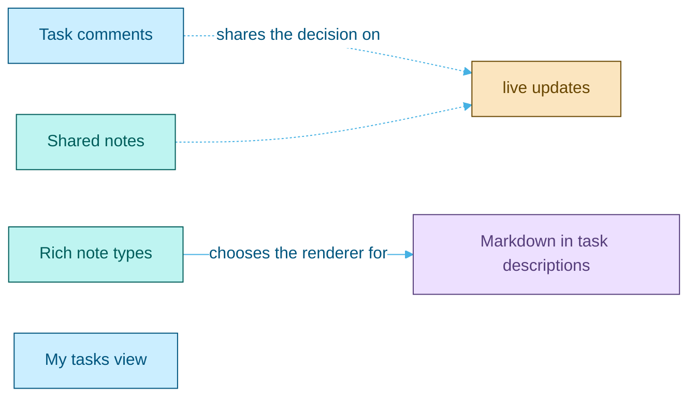

<picture>
  <source media="(prefers-color-scheme: dark)" srcset="assets/brand/header-strip-dark.svg">
  
</picture>

# Roadmap

Ideas on the horizon, waiting for the right wind: what each one would add, why it is not built yet, and what it needs before work starts.

Nothing here is promised or scheduled. Each entry was considered and deliberately left out of the current scope, and stays here so the reasoning is not lost.

| Idea | In one line |
|---|---|
| [Task comments](#task-comments) | A discussion thread on every card |
| [My tasks view](#my-tasks-view) | Every task assigned to you, across all your boards |
| [Shared notes](#shared-notes) | Personal notes you can share with other people |
| [Rich note types](#rich-note-types) | Markdown notes and checklist notes |
| [Markdown in task descriptions](#markdown-in-task-descriptions) | Card descriptions written and shown as Markdown |

## Task comments

A discussion thread on each task: write, edit and delete a comment, with the comment count shown on the task card.

Not built now because a count with no thread behind it shows a number the user cannot act on, and the thread itself is a feature of its own size: a new model, its permissions (who may edit or delete a comment), notifications, and possibly live updates while the task is open.

Needs before work starts:

- A design for the thread inside the task modal.
- The permission rules for editing and deleting, consistent with the board roles.
- A decision on live updates, which ties into the server push transport that the server state layer is built to accept.

## My tasks view

A page listing every task assigned to the signed-in user across all their boards, with filters by board, label and due date, and the same quick complete Up next offers.

Not built now because Up next on Home covers the daily need with its five soonest tasks, and its "+N more" count is enough to signal that more exist.

Needs before work starts:

- A design for the page and its place in the sidebar navigation.
- Pagination and the indexes behind a query across boards, since a user may own tasks on many large boards.
- The filters it offers and whether they persist per user.

## Shared notes

Sharing a personal note with other users, as Google Keep does. The note keeps one owner; each collaborator can read and edit it and can leave it, which removes it from their own notes without touching anyone else's copy. Only the owner can delete the note.

Not built now because notes start as a personal notebook, where access is simply "yours or not found", and sharing brings collaborators, invitations and concurrent edits with it.

Needs before work starts:

- How a collaborator is invited: by email of an existing user, or also of someone without an account.
- Which per-user state stays personal on a shared note, such as pinning and its colour.
- How concurrent edits are resolved, at minimum detecting that the note changed since it was opened.
- Whether the owner can remove a collaborator, and what each side sees when the owner deletes the note.

## Rich note types

Two kinds of note in place of the single plain text one: a text note whose body is Markdown, and a checklist note whose body is a list of items to tick, as Google Keep offers.

Not built now because a plain text body needs no renderer and puts no user-written markup on the page, which keeps the Content Security Policy and the attack surface where they are.

Needs before work starts:

- A Markdown renderer that never emits raw HTML, plus sanitization of its output, and the subset of Markdown allowed.
- The editor for each kind, and whether a note can be converted between the two.
- The migration of existing plain text notes, which are valid Markdown except for characters that Markdown reads as syntax.
- How search and the four line preview on Home treat each kind.

## Markdown in task descriptions

The description of a board task written and shown as Markdown, with the same renderer and rules as Markdown notes.

Not built now for the same reason as rich notes, and because both should share one renderer and one sanitization policy rather than grow two.

Needs before work starts:

- The renderer and policy chosen for rich notes.
- A preview or toggle in the task modal, which edits the description in a plain textarea.
- How a description appears where it is shortened, should the card ever show it.

---

[Back to the README](../README.md) · Previous: [API](API.md)
