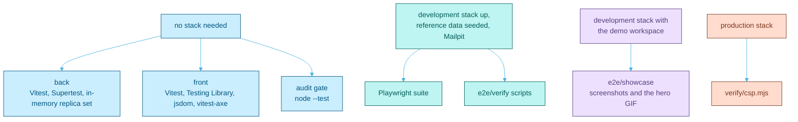
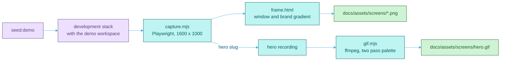

<picture>
  <source media="(prefers-color-scheme: dark)" srcset="assets/brand/header-strip-dark.svg">
  
</picture>

# Testing

Four layers of weather testing, from a still room to a full gale: unit tests, a real browser, standing scripts against the live stack, and a camera that photographs the product.



## Quick path

| Where | Command | Checks |
|---|---|---|
| `back` | `npm run lint` | ESLint |
| `back` | `npm test` | Vitest with an in-memory MongoDB replica set, no database to start |
| `back` | `npm run openapi:check` | `docs/openapi.yaml` matches the route schemas |
| `front` | `npx eslint src/` | ESLint |
| `front` | `npm run build` | The type check (`tsc -b`) and the production bundle |
| `front` | `npx vitest run --no-file-parallelism` | Unit and component tests |
| `e2e` | `npm run typecheck` | The Playwright specs and config compile |
| `e2e` | `npx playwright test` | The browser suite, against the running development stack |
| `e2e` | `npm run verify` | The standing scripts, against the running development stack |
| repository root | `node --test scripts/audit-gate.test.mjs` | The tests of the audit gate |
| repository root | `node scripts/audit-gate.mjs` | No vulnerable dependency in any package |

The first seven rows and the two audit rows are what CI runs, described in [CI.md](CI.md). Playwright and the verify scripts need the whole stack, so they stay local gates.

## Backend

- Runner: Vitest with Supertest driving the Express app. `npm test` runs once, `npm run test:watch` watches.
- Database: `test/globalSetup.js` starts one single node `MongoMemoryReplSet` for the whole run. A replica set, not a standalone server, because registration and the board delete cascade use transactions. `test/setup.js` connects per file and empties every collection after each test.
- Files run one at a time (`fileParallelism: false`), since they share one `mongod`. The first run downloads a `mongod` binary.
- Factories for users, boards, tasks, reference data and a capturing mail transport live in `test/helpers/`.
- The rate limiters skip themselves under `NODE_ENV=test`. A test that proves a route sits behind its limiter switches `rateLimitTesting.enabled` on.
- `[env] ... Using the default` warnings in the log are expected: they come from the tests of the variable validation.

## Frontend

- Runner: Vitest with jsdom and Testing Library, plus `vitest-axe` for accessibility. Tests sit next to the code as `*.test.ts` and `*.test.tsx`.
- `npx vitest run --no-file-parallelism` is what CI runs. With files in parallel a loaded machine trips the default `waitFor` timeouts. `npm test` is plain `vitest run`, in parallel.
- Stylesheets are not loaded (`css: false`), so anything about layout belongs to the verify scripts.
- `npm run build` is the type check. `npx tsc --noEmit` checks nothing here, because the root `tsconfig.json` holds only project references.

## Playwright

The browser suite in `e2e/tests` covers the core loop, editing and deleting boards and cards, column management, the profile and the password reset by mail. It runs Chromium at 1440 by 900, one worker, one retry, with a trace and a video kept on the retry only: drag and drop is sensitive to pointer timing, and recording from the first attempt would change it.

```bash
docker compose up -d --build
docker compose exec back npm run seed:templates
cd e2e
npm ci
npm run install:browsers
npx playwright test
```

Mailpit must be up, because the reset spec reads the link from its HTTP API. `npm run report` opens the last HTML report, and `npm run test:headed` and `npm run test:ui` are there for watching it work.

## Standing verify scripts

Scripts that drive the running stack and assert what a unit test structurally cannot see: a real browser, real time, a real database, the production CSP. Each one prints `PASS` or `FAIL` per assertion and exits non-zero on the first failure, so they read as a checklist. Run them from `e2e/` after touching authorization, the session model, the API surface, layout or design tokens, and before a pull request that does.

`npm run verify` runs every script except `idle` and `csp`. Each script registers its own accounts, so only the reference data needs seeding.

<details>
<summary><strong>Every script and what it asserts</strong></summary>

| npm script | File | What it asserts |
|---|---|---|
| `verify:auth` | `authorization.mjs` | Two real accounts. An outsider is refused reading or changing another user's board and tasks, a member who did not create the board can act, and the owner still can. The positive cases matter: a gate that denied everyone would pass every refusal |
| `verify:session` | `session.mjs` | The renewal header is there, the token differs from the one sent, `sessionStartedAt` survives while `exp` advances, a 404 still renews, `ping` answers 204 with `no-store`, and a token is dead on its next use after logout |
| `verify:api` | `api-surface.mjs` | `/api` and `/api/v1` answer identically, `X-Request-Id` is echoed or generated, pagination keeps its total with and without `limit`, and every error body carries a `code` |
| `verify:drafts` | `drafts.mjs` | Drafts in the task modal and the column composer survive a reload, an empty form is never written, Done drops the draft, closing keeps it, and Blow it away drops it |
| `verify:integrity` | `integrity.mjs` | Deleting a board removes it and its tasks in a transaction, which needs the replica set, and a soft deleted task is unreachable until a restore brings back the same task in the same place |
| `verify:workspaces` | `workspaces.mjs` | Four real accounts through the two level access model, the workspace admin exception, and that adding someone to a board admits them to its workspace |
| `verify:a11y` | `accessibility.mjs` | axe on every main surface and dialog, as a ratchet whose budget only goes down, plus a contrast sweep after every scan with four probes of known colour that prove it measures something |
| `verify:layout` | `rendered-layout.mjs` | Controls land inside their parent on the rendered page, asserted as containment rather than coordinates |
| `verify:board` | `board-layout.mjs` | At 390, 1024 and 1440 pixels: no page scroll, columns in one focusable horizontal scroller, long columns scroll inside themselves, and a card held at the edge auto-scrolls and lands in another column |
| `verify:responsive` | `responsive.mjs` | Every main surface at 320, 390, 768, 1024 and 1440 pixels: no sideways scroll, no clipped or overlapping control, targets of at least 24 pixels, and the task modal as a bottom sheet on a phone and a centered dialog from 768 |
| `verify:tokens` | `design-tokens.mjs` | Design tokens on a rendered page: computed styles, loaded font faces, painted pixels and contrast. Tailwind 4 turns an undeclared token into a silent no-op, so this is where one shows up |
| `verify:idle` | `idle.mjs expire` | Signs in and sits still: zero API calls while idle, the warning 60 seconds before expiry that never dismisses itself, and the sign out to the login page |
| `verify:idle-extend` | `idle.mjs extend` | The warning's action pings and carries the session past its original deadline |
| `verify:csp` | `csp.mjs` | Against the production stack: zero CSP violations, console errors and failed requests, no cross-origin request, fonts and an uploaded avatar served from the application origin |

</details>

`observe.mjs` and `contrast.mjs` are helper modules the scripts import, not scripts of their own.

### The idle and CSP runs

`idle.mjs` needs an inactivity window short enough to wait out:

```bash
JWT_INACTIVITY_TTL_MS=90000 docker compose up -d --force-recreate back front
cd e2e && npm run verify:idle && npm run verify:idle-extend
docker compose up -d --force-recreate back front
```

The last line restores the normal 15 minute window. The inactivity window only works because nothing in the client polls, and this script is the one thing that would notice a stray interval.

`csp.mjs` needs the production stack, because the policy is served by nginx and does not exist in the Vite dev server. Start it with the command in [ENVIRONMENT.md](ENVIRONMENT.md#trying-the-production-stack-locally), then run `npm run verify:csp`.

> [!TIP]
> A full `npm run verify` plus Playwright registers roughly fifteen accounts. Development raises `REGISTRATION_LIMIT_PER_HOUR` to 500, but if a 429 ever shows up, usually as a browser test timing out, `docker compose restart back` clears the in-memory counter.

## The showcase pipeline

The screenshots and the hero animation in the README are taken by a script, not by hand, so they always show the product as it is. `capture.mjs` signs in as the demo account and photographs each screen in a fixed window, `frame.html` wraps each shot in a browser frame on the brand gradient, and `gif.mjs` turns the recorded hero flow into the GIF with ffmpeg.



From `e2e/`, with the password the demo was seeded with and ffmpeg on the PATH:

```bash
export DEMO_PASSWORD=<password>
npm run showcase
npm run showcase:gif
```

| Variable | Default | Meaning |
|---|---|---|
| `DEMO_PASSWORD` | None, required | The password of the demo account |
| `SHOWCASE_BASE` | `http://localhost:5173` | The page to capture |
| `SHOWCASE_API` | `http://localhost:5000/api/v1` | The API, used only to put the hero card back |
| `SHOWCASE_EMAIL` | `demo@breezyboard.local` | The demo account |
| `SHOWCASE_OUT` | `docs/assets/screens` | Where the framed shots and the animation are written |
| `SHOWCASE_FRAME_SCALE` | `1.25` | The pixel density of the framed shots |
| `SLUGS` | Every still | A comma separated list of shots to take |
| `FFMPEG` | `ffmpeg` | The ffmpeg executable |

The shots stay identical from run to run: the window is fixed, the clock answers a fixed morning, the data comes from the deterministic demo seed, and a shot fails while a loading indicator or a notice is on screen. The pipeline never confirms a dialog, and the only write it makes is the hero drag, which it undoes through the API. The full maintenance notes are in [e2e/showcase/README.md](../e2e/showcase/README.md).

## One rule for fixes

Every bug fix lands with a test that fails without it and passes with it. For a defect only a browser can see (layout, tokens, focus) that test is a verify assertion, because jsdom loads no stylesheet. A gate that cannot fail is not a gate: security checks carry positive cases next to their refusals, ratchets must not flap, and a sweep carries a probe that proves it measures.

---

[Back to the README](../README.md) · Previous: [Environment](ENVIRONMENT.md) · Next: [CI](CI.md)
