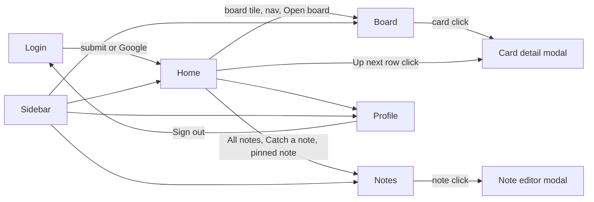

# BreezyBoard redesign - design specification

Source: `prototype/BreezyBoard.dc.html`, the Claude Design export that is the reference for Phase 6b of `docs/REVIVAL-PLAN.md`. The file renders only inside Claude Design, whose runtime is not vendored here, so this document is the readable form of it. All values below are copied from the source unless marked "approx". Hex values for oklch colors are computed conversions (sRGB, gamut-clipped) and are approximate; the oklch value is the source of truth. Where the prototype and the plan disagree (accessibility, mobile, scope), the plan wins.

## 1. Overview

The prototype is a single-page, 5-view app with a login gate, built as one React-style class component (`DCLogic`) with seeded in-memory data. There is no router; a `view` state string switches the visible screen.

Views (`view` state, also the `startScreen` prop enum `login | home | board | notes | profile`):

- Login / Sign up (one screen, two modes via `authMode: signin | signup`).
- Home (dashboard): hero banner, "Your boards" grid, "Up next" list, "Pinned notes".
- Board (kanban): editable title, progress, members, add column, columns of draggable cards, empty-board hero, per-column inline card composer.
- Notes: header with color filter and search, composer, "Pinned" and "Everything else" masonry sections, empty state.
- Profile: cover image slot, avatar, About form, "Your breeze" settings with toggles, sign out card.
- Overlays: Card detail modal (z 50), Note editor modal (z 50), Toast (z 70).

Modes and states:

- Props (design-tool editable): `startScreen` (default `login`), `defaultBreeze` (`calm|breezy|gusty`, default `breezy`), `ambientWind` (boolean, default true), `motion` (`full|reduced`, default `full`).
- "Breeze" is an in-product motion intensity setting (Calm / Breezy / Gusty) that scales ambient wind animation density and speed.
- No dark mode exists. No mobile layout exists for the app shell (see section 3). Only the login screen and some inner grids are fluid.
- Empty states: empty board, empty column ("Still air"), empty Up next ("Clear skies"), empty notes ("Nothing caught yet" / "Nothing on the wind").
- Navigation: sidebar (Home, Notes, board list, profile button), logo button goes Home, breadcrumb in header (display only), contextual primary action in header (changes per view), cards/notes open modals. Esc closes modals or the notes composer. Switching view clears open card, open note, palette and add-card state.
- Startup: login prefilled `lucia@breezyboard.app` / `patagonia`. Sign-in has an 850 ms fake loading delay; Google login a 700 ms one. Sign-out in profile and in the header (on Profile view the contextual button is "Sign out") returns to login.

## 2. Design tokens

### 2.1 Color

Ground and surfaces:

- Page ground: `#F3F6F9` (html, body, login right half, avatar-stack ring on board header).
- App background: layered radial gradients over `#F3F6F9`: `radial-gradient(1200px 620px at 8% -12%, oklch(0.92 0.05 232) 0%, transparent 60%)`, `radial-gradient(900px 620px at 100% -5%, oklch(0.95 0.04 192), transparent 60%)`, `radial-gradient(1000px 700px at 85% 112%, oklch(0.955 0.045 82), transparent 60%)`. Approx hexes: `#C4EBFF` (sky blue, top-left), `#D1F8F5` (mint, top-right), `#FFEECF` (sand, bottom-right).
- Card / input surface: `#FFFFFF`.
- Glass surfaces: `rgba(255,255,255,.62)` (sidebar, Up next panel), `.5` (board column, `.82` when drag target), `.7` (sidebar breeze box, add-column button, notes filter pill), `.72` (empty-board hero), `.75` (notes search), `.8` (profile sections), `.85` (board tile), `.6` (notes empty, "New board" dashed tile uses `.35`). All with `backdrop-filter: blur(14px)` or `blur(20px) saturate(1.5)` for the sidebar. Glass borders: `1px solid rgba(255,255,255,.85|.9|.95)`.
- Subtle input fill in card modal description: `#F7F9FB`.
- Scrim for modals: `rgba(15,27,45,.32)` with `backdrop-filter: blur(6px)`.

Text levels:

- Ink / primary: `#0F1B2D` (also primary button fill, toast fill).
- Body on colored notes: `#2E3B4E`; note editor textarea: `#1E2B3D`.
- Secondary: `#4B586B`.
- Tertiary / placeholder / meta: `#8391A4` (placeholder color is set globally).
- Link: `oklch(0.45 0.12 232)` (approx `#005E8C`), hover `#0F1B2D` with underline for `a`.
- Selection: `oklch(0.89 0.065 232)` (approx `#B0E3FF`).

Borders and dividers (all navy alpha): `rgba(15,27,45,.05)` (card border, sidebar profile box), `.06` (dividers in prefs, note compose border), `.07`, `.08` (card/modal inputs, plain note border `rgba(15,27,45,.08)`), `.1` (login divider line, profile inputs), `.12` (default input/button outline), `.14` (dashed "New board" border, scrollbar thumb), `.22` (unchecked checkbox border), `.2` (white note swatch border).

Accent: sky blue hue 232. Ramp pattern used everywhere (hue h):

- `tint(h)` = `oklch(0.93 0.045 h)` chip background.
- `deep(h)` = `oklch(0.42 0.11 h)` chip text.
- `mid(h)` = `oklch(0.72 0.12 h)` dots, bars, avatars, swatch-like fills.
- Note background = `oklch(0.955 0.035 h)`, note border = `oklch(0.9 0.05 h)`, swatch border = `oklch(0.8 0.08 h)`. White note: bg `#FFFFFF`, border `rgba(15,27,45,.08)`.
- Cover gradient for a hue: `linear-gradient(120deg, oklch(0.5 0.13 h) 0%, oklch(0.66 0.12 (h+30)%360) 60%, oklch(0.83 0.09 (h+60)%360) 100%)`.

Hue map (the whole system is hue-keyed):

| Hue | Name | tint approx | deep approx | mid approx |
|---|---|---|---|---|
| 232 | sky blue (accent, Dev label, board 1) | `#CBEEFF` | `#00557E` | `#46B1E3` |
| 192 | teal (Trip label, member MA) | `#C6F2EF` | `#005E5C` | `#1ABCB8` |
| 150 | green (success, Research, "landed") | `#D4F1D8` | `#0B5D2A` | `#69BA7C` |
| 82 | sand / amber (warning, Copy, Today due) | `#F7E6C7` | `#6A4500` | `#CA9D42` |
| 38 | coral (danger, Urgent, overdue, avatar default) | `#FFDED3` | `#7D331B` | `#E4896C` |
| 300 | lavender (Design label, member JP) | `#ECE2FF` | `#573C7F` | `#B093E5` |

Specific accent values:

- Interactive blue: `oklch(0.55 0.13 232)` (`#007DB0`, active nav icon, Breeze icon, feather icon), `oklch(0.62 0.13 232)` (`#0092C6`, focus border, toggle ON track), `oklch(0.7 0.12 232)` (add-card textarea border and description focus), `oklch(0.72 0.12 232)` (dashed tile hover border), `oklch(0.62 0.12 232)` (empty column wind icon).
- Focus ring: `0 0 0 4px oklch(0.74 0.13 232 / .22)` (inputs), `.2` (profile/search), `.18` (add-card textarea), `.25` with 3px (board title input).
- Primary button hover fill: `oklch(0.3 0.08 248)` (approx `#013053`).
- Success: `oklch(0.6 0.13 150)` (done-check icon), `oklch(0.5 0.11 150)` (plane-arrival icon), `oklch(0.62 0.12 150)` (complete-circle hover border), checkbox done fill `mid(150)`. Checklist progress gradient: `linear-gradient(90deg, oklch(0.72 0.12 192), oklch(0.68 0.13 150))`. Board progress gradient: `linear-gradient(90deg, mid(boardHue), mid(150))`.
- Danger: error banner bg `oklch(0.955 0.035 38)` text `oklch(0.42 0.11 38)`; "Blow it away" text `oklch(0.48 0.13 38)`, hover bg `oklch(0.955 0.035 38)`; sign-out hover border `oklch(0.6 0.13 38)` text `oklch(0.45 0.12 38)`.
- Warning / amber: "Clear skies" circle `oklch(0.955 0.035 82)`, sun icon `oklch(0.55 0.12 82)`.
- Toast icon: `oklch(0.82 0.1 192)` on `#0F1B2D`.

Due-date chips (`dueTone`): overdue (d<0) = tint(38)/deep(38); today or tomorrow (d<=1) = tint(82)/deep(82); otherwise `rgba(15,27,45,.06)` / `#4B586B`. Done-column cards hide the due chip.

Labels (name, hue): Design 300, Dev 232, Copy 82, Urgent 38, Research 150, Trip 192. There is no separate "priority" scale; "Urgent" is a label.

Members (initials, hue): LF 38, MA 192, JP 300, SR 82. Avatar fill `mid(hue)`, text `#0F1B2D`. Profile avatar: `oklch(0.74 0.13 38)` (approx `#F08C6D`).

Column dots: hue by index `[232, 82, 300, 192, 38]` as `mid(h)`; the last column always `mid(150)` green. Board hues cycle `[232, 150, 38, 300, 192, 82]`. Note hues: `[null(white), 232, 192, 150, 82, 38, 300]`.

Gradients (hero / login):

- Login panel: `radial-gradient(800px 520px at 88% 12%, oklch(0.72 0.11 192 / .55), transparent 60%), radial-gradient(700px 520px at 0% 105%, oklch(0.74 0.13 38 / .4), transparent 60%), linear-gradient(165deg, #0F1B2D 0%, oklch(0.34 0.09 248) 52%, oklch(0.5 0.11 222) 100%)`.
- Home hero: `radial-gradient(500px 300px at 92% 0%, oklch(0.86 0.1 82 / .55), transparent 70%), linear-gradient(118deg, oklch(0.36 0.1 250) 0%, oklch(0.55 0.12 222) 55%, oklch(0.74 0.1 192) 100%)`, shadow `0 30px 60px -36px oklch(0.4 0.12 240 / .8)`.
- Profile cover fallback: `linear-gradient(118deg, oklch(0.4 0.1 250), oklch(0.6 0.11 210), oklch(0.8 0.09 82))`.
- Accent word "wind.": `linear-gradient(90deg, oklch(0.88 0.12 82), oklch(0.78 0.14 38))` clipped to text (approx `#FFD077` to `#FF9674`).
- Sidebar logo tile: `linear-gradient(135deg, oklch(0.55 0.14 248), oklch(0.74 0.12 192))`, shadow `0 8px 18px -8px oklch(0.55 0.14 232 / .8)`.

### 2.2 Typography

Google Fonts link (exact): `https://fonts.googleapis.com/css2?family=Bricolage+Grotesque:opsz,wght@12..96,400..800&family=Instrument+Sans:wght@400..700&family=DM+Mono:wght@400;500&display=swap` (with preconnect to `https://fonts.googleapis.com`). Icons: Tabler Icons webfont `https://cdn.jsdelivr.net/npm/@tabler/icons-webfont@3.19.0/dist/tabler-icons.min.css` (classes `ti ti-*`).

Families: Display `'Bricolage Grotesque'` (variable opsz 12..96, wght 400..800); Body `'Instrument Sans', system-ui, sans-serif` (400..700); Mono `'DM Mono'` (400, 500). Body has `-webkit-font-smoothing: antialiased`. Buttons/inputs inherit font and color.

Type roles (size / weight / tracking / line-height):

| Role | Spec |
|---|---|
| Logo wordmark (login) | Bricolage 22px, -0.03em, 800 for "breezy", 400 for "board" |
| Logo wordmark (sidebar) | Bricolage 21px, -0.03em, 800 / 400 |
| Login hero h1 | Bricolage 700, `clamp(44px, 5vw, 66px)`, lh .98, -0.035em, `text-wrap:balance` |
| Login hero paragraph | Instrument 17px, lh 1.55, white .88 |
| Auth title h2 | Bricolage 700 38px, -0.03em |
| Auth subtitle | 15px lh 1.5, `#4B586B` |
| Home hero h1 | Bricolage 700 `clamp(36px, 4vw, 52px)`, lh 1, -0.035em |
| Home hero paragraph | 16px lh 1.5 white .9 |
| Section h2 (Your boards, Up next, Pinned notes) | Bricolage 650 24px, -0.02em |
| Page title (Notes h1) | Bricolage 700 40px, -0.035em |
| Board title input | Bricolage 700 36px, -0.035em |
| Profile name | Bricolage 700 34px, -0.03em |
| Empty-state title | Bricolage 700 26px, -0.02em |
| Card modal title input | Bricolage 700 28px, -0.025em |
| Note editor title | Bricolage 700 26px, -0.02em |
| Compose title | Bricolage 650 19px |
| Board tile name | Bricolage 650 17px, -0.01em |
| Note title (masonry) | Bricolage 650 17px, -0.01em; home pinned 16px |
| Panel title (profile) | Bricolage 650 20px |
| Body default | Instrument Sans 14-16px |
| Card title | 600 14.5px lh 1.35 `text-wrap:pretty` |
| Nav item | 600 14px |
| Board nav item | 14px, 600 active / 500 inactive |
| Form label | 600 13px (login), 12.5px (profile), `#4B586B` |
| Input text | 15px (44-48px tall) |
| Chip / label | 600 11.5px (card), 12.5px (modal toggle) |
| Meta (due, checklist) | 12px, 600 for due chip, 500 for checklist |
| Mono caps eyebrow | DM Mono 11px, letter-spacing .1em, `#8391A4` ("BOARDS", "MOVE TO", "LABELS", "DUE", "DESCRIPTION", "CHECKLIST", "PINNED", "EVERYTHING ELSE") |
| Mono small | DM Mono 10.5-11.5px (counts, wind speed, edit times, key hints) |
| Mono hero date | DM Mono 12px, .12em |
| Mono postcard caption | DM Mono 10.5px, .08em, `#4B586B` |
| Mono badge login | DM Mono 11.5px, .08em, uppercase text "HECHO EN PATAGONIA · 50°20′S" |

### 2.3 Spacing, radii, shadows

Spacing is ad hoc (no token scale). Recurring values: gaps 2, 3, 4, 5, 6, 8, 10, 12, 14, 16, 18, 20, 22, 24, 28, 30; paddings 8-16 for components, 22-40 for panels. Sidebar margin 12px; main padding `12px 18px 0 22px`; content scroll padding `8px 4px 32px`; header height 56px.

Radii (px): 4 (board dot), 6 (checkbox, progress), 8 (small chips, count pills), 9-10 (small buttons), 11-14 (buttons and inputs: 12 default, 13 header action, 14 auth inputs), 16 (cards, submit button), 18 (login mini-cards, home photo), 20 (notes), 22 (tiles, panels, glass sections), 24 (columns, sidebar, profile sections), 26 (modals, empty-board hero), 28 (home hero, card modal, profile cover), 30 (login panel), 50% and 99px (pills, avatars, circles).

Shadows (signature: large negative spread, navy alpha):

- Active nav/board item: `0 6px 16px -10px rgba(15,27,45,.35)`.
- Card resting: `0 1px 0 rgba(15,27,45,.04), 0 8px 20px -16px rgba(15,27,45,.35)`; hover `0 18px 30px -18px rgba(15,27,45,.45)`.
- Column: `0 16px 40px -32px rgba(15,27,45,.4)`.
- Sidebar: `0 20px 50px -30px rgba(15,27,45,.35)`.
- Board tile `0 14px 34px -24px rgba(15,27,45,.4)`, hover `0 26px 44px -24px rgba(15,27,45,.45)`.
- Modals: `0 40px 80px -30px rgba(15,27,45,.55)`.
- Primary button: `0 12px 24px -14px rgba(15,27,45,.7)` (header), `0 14px 30px -14px rgba(15,27,45,.6)` (submit), hover `0 20px 36px -14px rgba(15,27,45,.6)`.
- Login postcard `0 34px 60px -26px rgba(0,0,0,.6)`; login floating cards `0 30px 60px -24px rgba(0,0,0,.5)`.
- Toast `0 20px 40px -18px rgba(15,27,45,.7)`.
- Toggle knob `0 2px 6px rgba(15,27,45,.25)`. Segmented selected `0 2px 8px -3px rgba(15,27,45,.3)`.
- Note hover `0 18px 34px -20px` / `0 20px 34px -22px rgba(15,27,45,.4|.45)`.

Selected-swatch ring: `0 0 0 2px #fff, 0 0 0 4px #0F1B2D`.

### 2.4 Z-layers and breakpoints

- z 1: main. z 2: sidebar. z 50: modal scrims. z 70: toast. Wind layers are absolute, `pointer-events:none`, in the DOM before content (sidebar and main are positioned above them).
- No `@media` width breakpoints. Responsiveness relies on `auto-fit/auto-fill` grids and `flex-wrap`. The only media query is `prefers-reduced-motion`.
- Scrollbars: `::-webkit-scrollbar` 10x10, thumb `rgba(15,27,45,.14)`, radius 10, 3px transparent border, `background-clip: padding-box`.

## 3. Layout per screen

### Login

- Root: `min-height:100vh`, grid `repeat(auto-fit, minmax(min(100%, 440px), 1fr))`, bg `#F3F6F9`. Two columns on wide screens, stacks below about 880px (2x440) with no explicit breakpoint.
- Left brand panel: margin 14px, radius 30px, `min-height: min(800px, calc(100vh - 28px))`, padding `36px 44px 40px`, flex column `space-between` gap 28, white text, `overflow:hidden`, gradient above, wind layer (light) behind.
  - Top: logo tile 36x36, radius 12, `rgba(255,255,255,.14)` fill, `1px rgba(255,255,255,.25)` border, 22px SVG wind mark; wordmark.
  - Middle: 320px tall composition of three absolutely positioned items (see section 6).
  - Bottom: h1, paragraph (max 460), meta row with mono pill (`1px rgba(255,255,255,.32)` border, radius 99, padding `4px 10px`) and the line "Built where the wind never takes a day off." (13px, white .82). Container max-width 560.
- Right form column: flex center, padding `40px 24px`; form `max-width:400px`, gap 18. Order: title + subtitle, Google button (48px), "OR WITH EMAIL" divider, [Your name - signup only], Email, Password (with show/hide button and "Forgot it?" link in signin), optional error banner, submit (52px), switch line.

### App shell

- Root: `height:100vh`, grid `252px minmax(0,1fr)`, `overflow:hidden`, the three-gradient background, ambient wind layer (dark tone).
- Sidebar (`aside`): margin `12px 0 12px 12px`, padding `18px 12px 12px`, radius 24, glass (`rgba(255,255,255,.62)`, blur 20 saturate 1.5, `1px rgba(255,255,255,.85)`), flex column gap 18, `min-height:0`. Sections top to bottom: logo button; nav (Home, Notes with 40px items); BOARDS area (mono label + 26px "+" button, scrolling list of 38px items); Breeze box; profile button.
- Main: flex column, padding `12px 18px 0 22px`. Header 56px: breadcrumb left (icon 17px + section, chevron, board name in ink 600), spacer, contextual primary button right. Below, scrolling content area `overflow:auto`, padding `8px 4px 32px`.
- No collapse, hamburger, or bottom nav exists. At phone widths the 252px sidebar would consume most of the screen: the app shell is desktop-only in this prototype.

### Home

Container `max-width:1240px`, gap 30, enters with `bbView`.

- Hero: radius 28, padding `34px 40px 36px`, `min-height:240px`, white text, flex wrap, `justify-content:space-between`, align center, gap 28. Left block (`flex:1 1 340px`, max-width 600): date eyebrow (static text `THURSDAY · OCTOBER 8`), h1 greeting (`Good morning, {firstName}.`, always "Good morning"), line (dynamic: "{n} card(s) need(s) you today. The wind's in your favor." or "Clear skies: nothing due today. Go catch an idea."), buttons row (white "Open {first board name}" with kanban icon; glass "Catch a note" with feather icon). Right block: tilted photo frame 240x164 (white .92, padding 6, radius 18, rotate 3deg, image slot radius 13) plus a glass pill "El Calafate · {breezeHint} W" with swaying wind icon.
- "Your boards": heading + count label; grid `repeat(auto-fill, minmax(240px, 1fr))` gap 16. Tile: radius 22, cover 96px tall (hue cover gradient with 2 white wavy lines SVG, overlapping member avatars bottom-right 26px), body padding `14px 16px 16px` (name, description 13px, 6px progress bar in `mid(hue)` plus mono `done/total`). Last cell: dashed "New board" tile (min-height 196, `2px dashed rgba(15,27,45,.14)`, radius 22, 44px white icon square, "New board", "Four columns, ready for take-off").
- Two-column row: grid `repeat(auto-fit, minmax(min(100%, 380px), 1fr))` gap 24, `align-items:start`. "Up next" (panel radius 22, glass .62, blur 14, padding 8, rows padding 12 radius 14) with up to 5 non-done cards that have a due date sorted ascending; "Pinned notes" grid `repeat(auto-fill, minmax(200px,1fr))` gap 12, max 4 pinned notes, body clamped to 4 lines.

### Board

Container `height:100%`, `min-height:520px`, flex column gap 18.

- Header row (wrap, `align-items:flex-end`, gap `16px 28px`): left = 56px cover square (radius 18, hue cover gradient, white two-stroke wind mark SVG) + editable title input (36px, transparent, `padding 0 8px; margin-left:-8px`, hover bg `rgba(255,255,255,.6)`, focus white bg + 3px ring) + description (14.5px `#4B586B`); right = progress (190px wide: "{done} of {total} landed" + mono %, 8px bar), overlapping member avatars (32px, `2.5px solid #F3F6F9` ring, -8px overlap), "Add column" button (38px, glass).
- Empty-board hero (only when the board has 0 cards): radius 26, glass .72, padding `16px 24px 16px 16px`, image slot 240x150 (radius 18) + title "A fresh board. The wind's at your back." + body + dark button "Add your first card".
- Column rail: flex row, gap 14, `align-items:flex-start`, `overflow-x:auto`, `padding-bottom:10px`. Column: `flex:0 0 292px`, `max-height:100%`, radius 24, bg `rgba(255,255,255,.5)`, `1.5px solid rgba(255,255,255,.85)`, blur 14. Header: rotated 10px dot (rotate 12deg, radius 3), editable name input (700 14.5px, transparent, focus white), plane-arrival icon on last column, count pill (mono 11.5, 22px high, `rgba(15,27,45,.06)`). Card list: padding `2px 10px 10px`, gap 10, `overflow-y:auto`. Footer: "Add a card" ghost button (40px) or inline composer.
- Cards: white, radius 16, padding `12px 14px`, gap 9; sections: labels row (chips radius 99), title row (green filled check icon 17px if in last column, title `#4B586B` when done), meta row (due chip, checklist `n/m` with list-check icon (green `deep(150)` when complete), comment count, avatar stack 24px right-aligned).

### Notes

Container `max-width:1240px`, gap 22.

- Header: title/subtitle left; right = color filter pill (`padding 5px`, radius 99, 7 circular 24px swatches: first is "All" with layout-grid icon, then white and 6 hues; selected = double ring) + search input (220x40, radius 13, search icon at left 13px).
- Composer: `width:100%`, `max-width:640px`, centered, radius 22, bg follows chosen color, border `rgba(15,27,45,.06)`, shadow `0 20px 40px -26px rgba(15,27,45,.45)`. Collapsed: 58px row "Catch a thought..." with feather icon (21px, `oklch(0.55 0.13 232)`) and right icons list-check and palette (decorative; not wired). Expanded: title input 19px, 3-row textarea 15px, swatches 22px, mono hint "⌘↵ TO KEEP", Close and "Keep it" buttons (34px).
- Sections "PINNED" (pin icon) and "EVERYTHING ELSE": CSS multi-column masonry `columns:240px; column-gap:14px`, items `break-inside:avoid; margin-bottom:14px`. Note card radius 20, padding `16px 16px 8px`. Footer row: mono edit time (10.5px) then 30px circular icon buttons (pin, palette, trash) at opacity .65 -> 1 on hover with `rgba(15,27,45,.07)` fill. Palette reveals an inline row of 22px swatches.
- Empty (no results or no notes): glass panel radius 28, padding 28, image slot 260x180 (radius 20) + title + sub + dark CTA.

### Profile

Container `max-width:1000px`, gap 24.

- Cover: 220px tall, radius 28, gradient fallback + full-bleed image slot. Avatar 116px circle with `5px solid #F3F6F9` ring overlapping by `margin-top:-58px`, initials in Bricolage 40/700. Name 34px and a line "{location} · Breezing since March 2025" (map-pin icon). Row is `pointer-events:none`.
- Grid `repeat(auto-fit, minmax(min(100%, 380px), 1fr))` gap 18: left "About you" panel (Name, Email, Location 44px inputs radius 12, Bio 3-row textarea); right column: "Your breeze" panel (segmented control 38px buttons + three toggle rows) and "Sign out" card.

### Overlays

- Card detail modal: scrim `position:fixed; inset:0`, padding `48px 20px`, content top-aligned. Panel `max-width:680px`, radius 28, white. 100px hue-gradient header with calm wind layer, glass pill top-left "{board} · {column}" (kanban icon), 36px round close button top-right (rotates 90deg on hover). Body padding `20px 28px 24px`, gap 22: title input; "MOVE TO" column buttons (34px, radius 11, selected = ink fill); two-column grid `repeat(auto-fit, minmax(240px,1fr))` gap 20 with LABELS (30px pill toggles with plus or check icon) and DUE (None / Today / Tomorrow / In a week, 30px, radius 10); DESCRIPTION textarea; CHECKLIST with 6px gradient progress, items (20px square checkbox radius 6, remove x), add-item input; footer with "Blow it away" ghost-danger (wind icon) and "Done" dark button.
- Note editor modal: padding `72px 20px`, panel `max-width:600px`, radius 26, bg = note color (transitions .35s), padding `22px 24px 16px`; title input + pin button, 9-row textarea 16px/1.6, footer with 24px swatches, mono "EDITED {time}", trash (36px), "Done" (36px).
- Toast: fixed, `left:50%; bottom:28px`, centered by `translateX(-50%)`, pill radius 99, bg `#0F1B2D`, padding `8px 8px 8px 16px`, `white-space:nowrap`, 14px/500, wind icon `oklch(0.82 0.1 192)`, optional "Catch it" undo button (32px, `rgba(255,255,255,.14)`, hover `.26`). Auto dismiss 4200 ms.

## 4. Components inventory

Buttons:

- Primary dark: bg `#0F1B2D`, white text, 600; heights 52 (submit, radius 16), 40 (header, radius 13; empty-state radius 12), 36-34 (modal/composer, radius 10). Hover (submit/header): `translateY(-2px|-1px)`, bg `oklch(0.3 0.08 248)`, deeper shadow. Loading state: spinner `ti-loader-2` with `bbSpin .8s linear infinite`, text changes ("Signing in...", "Creating your space...").
- Secondary white (outline): login Google button (48px, radius 14, `1.5px solid rgba(15,27,45,.12)`, white, hover lift -1px, border `.25`, shadow `0 10px 24px -14px rgba(15,27,45,.35)`); sign out button (38px, radius 12, hover border/text coral).
- Hero white button (42px, radius 13, hover lift -2px + shadow) and hero glass button (`rgba(255,255,255,.14)`, `1px rgba(255,255,255,.45)`, blur 8, hover `.26`).
- Glass button: "Add column" (38px, `rgba(255,255,255,.7)`, `1px rgba(255,255,255,.95)`, hover `#fff` + lift).
- Ghost: "Done" in composer (transparent, `#4B586B`, hover `rgba(15,27,45,.06)`), "Add a card" (full width 40px, hover `rgba(255,255,255,.9)` + ink text), "Blow it away" (coral).
- Icon buttons: round 36-38 (modal close, pin), 30 (note actions), 26 (checklist remove, BOARDS "+" which rotates 90deg on hover), 36 square radius 10 (password toggle).
- Text link buttons: "All notes ->" 13px 600 link blue; auth switch (link blue, hover ink).
- Pill toggles: label toggles (radius 99, `1.5px` border; on = tint bg + deep text + `mid(h)` border + check icon; off = white + `#4B586B` + plus icon), column pickers and due pickers (selected = ink fill, white text).
- Segmented control (Breeze): container radius 11 (sidebar, 28px buttons, padding 3, gap 3) or 14 (profile, 38px buttons, padding 4); track `rgba(15,27,45,.05)`; selected = white bg, ink text, shadow `0 2px 8px -3px rgba(15,27,45,.3)`; unselected transparent, `#4B586B`.
- Toggle switch: 44x26 track radius 99, OFF `rgba(15,27,45,.16)`, ON `oklch(0.62 0.13 232)`, knob 20px white at `top:3px left:3px`, ON `translateX(18px)`, track `.25s`, knob `.3s cubic-bezier(.3,1.4,.5,1)` (overshoot spring).

Inputs:

- Text input (auth): 48px, radius 14, `1.5px solid rgba(15,27,45,.12)`, white, padding `0 16px`, 15px; focus `border-color oklch(0.62 0.13 232)` + `0 0 0 4px oklch(0.74 0.13 232 / .22)`, transition `.2s`. Outline removed (`outline:none`) and replaced by the ring. Password input has right padding 48 for the toggle.
- Profile input: 44px, radius 12, `1.5px solid rgba(15,27,45,.1)`.
- Inline-edit inputs (board title, column name, card title): transparent, no border; hover/focus reveal a soft background (`rgba(255,255,255,.6)` -> `#fff` + ring; column name focus `#fff`; card title `rgba(15,27,45,.04)`).
- Textareas: card add (2 rows, radius 14, `1.5px solid oklch(0.7 0.12 232)`, ring `.18`), description (radius 14, `#F7F9FB`, focus white + blue border), bio (resize vertical).
- Search input with left icon.
- Swatch (color) picker: circles 22/24px with border `swatchBorder(h)`, selected double ring, hover `scale(1.15)`.
- Error banner: coral tint, radius 12, padding `10px 14px`, wind icon, `bbUp` entrance. Messages: "Tell us what to call you.", "That email looks a little windswept. Check it?", "Passwords need at least 6 characters to stay put.". Failed submit shakes the form (see 5).

Chips / badges:

- Label chip: 11.5px 600, padding `3px 9px`, radius 99, tint/deep colors.
- Due chip: 12px 600, padding `3px 8px` (`4px 9px` in Up next), radius 8-9, calendar icon, 4px gap.
- Count pill: mono 11.5px, min-width 24, height 22, radius 8, `rgba(15,27,45,.06)`.
- Nav counts: mono 11px `#8391A4` right-aligned.
- Mono badge (login): outlined pill.
- Eyebrow labels: mono caps.

Avatars: circle with 2px white ring (24 on card, 26 on tile) or `2.5px #F3F6F9` (32 on board header), overlapped negative margin (-6, -7, -8), initials 9.5-11.5px 700. Profile avatar 36 (sidebar) / 116 (profile).

Cards: described above. States: rest; hover `translateY(-2px) rotate(-0.6deg)` + bigger shadow (transition `.25s cubic-bezier(.2,.8,.2,1)`); `cursor:grab`; dragging (card removed from list and replaced by gap placeholder, see 5); done (green filled check, muted title); landed/fresh/leaving animations.

Columns: described above. States: rest; drag-over (bg `.82`, border `oklch(0.72 0.12 232 / .7)`, transition `.25s`); empty ("Still air" placeholder: dashed `1.5px rgba(15,27,45,.12)` radius 16, swaying wind icon 24px, title 600 13.5px, "Drop a card here or add one below."). Last column is the "done" column (green dot, plane-arrival icon); new boards seed columns Ideas / To do / In motion / Landed. Add column inserts "New column" before the last.

Gap placeholder (drop target): height 58px, radius 16, `2px dashed oklch(0.66 0.12 232 / .6)`, bg `oklch(0.93 0.045 232 / .55)`, animation `bbGap .18s`.

Board tile, board nav item, nav item: nav item 40px radius 12, icon 19px, label 600 14px; active = `#fff` bg + active shadow + icon `oklch(0.55 0.13 232)`; hover `rgba(255,255,255,.95)`. Board nav item 38px, 12px rotated (12deg) rounded-square dot in `mid(hue)`.

Breeze box (sidebar): padding 10, radius 16, `rgba(255,255,255,.7)`, `1px solid rgba(15,27,45,.05)`; title row (wind icon 16px, "Breeze", right mono km/h hint) then 3-up segmented control.

Complete circle (Up next): 24px circle, `2px` border `rgba(15,27,45,.22)`, hover border `oklch(0.62 0.12 150)` + `scale(1.1)`; checked fill `mid(150)` with white check (`bbPop`).

Checklist checkbox: 20px, radius 6, `2px` border; done = `mid(150)` fill, line-through text `#8391A4`.

Progress bars: 6px (tile, checklist, `rgba(15,27,45,.07)` track), 8px (board header, `.08` track); fill width transition `.6s` (tile), `.5s` cubic-bezier(.2,.8,.2,1) (checklist), `.7s` cubic-bezier(.2,.8,.2,1) (board).

Modals/drawer: centered modal (not a side drawer). Toast: described above.

Tabs: no tab component. Breadcrumb is plain.

Empty states: four, each with copy in section 7; 2 use `image-slot` illustrations.

Logo: see section 6/7.

## 5. Motion and microinteractions

All keyframes (exact):

- `bbFlow` `from{stroke-dashoffset:2000} to{stroke-dashoffset:0}`: wind streak path travel.
- `bbDrift` 0% `translate(-4vw,0) rotate(0) opacity 0`; 8% opacity 1; 50% `translate(50vw,-40px) rotate(200deg)`; 92% opacity 1; 100% `translate(104vw,16px) rotate(420deg) opacity 0`: leaf/dot particles crossing the screen.
- `bbIn` `from{opacity 0; translate(-34px,8px) rotate(-5deg)} to{opacity 1; none}`: new card/note arrives from the left.
- `bbLand` 0% `translateY(-12px) rotate(3deg) scale(1.03)` + shadow `0 26px 40px -18px rgba(15,27,45,.45)`; 55% `translateY(2px) rotate(-.6deg)`; 100% none: dropped or moved card settles.
- `bbAway` `0% opacity 1 none -> 100% opacity 0; translate(180px,-60px) rotate(18deg) scale(.85); filter blur(2px)`: deleted card/note "blows away".
- `bbView` `from{opacity 0; translateX(-16px)} to{opacity 1; none}`: screen enter.
- `bbUp` `from{opacity 0; translateY(16px) scale(.97)} to{opacity 1; none}`: modals, composer, error banner, palettes, empty states.
- `bbFade` opacity 0 -> 1.
- `bbShakeA` / `bbShakeB` (identical): 20% `translateX(-9px)`, 40% `8px`, 60% `-5px`, 80% `3px`, 0/100% none. Two copies are alternated so the animation restarts on each failed submit.
- `bbFloat` `from translateY(0) to translateY(-14px)`: floating login mock cards.
- `bbToastA` / `bbToastB` (identical): `from{opacity 0; transform translateX(calc(-50% - 70px)) rotate(-3deg)} to{opacity 1; translateX(-50%)}`; alternated by toast counter so each new toast replays.
- `bbSpin` rotate 360deg.
- `bbGap` `from{height 0; opacity 0} to{height 58px; opacity 1}`.
- `bbPop` 0% `scale(.4)`, 60% `scale(1.25)`, 100% `scale(1)`: check marks.
- `bbSway` 0%/100% `translateX(0) rotate(0)`; 50% `translateX(3px) rotate(.4deg)`.

Usage and timing:

- Screen transitions: `bbView .45s cubic-bezier(.2,.8,.2,1) both` on Home, Board, Notes, Profile.
- Modal scrim `bbFade .2s both`; panel `bbUp .35s cubic-bezier(.2,.8,.2,1) both`. Note editor bg transition `.35s`.
- Toast enter `.45s cubic-bezier(.2,.8,.2,1) both`; visible 4200 ms.
- New card: `bbIn .5s cubic-bezier(.2,.8,.2,1) both` for 700 ms flag. Delete: `bbAway .46s cubic-bezier(.5,0,.75,0) forwards`, removal at 460 ms, then toast with Undo (restores snapshot). Drop/move: `bbLand .55s cubic-bezier(.2,.8,.2,1)` (flag cleared at 650 ms).
- Up next complete: circle fills and checkmark pops (`bbPop .35s`), row after 250 ms delay runs `bbAway .5s .25s cubic-bezier(.5,0,.75,0) forwards`; at 750 ms the card moves to the board's last column, toast "Landed in {col}. Light as a feather.".
- Gap placeholder `bbGap .18s both`. Add-card composer `bbUp .22s both`. Empty column `bbFade .3s both`. Empty board hero `bbUp .45s .1s both`. Palette row `bbUp .2s both`.
- Logo mark sway: sidebar icon `bbSway 4s ease-in-out infinite`; Home weather pill icon `bbSway 2.4s ease-in-out infinite`; "Still air" icon `bbSway 3s ease-in-out infinite`.
- Login floating cards: trip card `bbFloat 6s ease-in-out infinite alternate`; note card `bbFloat 7s ease-in-out -2s infinite alternate`.
- Gusty sway: when `breeze === 'gusty'` and the "Cards sway in gusty weather" pref is on (and motion on), every card gets `bbSway {3 + (i % 3)}s ease-in-out {-i*0.7}s infinite`. This overrides no other card animation (only used when none of leaving/landed/fresh apply).
- Shake: form animation `bbShakeA|B .45s`, alternating per error count.
- Spinner: `bbSpin .8s linear infinite`.

Hover and press transitions:

- Cards `transform .25s cubic-bezier(.2,.8,.2,1), box-shadow .25s`; hover `translateY(-2px) rotate(-0.6deg)`.
- Board tile `.3s cubic-bezier(.2,.8,.2,1)`; hover `translateY(-4px) rotate(-0.6deg)`.
- Notes `.25s cubic-bezier(.2,.8,.2,1)`; hover `translateY(-3px) rotate(0.6deg)` (home pinned `0.8deg`).
- Dashed "New board" tile hover `translateY(-3px)`, bg `.7`, border `oklch(0.72 0.12 232)`; `transition: background .2s, border-color .2s, transform .3s`.
- Primary buttons: `transform .2s, background .2s, box-shadow .2s`, lift 1-2px.
- Nav items `background .2s`. Icon buttons `.2s`; rotating "+" and close icon `transform .3s` to `rotate(90deg)`.
- Swatches hover `scale(1.15)` `.2s`. Complete circle hover `scale(1.1)`.
- Column highlight on drag-over `background .25s, border-color .25s`.
- Press (`:active`) states are not defined anywhere.

Drag and drop (native HTML5 DnD): cards `draggable`; on dragstart the dragged card is hidden from its list one tick later (`setTimeout 0`) and a 58px dashed gap placeholder is shown at the hover index (midpoint of the target card decides before/after); dragging over a column's empty area appends at the end; the column under the pointer gets the highlighted bg/border; drop moves the card (cross-column allowed) and triggers `bbLand`. There is no drag preview customization and no keyboard alternative (the card modal "MOVE TO" buttons act as one).

Ambient/background animation ("wind layer", `windLayer(tone, level, key)`): absolute, `inset:0`, `pointer-events:none`, `overflow:hidden`, rendered in four places: login panel (light), app shell (dark tone), Home hero (light), Card modal header (light, `calm`).

- SVG `viewBox="0 0 1440 900"`, `preserveAspectRatio="none"`. Streaks: `d = M-80 {y} C 260 {y-a}, 520 {y+a}, 820 {y-a*0.4} S 1260 {y-a}, 1540 {y+a*0.3}` where `y = 70 + ((i*137) % 760)`, `a = 30 + ((i*53) % 60)`; `pathLength:1000`, `fill:none`, `strokeLinecap:round`, `strokeWidth = 1.2 + (i%3)*0.6`, `strokeDasharray = "{110 + (i%4)*45} 1890"`, animation `bbFlow {((9 + (i*7)%8) * sp).toFixed(2)}s linear {-((i*3.1)%12).toFixed(2)}s infinite`. Light tone stroke `rgba(255,255,255,{0.35 + (i%3)*0.12})`; dark tone `oklch(0.62 0.12 {[232,192,232,300][i%4]} / {0.22 + (i%3)*0.06})`.
- Particles: absolutely positioned spans at `left:0`, `top:{6 + ((i*61)%86)}%`; even index = "leaf" (9x5, radius `70% 0 70% 0`), odd = dot (width `4 + (i%3)*2`, height 3, radius 50%); light tone fill `rgba(255,255,255,.85)`, dark tone `oklch(0.7 0.13 {[38,82,150,300,232][i%5]} / .75)`; animation `bbDrift {((14 + (i*5)%10) * sp).toFixed(2)}s linear {-((i*2.3)%20).toFixed(2)}s infinite`.
- Intensity config: calm `{streaks 3, particles 3, speedMultiplier 1.6}`, breezy `{6, 9, 1}`, gusty `{11, 20, 0.55}` (speed multiplier lower = faster). Weather hint: calm `12 km/h`, breezy `38 km/h`, gusty `74 km/h`.
- Disabled when `ambientWind` prop is false or `motion` prop is `reduced`.

Reduced motion: handled in CSS: `@media (prefers-reduced-motion: reduce){*,*::before,*::after{animation-duration:.01ms!important;animation-iteration-count:1!important;transition-duration:.01ms!important}}`, plus the `motion: reduced` prop that removes the wind layer and the gusty sway. The in-app Breeze setting (Calm) reduces, but does not remove, ambient motion.

## 6. Imagery and decoration

Image slots (`<image-slot>` custom element from `image-slot.js`; attributes `id`, `shape` (`rounded` or `rect`), `radius`, `placeholder`; it fills a `position:relative` parent, so each is wrapped in a sized container). Each expects a user-supplied image; the prototype ships none (thumbnail shows an empty frame):

| id | Where | Size | Expected content |
|---|---|---|---|
| `login-postcard` | Login panel, tilted white polaroid (250x300, padding `8px 8px 34px`, radius 18, rotate 6deg, right 2%) | image area ~234x258, radius 12 | "Patagonia photo: Fitz Roy, the steppe, a windy lake"; caption row "EL CHALTÉN" left and "05:40 · 62 KM/H" right (mono 10.5px, `.08em`, `#4B586B`) |
| `home-hero-photo` | Home hero, 240x164 frame, padding 6, radius 18, rotate 3deg | radius 13 | "Today's view: a Patagonia photo" |
| `empty-board-art` | Empty board hero | 240x150, radius 18 | "Illustration: a kite catching the wind" |
| `empty-notes-art` | Notes empty state | 260x180, radius 20 | "Illustration: paper notes drifting on the wind" |
| `profile-cover` | Profile cover | full bleed 220px tall, `shape="rect"` | "Cover photo: your corner of Patagonia" |

Implementation note: map these to a single `<ImageSlot>` component (upload/placeholder), or a static image with the gradient fallback.

SVGs:

- Logo mark (24x24 viewBox, `fill:none; stroke:#fff; stroke-width:2; stroke-linecap:round`): three wind swirls. Paths: `M3 9h10a3 3 0 1 0-3-3`, `M3 13.5h15a3 3 0 1 1-3 3`, `M3 18h6`. Rendered 22px (login) or 21px (sidebar) inside a tile.
- Board header mark (56x56 viewBox): `M6 24 h22 a6 6 0 1 0 -6 -6` (stroke `#fff`, width 3, round) and `M6 33 h32 a6 6 0 1 1 -6 6` (stroke `rgba(255,255,255,.75)`).
- Board tile cover overlay (viewBox `0 0 300 96`, `preserveAspectRatio="none"`): two wavy lines `M-10 58 C 60 30, 120 80, 190 50 S 280 26, 320 44` (stroke `rgba(255,255,255,.6)`, 1.5) and `M-10 74 C 70 54, 140 96, 210 68 S 290 52, 320 62` (stroke `rgba(255,255,255,.35)`, 1.2).
- Wind layer streaks and particles (section 5).
- Decorative text: "wind." with warm gradient fill.
- No raster textures, noise, or patterns. Depth comes from blurred glass, large soft shadows, and tilted (rotate 3-6deg) postcard-style frames.

Login mock cards (static decorative content, left panel): "Trip" tag card (250 wide, radius 18, rotate -5deg, at left 0, top 20, floating): label chip Trip (teal), title "Check the wind forecast (again)" (600 15px), chips "Today" (amber, calendar icon) and "2/3" (list-check). "Note to self" sticky (230 wide, radius 20, bg `oklch(0.955 0.035 82)`, rotate 3deg, left 16%, top 170, floating): Bricolage 650 17px title, body "You don't fight the wind here. You lean into it and keep walking." (14px, lh 1.5, `#2E3B4E`).

Icons (Tabler, webfont): home-2, notes, layout-kanban, plus, wind, feather, calendar, list-check, message-circle, check, circle-check-filled, x, palette, pin, pinned, pinned-filled, trash, search, layout-grid, eye, eye-off, brand-google, arrow-right, loader-2, chevron-right, columns-3, plane-arrival, sun, map-pin, user-circle, logout. Sizes: 13-21px typically (nav 19, header action 18, section icons 17).

## 7. Brand

- Wordmark: "breezy" in Bricolage Grotesque 800 + "board" 400 (lowercase, single word, tight -0.03em tracking), with a 3-swirl wind glyph in a rounded tile. Login tile is translucent white on the gradient; app tile is the blue-to-teal gradient with a gently swaying glyph.
- Theme: Patagonia and wind. Palette is glacial sky blue, steppe sand, and teal; coral for warmth and warnings. Copy references El Chaltén, El Calafate, Torres del Paine (Torres trek), Ushuaia, calafate berry, yerba mate, dulce de leche. Static badge: "HECHO EN PATAGONIA · 50°20′S" (Spanish, left as brand text). Weather pill "El Calafate · {n} km/h W" is a static brand/ambient element (does not show real weather).
- Tone: warm, wry, wind metaphors, short sentences. Vocabulary mapping: delete = "blow it away" / "Card blown away." / "Note blown away."; undo = "Catch it"; done column = "Landed" (plane-arrival icon); in progress = "In motion"; empty column = "Still air"; empty list = "Clear skies"; mark complete aria-label "Mark landed"; new board = "Fresh board, ready for take-off."; note saved = "Note caught."; complete toast = "Landed in {col}. Light as a feather."; settings = "Breeze" (Calm / Breezy / Gusty); weekly email = "Weekly wind-down email".
- Other microcopy: login title "Welcome back" / "Catch your first breeze"; subtitle "The wind's been tidying up while you were away." / "Free for personal boards. Set up in under a minute."; CTA "Sign in" / "Create account"; switch "New to BreezyBoard? Create an account" / "Already have an account? Sign in"; hero "Organize at the speed of wind." / "Boards and notes that keep up with you. Quick to capture, effortless to move, light enough to carry anywhere."; "Built where the wind never takes a day off."; Notes subtitle "Catch it before it blows away."; compose placeholders "Catch a thought..." and "Take a note..."; empty board "A fresh board. The wind's at your back." / "Give it a name up top, then toss your first card into a column. Press Enter to keep adding, no clicks needed."; empty notes "Nothing caught yet" / "Ideas drift by fast around here. Jot the next one down before it blows off." (CTA "Catch a thought") and filtered "Nothing on the wind" / "No notes match that search or color. Try another word, or clear the filters." (CTA "Clear filters"); sign out "Your boards will be right here when you're back."; "Add an item, press Enter"; "What needs doing?"; key hints "↵ ADD · ESC CLOSE" and "⌘↵ TO KEEP".
- New product surface: a Notes module (color notes, pinning, search and color filter, quick capture, cross-link to Home), a Home dashboard, Profile with preferences, and the Breeze setting.

## 8. Behavior in the logic class

State: `view`, `authMode`, `email`, `password`, `name`, `showPw`, `authError`, `authLoading`, `shakeN`, `boards` (id, name, desc, hue, members[], cols[] of {id, name, cards[]}), `activeBoard`, `drag`, `over`, `addingCol`, `draft`, `openCard`, `checkDraft`, `leaving` / `fresh` / `landed` / `completing` (animation flags), `notes` (id, title, body, hue `h`, pinned, `edited` string), `noteQuery`, `noteHue`, `compose {open,title,body,h}`, `openNote`, `paletteFor`, `toast {msg, snap, n}`, `breeze`, `profile {name,email,location,bio}`, `prefs {sway, nudges, digest}`.

Card model: `{id, title, desc, labels[], due (integer days from today or null), check[{id,t,done}], comments (count), who[] (member initials)}`. Date logic is relative: `fmtDue` -> Overdue (<0), Today, Tomorrow, else "Mon D" computed from a hard-coded base date `new Date(2026, 9, 8 + d)`.

Handlers and rules:

- Auth: client validation (name required on signup, email regex `^\S+@\S+\.\S+$`, password >= 6), shake plus coral banner on failure; fake async success to Home; Google button fakes login; show/hide password; toggle sign in / sign up clears error. "Forgot it?" is a dead `#` link.
- Boards: create (named "Untitled board", desc "A blank sky. Make it yours.", hue cycling, member LF, four default columns), rename inline (live), add column (inserted before the last), rename columns, open from tiles, nav, or hero. No board delete, no column delete/reorder, no member management, no board description edit.
- Cards: add via per-column composer (Enter adds and stays open for the next card, Shift+Enter newline, Esc closes; header "Add card" opens composer in first column); drag to reorder and move across columns; open modal to edit title, description, move to column, toggle labels, set due (None/Today/Tomorrow/In a week), checklist add (Enter)/toggle/remove; delete with blow-away animation and Undo toast (restores the full board snapshot); complete from Home "Up next" (moves to the last column).
- Derived data: board progress = cards in last column / total; hero line counts non-done cards due <= 0; Up next = non-done cards with a due date, sorted ascending, top 5; checklist progress; counts in sidebar are card totals per board and note total.
- Notes: quick compose (title or body required; Cmd or Ctrl+Enter saves; "Close" also commits), 7 colors, pin toggle, per-card palette, delete with Undo toast, editor modal with live edit (sets "JUST NOW"), color filter, text search over title+body, pinned/others sections, empty states. Home shows first 4 pinned.
- Toast system: single toast, auto-hide 4200 ms, optional undo snapshot (restores boards or notes).
- Esc: closes modal first, else closes composer.
- Profile: live edit of name (updates initials, greeting, sidebar), email, location, bio; preference toggles (`sway`, `nudges`, `digest`; only `sway` has an effect); breeze setting shared with the sidebar.

Candidate features the current product may not have (verify against the current app):

1. Notes module (color notes with pin, search, color filter, quick-capture composer, editor).
2. Home dashboard (greeting hero, board tiles with progress, "Up next" list with quick-complete, pinned notes).
3. Card detail with description, checklist and checklist progress, label set (6), due date presets, comment count, assignee avatars, "Move to" column picker.
4. Board-level progress bar and member avatar stack; board cover color hue.
5. Last column treated as "done" (progress, green styling, hidden due chips).
6. Drag-and-drop with drop-gap placeholder and landing animation.
7. Delete with Undo toast (snapshot restore).
8. "Breeze" setting (Calm / Breezy / Gusty) controlling ambient animation and card sway; Reduced-motion handling.
9. Profile page (cover image, avatar initials, bio, location), notification preferences (due nudges, weekly digest email).
10. Image slots (user photos for postcard, hero, cover; empty-state art).
11. Add column, inline rename of board and column names, board "Add card" shortcut.
12. Sign up with name, Google sign-in, forgot password link.
13. Comments (count only displayed, no thread UI) and member assignments (display only; no assign UI).

## 9. Accessibility observations

Contrast (WCAG ratios computed from the converted colors; approx):

- Ink `#0F1B2D` on white 17.3:1, on page `#F3F6F9` 15.9:1.
- `#4B586B` on white 7.2:1, on `#F3F6F9` 6.7:1. `#2E3B4E` on white 11.3:1 and on note tints ~9.7-10.1:1.
- `#8391A4` on white 3.2:1, on `#F3F6F9` 3.0:1, on note tints 2.7-2.9:1. FAILS 4.5:1. Used for placeholders, mono eyebrow labels (11px), nav counts, "Forgot", edit timestamps (10.5px), checklist done text, board meta, key hints. Needs a darker tertiary (about `#5E6B7E` or darker for text).
- Chip pairs `deep(h)` on `tint(h)`: 6.3-7.1:1 (pass).
- Link `oklch(0.45 0.12 232)` (`#005E8C`) on `#F3F6F9` 6.5:1, on white 7.0:1 (pass).
- White on primary `#0F1B2D` 17.3:1; white on hover `oklch(0.3 0.08 248)` 13.6:1.
- Login panel: white on `oklch(0.34 0.09 248)` high (>10:1); white .88 paragraph on the lightest gradient area (`oklch(0.5 0.11 222)`) ~5.0:1; white on the Home hero's lightest stop `oklch(0.74 0.1 192)` is about 2.2:1 and on the mid stop `oklch(0.55 0.12 222)` about 4.6:1: hero text sits over the gradient's lighter end only if the layout wraps there; the right-hand weather pill and photo frame fall on the light teal end (the pill's white 13.5px text on glass over `#51BFBB` is low contrast). The hero's left text block sits over the dark-to-mid portion (fine). The wind-gradient word "wind." is 12.0:1 (yellow stop) to 5.5:1 (coral stop) on the dark panel (pass).
- Toggle ON track `oklch(0.62 0.13 232)` vs white knob 3.5:1 (meets 3:1 non-text). Unchecked checkbox border `rgba(15,27,45,.22)` and input borders `.12` are well under 3:1 (non-text contrast fails for the unchecked checkbox, light inputs, and unselected pills).
- Label toggles unselected `#4B586B` on white pass.

Focus: all inputs use `outline:none` and rely on a custom ring (`0 0 0 4px` blue alpha .18-.25, or border change). Buttons have NO focus-visible style at all (only hover); with global `button{font:inherit}` and no outline reset on buttons the browser default ring remains, but many are styled elements so verify. Inline-edit inputs (board title, column name, card title) have weak or no visible focus indication (column name only changes background to `#fff`). Recommend `:focus-visible` ring on every interactive element.

Semantics and ARIA:

- Good: aria-labels on icon-only buttons (Show password, Close, Pin, Color, Delete, New board, Mark landed, Toggle, Remove, Board name, Column name, Card title). Note: "Show password" label does not reflect state; no `aria-pressed` or `aria-checked` on toggles/checkboxes/segmented controls.
- Missing: no landmarks beyond `aside`/`main`/`nav`/`header`; modals lack `role="dialog"`, `aria-modal`, labelled-by, focus trap, and focus return (Esc is handled); toast has no `aria-live`; cards are `div` with `onClick` (not focusable, no keyboard open); drag-and-drop has no keyboard path (mitigated only by the modal "Move to" buttons, which require opening the card by mouse); note cards are `div` clickables; the Up next row is a `div` with a nested `button`; swatches have the same generic aria-label "Color" (no color name); the color filter swatches are not announced as a radio group; error banner has no `role="alert"`; the heading hierarchy has two `h1`s (login) and h1 plus h2s per view (fine) but the sidebar logo is a button.
- Document `<html>` has no `lang`.
- Motion: reduced-motion media query is present and global; also the `motion` prop. Ambient animation is continuous (not pausable) otherwise.

Touch targets: many controls are below 44px (icon buttons 26-36px, label pills 30px, chip toggles 30px, swatches 22-24px, checklist checkbox 20px, composer buttons 34px, segmented sidebar buttons 28px). Primary controls (40-52px) are fine.

Other: title text 14.5px and meta 10.5-12px are small; mono 10.5-11px text at `#8391A4` is the worst combination.

## 10. Ambiguities and prototype shortcuts

- No responsive app shell (fixed 252px sidebar) and no dark mode: either extend or treat as out of scope; mobile will need a drawer or bottom nav not specified by the design.
- "Up next" shows hard-coded "THURSDAY · OCTOBER 8", greeting always "Good morning", date base `2026-10-08` hard-coded in `fmtDue`, and "Breezing since March 2025" static: replace with real dates and time-aware greetings.
- Weather pill "El Calafate · {breeze km/h} W" is derived from the Breeze setting, not real weather; decide whether to show real weather or drop it.
- `prefs.nudges` and `prefs.digest` are UI-only toggles with no effect; `sway` is the only functional preference. The profile "Your breeze" Calm/Breezy/Gusty duplicates the sidebar control (same state).
- `comments` is a number only; `who` is initials only: no comment thread or assignee picker exists.
- Compose collapsed bar shows decorative list-check and palette icons that do nothing; the notes list-check implies checklist notes that are not designed.
- The last column is implicitly "done" by position (no explicit flag); adding a column inserts before the last; renaming the last column does not change semantics.
- Due options are only Today / Tomorrow / In a week / None (no date picker); `fmtDue` renders "Mon D" for others; overdue is derived from negative integers.
- Delete undo restores a whole-state snapshot (can overwrite edits made during the 4.2s window), and a second toast replaces the first.
- Duplicate keyframe copies (`bbShakeA/B`, `bbToastA/B`) are an animation-restart hack in a design tool; in React use a `key` or Web Animations API instead.
- Cards with `sway` and the `bbIn/bbLand/bbAway` animations share the single `animation` property, so only one can be active; only one wins by precedence (leaving > landed > fresh > sway).
- `style-hover` / `style-focus` attributes and `<sc-if>`, `<sc-for>`, `{{ }}` are design-tool constructs, not CSS: translate to Tailwind `hover:` / `focus-visible:` variants and JSX conditionals/maps.
- Login hero panel `min-height` combined with absolute positioned mock cards assumes about 1440x900; the 320px composition may overlap at narrower widths (uses percentage `left:16%`, `right:2%`).
- "Forgot it?" link is `href="#"`; no reset flow. Sign out from Profile header button sits where "New board" or "Add card" appears in other views.
- Column drag over uses `e.currentTarget` midpoint math; no auto-scroll while dragging near edges, and no column reordering.
- Passwords prefilled in the login form (`patagonia`) is a demo shortcut. Seed content (boards "Website relaunch", "Torres trek · March", "Content calendar"; 8 notes; members Lucía Ferreyra LF, MA, JP, SR) is demo data, not product copy requirements, though the copy tone is intentional.
- Fonts: `Bricolage Grotesque` weight `650` is used (variable range 400..800 supports it) and `Instrument Sans` `500/600/700`; `DM Mono` only 400/500 (all mono text is 400 since no mono weights are set).
- A `.thumbnail` (WebP) shows the login screen: dark teal-navy rounded panel at left with floating cards and the headline, form on the right.
