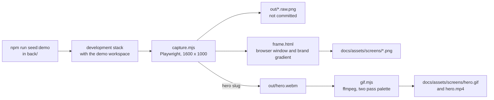

# Product captures

The screenshots and the animation in the repository README are produced by a script, not by hand. `capture.mjs` drives the running stack with a real browser, signs in as the demo account and takes each shot, so the pictures always show the product as it is, with the same data, the same window size and the same frame. `gif.mjs` turns a recorded flow into the GIF and the MP4.



## Requirements

- The development stack running (`docker compose up -d`), and the reference data seeded (`docker compose exec back npm run seed:templates`).
- The demo workspace, seeded with a password of your choice: `docker compose exec -e DEMO_PASSWORD=<password> back npm run seed:demo`. The seed replaces the demo account's data with the same content every time.
- Playwright and its Chromium, from `e2e/`: `npm ci` and `npm run install:browsers`.
- ffmpeg on the PATH for the GIF and the MP4. Set `FFMPEG` to the executable when it is installed but not on the PATH.
- The page being captured must be built from the code whose look is to be shown. The stack serves the working tree through bind mounts, so check out the branch first.

## Running it

From `e2e/`, with the same password the demo was seeded with:

```bash
export DEMO_PASSWORD=<password>
npm run showcase
npm run showcase:gif
```

`npm run showcase` takes every still. `npm run showcase:gif` records the hero flow and converts it. Seed the demo again before running either one if anybody has used the demo account since.

| Variable | Default | Meaning |
|---|---|---|
| `DEMO_PASSWORD` | None, required | The password of the demo account. It is never written in the repository |
| `SHOWCASE_BASE` | `http://localhost:5173` | The page to capture |
| `SHOWCASE_API` | `http://localhost:5000/api/v1` | The API, used only to put the hero card back |
| `SHOWCASE_EMAIL` | `demo@breezyboard.local` | The demo account |
| `SHOWCASE_OUT` | `docs/assets/screens` | Where the framed shots and the animation are written |
| `SHOWCASE_FRAME_SCALE` | `1.25` | The pixel density of the framed shots |
| `SLUGS` | Every still | A comma separated list of slugs to capture. A slug may also be passed as an argument |
| `FFMPEG` | `ffmpeg` | The ffmpeg executable |

The script prints `OK` or `FAIL` for each shot and exits non-zero when any failed.

## The shots

| Slug | Shows | Output |
|---|---|---|
| `boards-overview` | The home page: the greeting, the totals and the four boards | `boards-overview.png` |
| `board` | The Kite Festival board with its four columns, the last one holding the landed cards | `board.png` |
| `task-detail` | A card open for editing: priority, owner, colour, description and checklist | `task-detail.png` |
| `edit-columns` | The board dialog with the column list: rename, reorder, recolour | `edit-columns.png` |
| `login` | The sign in page and its brand panel | `login.png` |
| `hero` | A card dragged from Airborne into Landed, where it lands | `hero.gif`, `hero.mp4` |

Every still also leaves its unframed screenshot in `showcase/out/<slug>.raw.png`, which is not committed.

## How the shots stay the same

- The window is 1600 by 1000, the narrowest 16:10 window in which the sidebar and four columns fit without the last column being cut off. Stills are taken at twice the pixel density, and the page is always light.
- `new Date()` answers a fixed morning in March, so the greeting and the date on the home page do not depend on the hour. `Date.now()` is left alone, because the session schedules its expiry from it.
- The Breeze control is hidden: it is a setting, not part of the tour.
- A shot fails when a loading indicator or a notice is on screen, and it waits for every finite animation to end.
- Cards, ids and timestamps come from the seed, which is deterministic.

## Maintenance

- Rerun both commands at the close of each feature slice that changes a screen, and commit the images with the change.
- Never confirm a dialog. A shot that opens one closes it with Cancel or Escape. The only write the pipeline makes is the hero flow's drag, which moves one card, and it puts the card back through the API when the recording ends.
- A shot that needs a new screen is one more entry in `SHOTS` in `capture.mjs`: a slug, a title for the frame, and a function that brings the page to the state to photograph.
- The frame is `frame.html`: the window, the dots and the gradient are plain CSS and can be restyled without touching the script.
- The GIF has a budget of 8 MB. `gif.mjs` fails when it is over, and `WIDTH` and `FPS` at its top are the two levers.
