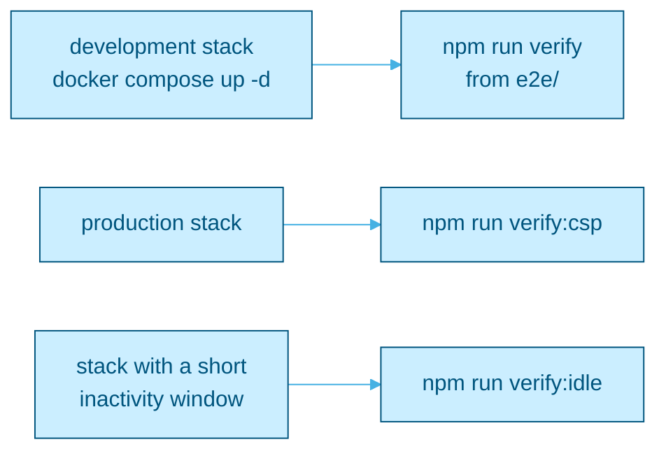

# Standing verification scripts

Scripts that drive the running stack and assert what a unit test structurally cannot see: a real browser, real time, a real database and the production CSP.

What each script asserts, how to run it, and the special setups for `idle.mjs` and `csp.mjs` are documented in [docs/TESTING.md](../../docs/TESTING.md#standing-verify-scripts).



Quick run, from `e2e/` with the development stack up and the reference data seeded:

```bash
npm run verify
```
