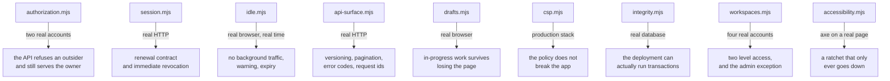

# Standing verification scripts

Scripts that drive the running stack and assert things a unit test structurally cannot. They are not part of `npm test` in either package: they need real containers, a real browser, and in two cases real elapsed time. Run them by hand after touching authorization, the session model, or the API surface, and before opening a pull request that changes any of those.

Each one exits non-zero on the first failure and prints a `PASS` or `FAIL` line per assertion, so they read as a checklist rather than a stack trace.

## Running them

The development stack must be up, and the reference data seeded:

```bash
docker compose up -d
docker compose exec back npm run seed:all
```

Then, from `e2e/`:

```bash
node verify/authorization.mjs
node verify/session.mjs
node verify/api-surface.mjs
node verify/drafts.mjs
node verify/idle.mjs expire
node verify/idle.mjs extend
node verify/integrity.mjs
```

Base URLs default to the local development stack and can be overridden with `E2E_API_URL`, `E2E_FRONT_URL` and `E2E_PROD_URL`.

One practical limit, now mostly out of the way. These scripts register real accounts: a full `npm run verify` pass plus the Playwright suite uses roughly fifteen, with `workspaces.mjs` alone accounting for five because the two level model needs that many distinct roles to be worth testing. Against the production budget of twenty an hour, a second cycle inside the same hour starts answering 429, and it used to surface as a browser test timing out rather than as anything that says "rate limit". That was diagnosed as a product defect more than once.

`docker-compose.yml` now raises `REGISTRATION_LIMIT_PER_HOUR` to 500 for development. `docker-compose.prod.yml` deliberately does not set it, so production keeps the strict default of twenty from `back/src/config/env.js`. The login limiter next to it is untouched and not configurable at all: that one bounds credential stuffing, and the difference is the point rather than an oversight.

The counter still lives in memory, so `docker compose restart back` clears it if a limit is ever hit, and each registering script now says so plainly instead of failing on an undefined token.

## What each one covers, and why it exists



**`authorization.mjs`** replays the exploit recorded in appendix A of the revival plan. It registers two accounts, has the first create a board and a task, and asserts twelve outcomes. Six are refusals for an outsider, three cover a legitimate member who is not the creator, and three confirm the owner can still do their work.

Those last three matter as much as the refusals. A middleware that denied everyone would pass every negative security assertion ever written, so a security check without positive cases proves nothing.

**`session.mjs`** checks the sliding session over real HTTP: the renewal header is present, the returned token differs from the one sent, `sessionStartedAt` survives verbatim while `exp` advances, a 404 still renews, `ping` answers 204 with `no-store`, and a token is dead on its very next use after logout.

**`idle.mjs`** is the one that could not be written any other way, and it is the most important script here. Run it with a shortened window:

```bash
JWT_INACTIVITY_TTL_MS=90000 docker compose up -d --force-recreate back front
node verify/idle.mjs expire
```

It logs in, then sits still and counts requests. The assertion is zero API calls across the idle period.

The inactivity window is not enforced by the server. The server renews the token on every request it sees, so the window only works because nothing in the client polls. A single stray interval anywhere in the frontend would turn fifteen minutes into a session that never ends, and nothing would fail loudly the day it was added. This script is the only thing that would notice.

It also confirms the warning appears sixty seconds before expiry, never dismisses itself, and that an unattended session signs out and lands on the login page. Passing `extend` instead checks that the warning's action really pings and carries the session past its original deadline.

Remember to restore the normal window afterwards with `docker compose up -d --force-recreate back front`.

**`api-surface.mjs`** checks that both mount paths return identical bodies, that a supplied `X-Request-Id` comes back verbatim and an absent one is generated, and the pagination contract from both sides: no `limit` returns everything and still reports the total, `limit` returns exactly that page with the total unchanged. It also checks that error responses carry a machine-readable `code` without having lost any pre-existing envelope field.

**`drafts.mjs`** types into the task drawer, reloads the page entirely, and asserts the text comes back, then saves the task and asserts the draft is gone. This is what makes the discreet expiry warning acceptable: being signed out mid-sentence stops costing the user their work.

**`integrity.mjs`** creates a board with three tasks, deletes the board, and asserts the board and all three tasks are gone. The interesting assertion is the first one, that the delete returns 200 at all.

The board delete cascade runs inside a transaction, and transactions exist only on a replica set. That property lives in `docker-compose.yml`, not in any source file, and the unit suite cannot observe it because its own in-memory database is configured separately. Every other request in this application works perfectly against a standalone mongod, so a deployment that quietly lost its replica set would look entirely healthy right up until somebody deleted a board. This script is what notices.

The other half of the guarantee, that a failure partway through the cascade rolls the whole thing back, is covered in `back/test/boards.test.js` by injecting a failure into the cascade. That one needs to reach inside the process, so it cannot live here.

**`workspaces.mjs`** drives four real accounts through the two level access model: workspace membership is a prerequisite for reaching a board, explicit board membership is still required on top of it, and a workspace admin is the single exception who administers every board in their workspace.

It sits next to `authorization.mjs` for the same reason that one does. Half of its assertions are refusals and half are successes, because a model that refused everybody would satisfy every negative assertion ever written. It also checks the two cases that are easy to get subtly wrong: that a board admins can administer is one they can also find in their list, and that adding somebody to a board actually admits them to the workspace, without which the invitation is inert and the person is refused on every request.

**`accessibility.mjs`** is the end to end layer of the accessibility gate, and it is the layer that matters most, because what it catches is what static analysis structurally cannot see. It drives six surfaces, including two with a dialog open, and runs axe against each.

It is a ratchet rather than a pass. Each surface carries the violation count measured when the gate went in, and the script fails on anything above it. Numbers may only go down, and a rule that reaches zero has its line deleted rather than left at zero, so the table shrinks as the debt does. A gate that failed on all the existing debt at once would be switched off within a week; one that cannot get worse is one people keep.

It earned its keep before it was even finished. The first measurement reported eleven contrast violations on the login page and four on the dashboard, and every one was an artefact of scanning during the entrance animation: framer-motion animates opacity from zero by writing inline styles, and axe computes contrast against whatever opacity it finds. The count moved between 0, 3 and 11 across consecutive runs of an identical page. The script now waits for animations to settle first, after which the count is zero, consistently. A ratchet built on a number that flaps is worse than no ratchet, because the first false red teaches everyone to ignore it.

It also confirmed the prediction in section 10.2 of the revival plan, word for word: the task drawer reports `aria-dialog-name`, an unlabelled dialog, which no lint rule and no unit test in this repository had ever noticed.

**`csp.mjs`** runs against the production stack rather than development, because the Content-Security-Policy is served by nginx and does not exist in the Vite dev server. It loads the real application and asserts zero policy violations, zero console errors and zero failed requests. Bring that stack up first:

```bash
MONGO_USER=bb MONGO_PASSWORD=devpassword JWT_SECRET=local-only \
  CORS_ORIGINS=http://localhost:8080 HTTP_PORT=8080 \
  docker compose -f docker-compose.prod.yml up -d --build
```

## rendered-layout.mjs

Controls that land where they belong, measured on a rendered page.

It exists because of finding P4-13 and the class of defect it belongs to. A control positioned with absolute inside a parent that was never made relative is correct markup, correct classes and correct behaviour, and it is in the wrong place on screen. No layer below a real browser computes layout, so the static lint, axe and the component tests all pass while two password toggles sit stacked on each other above the wrong field.

It asserts containment rather than coordinates, so a redesign does not break it.

## board-layout.mjs

The board's layout, measured at 390, 1024 and 1440 pixels.

It asserts that the document scrolls in neither direction, that the columns share one row at one fixed width inside a single horizontally scrolling container that can take focus, that a long column scrolls inside itself while its header stays put, that an empty column says so and fills its column, and that holding a dragged card at the screen edge scrolls the row and lets the drop land in another column. None of this exists below a real browser, because jsdom loads no stylesheet.

It found P4-16, absolutely positioned `sr-only` text escaping a column's scroller and growing the page.
